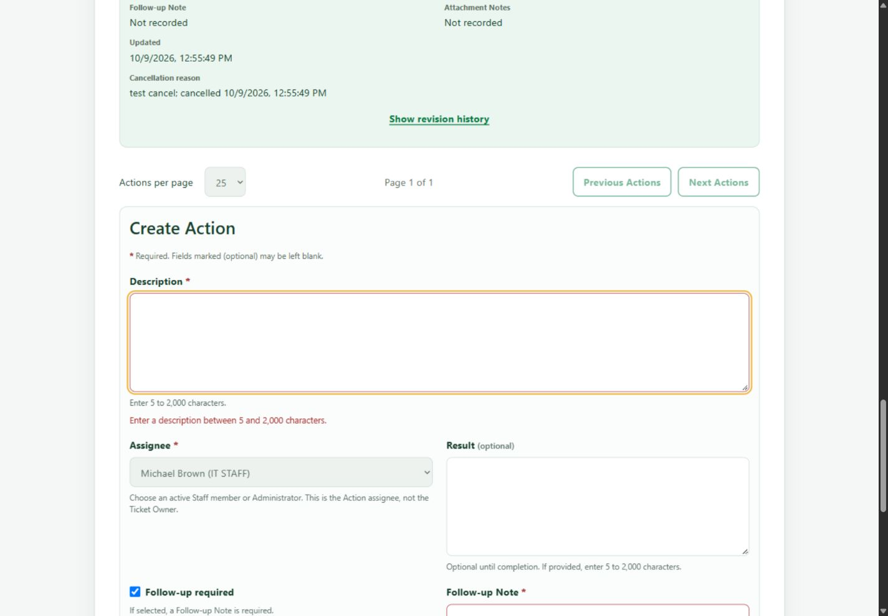
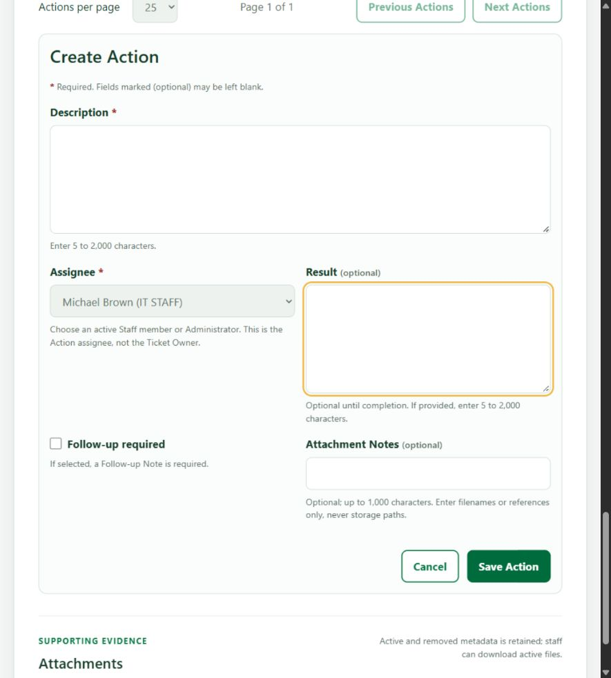
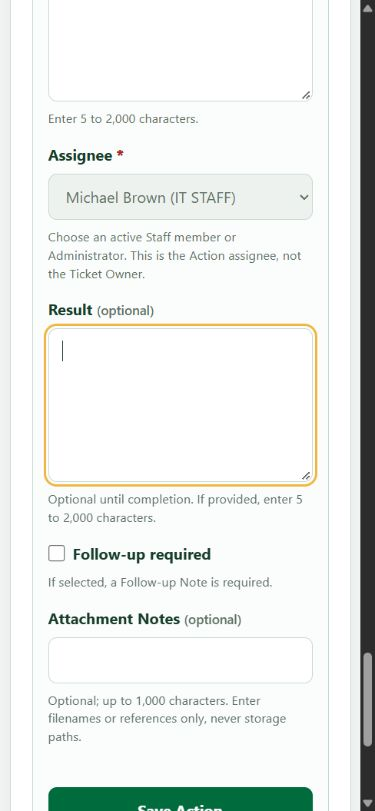

# Lab 4 Tests and Evidence

Issue #55 establishes the contract baseline. Issues #56–61 and their verified implementation evidence are recorded in Section 4; local authenticated E2E and visual evidence are now recorded for Issue #61, while review and release gates remain pending. Normative requirements: [specification.md](specification.md); [API](api-spec.md); [UI](ui-spec.md). Each ID below maps to an intended concrete test path. **Planned** means no automated test for that row has been run; **Partial** means some but not all assertions for that row have been verified; **Passed** means the row's stated assertions were observed. Issue evidence names the exact local scope and SHA status. Never check an unobserved result or claim candidate output came from final `main`.

## 1. Planned test matrix

For compactness, the exact path prefixes in this table are `S = server/tests/lab-04/`, `C = client/tests/lab-04/`, and `E = e2e/lab-04/`; concatenate prefix and filename, not a glob. The matrix includes both existing and planned files; each row's status and Issue evidence below distinguish them.

| Test ID | Type / exact planned path | Requirements and ACs | Required assertions | Status |
| --- | --- | --- | --- | --- |
| UNIT-01 | Unit; S`action-validation.unit.test.ts` | FR-02,05; BR-02,04,05,06; AC-02,03 | Trim boundaries, wrong types/unknown actor/date fields, default assignee, conditional note, Result completion and cancellation reason. | Partial: Issue #56 validation subset passed; full matrix remains open. |
| UNIT-02 | Unit; S`workflow-rules.unit.test.ts` | FR-04,07; BR-07,08,11,12,15; AC-05,07,08,10 | Every allowed/forbidden Action/Ticket transition, terminal edits, gate combinations, cancellation and legacy zero-Action rules. | Partial: all 37 unit tests passed, including exhaustive Action/Ticket status-pair checks and gate predicates; broader lifecycle/API/browser assertions remain open. |
| UNIT-03 | Unit; S`dashboard-calculations.unit.test.ts` | FR-09,10; BR-17,18; AC-11,13 | Distinct Tickets vs Actions, active states, zero counts, UTC seven-day edges/future dates, Asia/Bangkok display, deterministic ties. | Passed in Issue #59 worktree; 4 tests. |
| API-01 | API; S`actions-taken.api.test.ts` | FR-01,02,03,04,05,06; BR-01–09; AC-01–05 | Real create/list/edit/assign/complete/cancel, Owner≠actors, completed correction with inactive assignee, actor active-role recheck inside each write transaction, immutable prefix snapshots, no-op, scoped pagination, validation and rollback. | Partial: implemented lifecycle subset plus stale-actor and inactive-assignee corrections passed; remaining lifecycle assertions stay open. |
| API-02 | API; S`authorization.api.test.ts` | FR-01,10,13,14; BR-01,03,16,22; AC-01,12,18 | Missing/expired/revoked/password-gated sessions, CSRF/Origin, Requester mutation403, own read, cross-owner/resource404, Staff/Admin access and sanitized errors. | Partial: dashboard unauthenticated/wrong-role checks and existing session/role/ownership tests passed in full server run; complete authorization and browser matrix remains open. |
| API-03 | API; S`concurrency.api.test.ts` | FR-03,06,07,08; BR-09,10,12,14; AC-04,06,08 | Same-key concurrent create one row/revision; different payload409; replay after stale version; edit/edit, resolve/create, resolve/follow-up, assignment/Admin races; forced transaction failure; bounded conflict retry. | Partial: existing idempotency/stale replay/rollback/race tests and Issue #58 version/no-op/stale Ticket mutations passed; workflow race scenarios remain open. |
| API-04 | API; S`ticket-workflow.api.test.ts` | FR-07,08,12; BR-11–15; AC-07–10 | Full matrix, confirmation/reason, each gate predicate, event order, advisory indication, reopen clearing, terminal legacy behavior, atomic Ticket/Action cancellation rollback. | Partial: 4 workflow API tests passed, including gate rejection and success after a valid completed Action, cancellation effects, indication idempotency/reopen and history; exhaustive predicate/error/history isolation checks remain open. |
| API-05 | API; S`requester-dashboard.api.test.ts` | FR-10,11; BR-16,18,19; AC-12–14 | Session scope, all owned statuses, exact metrics, bounds/ties/zero, attention and recent, shared filtered totals, unsupported identity query400. | Passed in Issue #59 worktree; 4 tests. |
| API-06 | API; S`staff-dashboard.api.test.ts` | FR-09,11; BR-17–19; AC-11,13,14 | Unassigned/my-owned/urgent/distinct my-Action metrics, current-user Action rows, status/IT-priority counts, bounded lists, drill-down and Owner≠assignee. | Passed in Issue #59 worktree; 4 tests. |
| API-07 | Migration/API; S`migration-regression.api.test.ts` | FR-07,12; BR-15,21; AC-10,16,17 | Apply the real Lab 4 migration to an actual pre-Lab-4 schema, preserve Ticket/Attachment/changed-password state; seed twice and after edits; collision skip; counter monotonic; backup/restore disposable rehearsal. | Partial: real migration and preservation plus repeat-seed checks passed; collision/counter and full recovery rehearsal remain open. |
| API-08 | API; S`user-assignment-safety.api.test.ts` | FR-02,13; BR-02,05,20; AC-02,15 | Inactive/non-staff assignee, User active-Action conflict and session unchanged, self/last-Admin and owned-Ticket precedence, eligible role change and historical actors, concurrent eligibility change. | Partial: active-Action deactivation/demotion protection and assignment race passed; remaining safety cases stay open. |
| PERF-01 | Performance-smoke; S`dashboard-performance.api.test.ts` | FR-09,10; BR-16–19; AC-13 | Representative 500-Ticket/1000-Action fixture; aggregate query count stays bounded as fixture doubles (no N+1), arrays capped5, response does not contain complete collections. Record elapsed diagnostics, no invented production SLA. | Passed in Issue #59 worktree; 1 test. Query count remained 23 at both sizes; see §4. |
| UI-01 | Component; C`ActionsTaken.test.tsx` | FR-01–06; BR-01–10,22; AC-01–06,19 | Inline create/edit, required/optional markers, conditional requirements, plain-language field errors/focus, Requester and terminal-Ticket read-only views, lifecycle confirmation/reason, stale-draft retention, safe retry with stable idempotency key, active assignee and User-management safety feedback. | Partial: 24 Action component tests pass, including version refresh, linked-Action page navigation, loading/error/retry gating and revision-history pagination; Staff detail tests include terminal and loading/error guards. E2E proves create/edit/complete/cancel, persisted revisions and Requester read-only behavior; Action assignment, inactive-assignee browser rejection and browser conflict retry remain API/component-only. |
| UI-02 | Component; C`TicketWorkflow.test.tsx` | FR-07,08; BR-11–15,22; AC-06–10,19 | Legal target controls, gate explanation, confirmation/cancel reason, protected direct calls, reload on stale version, indication vs status, ordered history. | Partial: 5 workflow UI tests passed, including history pagination reset when switching Tickets and Asia/Bangkok timestamp formatting; full visual/accessibility/E2E assertions remain open. |
| UI-03 | Component; C`RequesterDashboard.test.tsx` | FR-10,11,14; BR-16,18,19,22; AC-12–14,19 | Loading/zero/error/Retry/session expiry, correct owned cards/lists/links, time display, navigation/deep link and account-cache reset. | Partial: 3 dashboard component tests passed; Requester session-expiry/default-route behavior is covered by the App regression file. Authenticated E2E now compares live metrics, retries a safe failure, verifies an empty account and drills into owned Tickets; broader manual account-cache review remains open. |
| UI-04 | Component; C`StaffDashboard.test.tsx` and C`ActionsTaken.test.tsx` | FR-09,11,14; BR-17–19,22; AC-11,14,19 | Current-user assigned Actions and real metric links, capped summaries, all states/refresh, role navigation, keyboard semantics, and focus of a linked Action after its list loads. | Partial: dashboard component/App tests and linked Action-focus regression passed; authenticated E2E now compares live role metrics and drills through a real Action link. Manual keyboard/screen-reader review remains open. |
| STYLE-01 | Style/responsive; C`ZenGreen.styles.test.tsx` plus E2E browser assertions | FR-14; BR-22; AC-19 | Token and breakpoint/style contracts; real-browser responsive, visual, overflow and accessibility checks. | Partial: CSS contract tests pass. Issue #61 captured real dashboard and Action/detail screens at desktop/tablet/mobile sizes; axe and overflow assertions pass on dashboard/Action views, and 767/768/991/992 widths are checked. Manual screen-reader/touch-target review and full human visual checklist remain open. |
| E2E-01 | Browser; E`actions-taken-flow.spec.ts` | FR-01–06,13,14; BR-01–10,20,22; AC-01–06,15,18 | Authenticate real roles; create multiple Actions on one Ticket, assign/edit/complete/cancel, inactive rejection, read-only Requester, conflict/retry and attachment continuity; assert actual persisted records. | Partial, locally exercised in all three projects: real create/edit/revision/start/complete/cancel and Requester read-only/ownership, persisted rows, attachment continuity, axe and overflow pass. Action assignment, inactive-assignee rejection and browser conflict retry are covered by lower-level tests, not this E2E. |
| E2E-02 | Browser; E`ticket-resolution.spec.ts` | FR-07,08,14; BR-11–15,22; AC-07–10,18 | Failed gate via direct API, complete/follow-up correction then resolve/close/reopen/cancel, confirmed transitions, retained events/revisions, advisory indication and legacy Ticket. | Partial, locally exercised in all three projects: failed gate remains unchanged; valid completed Action permits resolve; requester indication, persisted resolve/reopen events and read-only detail pass. Close/cancel and legacy zero-Action transitions remain covered by API/component regression rather than this browser flow. |
| E2E-03 | Browser; E`dashboards.spec.ts` | FR-09–11,14; BR-16–19,22; AC-11–14,18,19 | Requester/Staff/Admin dashboard roles, metrics-to-list totals, real Action links, zero/failure, 3 sizes/boundaries, keyboard/axe and no page overflow. | Passed locally in all three projects: live Requester and Staff metrics match API responses, Admin role navigation, real drill-down/focus, genuine empty-account state, safe failure/retry, axe, no overflow, and 767/768/991/992 width checks. |
| REG-01 | Full prior/new suites; manifest and Lab 2 flow mapping below; `e2e/lab-04/requester-regression.spec.ts` | FR-07,12–14; BR-13,21,22; AC-09,16,18,20 | Full inherited server/client suites and authenticated equivalents of every retained Lab 2 browser flow, plus Lab 3/4 E2E; verify mapped scenarios actually pass, builds, migrations/repeat seed; no hidden skips. | Partial: full server/client regressions, builds, migrations/repeated seed and all 60 Lab 3/Lab 4 Playwright tests pass locally with no skips. R02-01–16 browser continuity is mapped below; R02-06 filter-value semantics also rely on existing API/component tests, and MAN-01/release checks remain open. |
| DOC-01 | Manual/inline contract check; six files in docs/lab-04 | FR-14; BR-22; AC-20 | Presence, exact eleven specification headings, all IDs/paths mapped, exact APIs/decisions, labsheet rubric and peer approval order. Approval is separate from local structural success. | Committed-source green at `b9ebdc2`, exit0; PR #63 merged after student-accepted comment sign-off; no formal GitHub Approve claimed. |
| MAN-01 | Real captures/manual review; artifacts/lab-04/screenshots directories in ui-spec | FR-12,14; BR-21,22; AC-17,19,20 | Disposable recovery observation, role/metric API evidence, real readable responsive screenshots, focus/console/links, Project/history/review audit and nine-part submission. | Partial: 15 genuine Playwright screenshots across three viewport projects plus automated axe/overflow/focus checks are recorded in Issue #61. Manual screen-reader/human visual review, Project/history/review audit, recovery observation and submission audit remain open. |

The eleven required files in labsheet §12 are API-01,04,05,06; UI-01,02,03,04; E2E-01,02,03. Additional focused tests cover explicit validation, authorization, concurrency, migration and performance requirements; they do not expand product scope.

## 2. FR/BR and AC traceability

The AC table in specification is authoritative; every AC-01–20 appears above with a path or genuine manual-evidence location. This direct index prevents a requirement disappearing between tables:

| AC | Test IDs (paths in §1) | Implementation acceptance status |
| --- | --- | --- |
| AC-01 | API-01,02; UI-01; E2E-01 | Partial: browser-persisted Action lifecycle and role-scoped read-only behavior passed; remaining API/auth edge cases remain open. |
| AC-02 | UNIT-01; API-01,08; E2E-01 | Partial: browser create/edit and persisted Action records passed; inactive-assignee and assignment-safety cases are not all browser-tested. |
| AC-03 | UNIT-01; API-01; UI-01; E2E-01 | Partial: valid browser create/edit passed; the broader invalid-input/conditional-validation matrix remains in unit/API/UI tests. |
| AC-04 | API-01,03; UI-01; E2E-01 | Partial: multiple Actions and persisted revisions passed in browser; full concurrency/idempotency cases remain API-level. |
| AC-05 | UNIT-02; API-01; UI-01; E2E-01 | Partial: browser start/complete/cancel and read-only behavior passed; exhaustive Action transition cases remain unit/API-level. |
| AC-06 | API-03; UI-01,02; E2E-01 | Partial: stale/no-op versioned Ticket writes, workflow UI and synchronized Action version passed; full race/conflict E2E remains open. |
| AC-07 | UNIT-02; API-04; UI-02; E2E-02 | Partial: complete unit transition matrix plus resolve/reopen browser flow passed; other terminal transitions remain API/component-tested. |
| AC-08 | UNIT-02; API-03,04; UI-02; E2E-02 | Partial: gate predicates, failed and successful browser gate, valid completion-to-resolution and cancellation effects passed; exhaustive concurrency/rollback remains open. |
| AC-09 | API-04; REG-01; E2E-02 | Partial: versioned ordered status events and browser resolve/reopen history passed; remaining role-isolation/history cases stay open. |
| AC-10 | API-04,07; E2E-02 | Partial: legacy zero-Action reopen path and immutable workflow history passed; full event API/browser history coverage remains open. |
| AC-11 | UNIT-03; API-06; UI-04; E2E-03 | Partial: live Staff metrics/status/priority API comparison, role landing and Action drill-down pass in browser; additional API cases remain open. |
| AC-12 | API-02,05; UI-03; E2E-03 | Partial: Requester-scoped API, empty/failure states, role landing, drill-down and authenticated list flows pass; account/session edge matrix remains open. |
| AC-13 | UNIT-03; API-05,06; PERF-01; E2E-03 | Partial: calculation/API, UI links, bounded-query smoke and live metric comparison pass; remaining filter/tie scenarios stay lower-level. |
| AC-14 | API-05,06; UI-03,04; E2E-03 | Partial: dashboards, role navigation, responsive projects, axe/overflow, drill-down and width boundaries pass; human visual review remains open. |
| AC-15 | API-08; REG-01; E2E-01 | Partial: browser ownership/read-only and cross-requester isolation passed; complete User/assignment safety cases remain API-level. |
| AC-16 | API-07; REG-01 | Partial: real pre-Lab-4 migration and repeated-seed preservation tests passed in the server regression; counter, broader fixture-collision and full integration gates remain open. |
| AC-17 | API-07; MAN-01 | Planned |
| AC-18 | API-02; REG-01; E2E-01,02,03 | Partial: server authorization, inherited E2E and Lab 4 role/ownership browser denials passed; remaining auth and release audit gates stay open. |
| AC-19 | UI-01,02,03,04; STYLE-01; MAN-01 | Partial: CSS/component checks plus real responsive screenshots, axe, keyboard, overflow and boundary assertions passed; manual screen-reader/touch-target review remains open. |
| AC-20 | DOC-01; REG-01; MAN-01 | Contract checks underway; approval/release pending |

| FR | Test IDs | BR | Test IDs |
| --- | --- | --- | --- |
| FR-01 | API-01,02; UI-01; E2E-01 | BR-01 | API-01,02; UI-01 |
| FR-02 | UNIT-01; API-01,08; E2E-01 | BR-02 | UNIT-01; API-01,08 |
| FR-03 | API-01,03; UI-01; E2E-01 | BR-03 | API-01,02; UI-01 |
| FR-04 | UNIT-02; API-01; UI-01 | BR-04 | UNIT-01; API-01 |
| FR-05 | UNIT-01; API-01; UI-01 | BR-05 | UNIT-01; API-01,08 |
| FR-06 | API-01,03; UI-01; E2E-01 | BR-06 | UNIT-01; API-01; UI-01 |
| FR-07 | UNIT-02; API-03,04; UI-02; REG-01; E2E-02 | BR-07 | UNIT-02; API-01 |
| FR-08 | API-03,04; UI-02; E2E-02 | BR-08 | UNIT-02; API-01 |
| FR-09 | UNIT-03; API-06; PERF-01; UI-04; E2E-03 | BR-09 | API-01,03; UI-01 |
| FR-10 | UNIT-03; API-02,05; PERF-01; UI-03; E2E-03 | BR-10 | API-03; UI-01; E2E-01 |
| FR-11 | API-05,06; UI-03,04; E2E-03 | BR-11 | UNIT-02; API-04; UI-02 |
| FR-12 | API-04,07; REG-01; MAN-01 | BR-12 | UNIT-02; API-03,04; UI-02 |
| FR-13 | API-02,08; REG-01; E2E-01 | BR-13 | API-04; REG-01; E2E-02 |
| FR-14 | API-02; UI-01–04; STYLE-01; REG-01; DOC-01; MAN-01; E2E-01–03 | BR-14 | API-03,04; UI-02 |
| — | — | BR-15 | UNIT-02; API-04,07; E2E-02 |
| — | — | BR-16 | API-02,05; PERF-01; UI-03 |
| — | — | BR-17 | UNIT-03; API-06; UI-04 |
| — | — | BR-18 | UNIT-03; API-05,06; PERF-01 |
| — | — | BR-19 | API-05,06; UI-03,04; E2E-03 |
| — | — | BR-20 | API-08; REG-01; E2E-01 |
| — | — | BR-21 | API-07; REG-01; MAN-01 |
| — | — | BR-22 | API-02; UI-01–04; STYLE-01; REG-01; DOC-01; MAN-01 |

### Existing regression manifest (real files)

REG-01 runs all Vitest-discovered tests, not only a selected green subset. These paths existed at the inspected baseline; helper files are not counted as suites:

```text
server/tests/lab-01/categories.test.ts
server/tests/lab-01/health.test.ts
server/tests/lab-02/attachment-validation.unit.test.ts
server/tests/lab-02/attachment-rollback.api.test.ts
server/tests/lab-02/attachments.api.test.ts
server/tests/lab-02/create-ticket-rollback.api.test.ts
server/tests/lab-02/create-ticket.api.test.ts
server/tests/lab-02/e2e-environment.unit.test.ts
server/tests/lab-02/my-tickets.api.test.ts
server/tests/lab-02/reference-data.test.ts
server/tests/lab-02/ticket-detail.api.test.ts
server/tests/lab-02/ticket-validation.unit.test.ts
server/tests/lab-03/auth-rate-limit.api.test.ts
server/tests/lab-03/auth-session.api.test.ts
server/tests/lab-03/auth-validation.unit.test.ts
server/tests/lab-03/auth.api.test.ts
server/tests/lab-03/authorization.api.test.ts
server/tests/lab-03/comments-notes.api.test.ts
server/tests/lab-03/migration-seed.api.test.ts
server/tests/lab-03/requester-regression.api.test.ts
server/tests/lab-03/resolution-indication.unit.test.ts
server/tests/lab-03/session-security.unit.test.ts
server/tests/lab-03/staff-queue.api.test.ts
server/tests/lab-03/staff-ticket-detail.api.test.ts
server/tests/lab-03/status-transition.unit.test.ts
server/tests/lab-03/users-admin.api.test.ts
client/tests/lab-01/App.test.tsx
client/tests/lab-02/AttachmentSection.test.tsx
client/tests/lab-02/CreateTicket.test.tsx
client/tests/lab-02/MyTickets.test.tsx
client/tests/lab-02/RequesterSelection.test.tsx
client/tests/lab-02/RequesterTicketDetail.test.tsx
client/tests/lab-02/ZenGreen.styles.test.tsx
client/tests/lab-03/ChangePassword.test.tsx
client/tests/lab-03/Login.test.tsx
client/tests/lab-03/RequesterRegression.test.tsx
client/tests/lab-03/StaffTicketDetail.test.tsx
client/tests/lab-03/StaffTicketQueue.test.tsx
client/tests/lab-03/UserManagement.test.tsx
e2e/lab-03/authentication.spec.ts
e2e/lab-03/requester-regression.spec.ts
e2e/lab-03/staff-ticket-flow.spec.ts
e2e/lab-03/user-administration.spec.ts
e2e/lab-03/release-evidence-states.spec.ts
```

### Lab 2 browser-flow continuity (REG-01)

The files `e2e/lab-02/requester-ticket-flow.spec.ts` and `e2e/lab-02/release-evidence-states.spec.ts` use the removed development selector and spoofable header. Do not run them unchanged or count them as current authenticated passing tests. Retire only selector-specific behavior; preserve all still-relevant product assertions through the mapping below. At planning time, “Existing” meant inspected assertions existed and “Extend” identified a browser gap; the final column below records the Issue #61 execution outcome and any remaining limitation.

Exact inherited destinations: `e2e/lab-03/requester-regression.spec.ts` (owned lifecycle and removed selector), `e2e/lab-03/authentication.spec.ts` (login/password gate/logout/role routing), and `e2e/lab-03/release-evidence-states.spec.ts` (authenticated workspace responsiveness). The authenticated extension is implemented in **`e2e/lab-04/requester-regression.spec.ts`**, in addition to the required Lab 4 browser files. Existing component/API assertions supplement the browser checks and are identified separately below.

| Flow ID | Original Lab 2 assertions | Authenticated equivalent / inspected coverage | Executed evidence / remaining limitation |
| --- | --- | --- | --- |
| R02-01 | Selector route, active selection/Continue, selector loading/empty/failure and selector accessibility | Selector UI retired deliberately. Lab 3 requester-regression checks the old route has no selector/sessionStorage flow; authentication.spec tests real login, password gate, logout and role landing. | Passed in the full inherited E2E run; selector-only states remain excluded by the authenticated Lab 3 contract. |
| R02-02 | Selected Requester identity, Change Requester, other Requester's Ticket disappearing from list | `e2e/lab-04/requester-regression.spec.ts` creates Tickets as A, logs out, signs in as B, and verifies A's Ticket is absent and cross-owner detail is 404. | Passed in all three viewport projects; authenticated account replacement and server ownership isolation are asserted. |
| R02-03 | Create form Category/System/Requested Priority, summary/description, initial attachment selection | Inherited Lab 3 and Issue #61 browser flows create Tickets through the UI with these fields and an initial PDF. | Passed in inherited and new E2E; created Ticket fields and identity are checked on detail. |
| R02-04 | Creation success and backend Ticket Number format | Inherited Lab 3 lifecycle plus the Issue #61 creation helper assert success and `TKT-YYYY-######`; authenticated requester session owns the Ticket. | Passed in inherited and new E2E; no spoofable Requester header is used. |
| R02-05 | My Tickets shows actual created Ticket, desktop table/mobile cards | Issue #61 asserts the created Ticket link is visible in the populated list in desktop/tablet/mobile projects; component tests cover responsive table/card presentation. | Passed for actual listing visibility across configured projects. |
| R02-06 | Search submitted through Apply Filters, URL query value and matching Ticket link/open detail | Issue #61 searches real Tickets, checks URL updates for search/category/system/priority/status/sort/order/page size, opens a matching row by keyboard, and checks no-results; API/component suites cover filter semantics. | Passed for browser control/URL/search/detail behavior and lower-level filter semantics. E2E does not create a unique result fixture for every filter value. |
| R02-07 | Initial attachment visible and browser download filename | Inherited Lab 3 and Issue #61 Requester flows attach a real PDF and assert its browser download filename. | Passed in the complete E2E run. |
| R02-08 | Add PNG after creation, ready state, upload success and new metadata | Issue #61 uploads a PNG after creation, then verifies persisted metadata and download in an authenticated flow. | Passed; lower-layer attachment API and validation regressions also ran in the full suite. |
| R02-09 | Removal dialog/reason, retained removed metadata and removed Download control | Inherited Lab 3 and Issue #61 flows verify removal reason/retained metadata and blocked removed-file access. | Passed in authenticated E2E; repeat-removal conflict remains covered by the API regression. |
| R02-10 | Cross-owner detail/list-metadata/download/upload/remove API404 | Issue #61 uses a second authenticated Requester and valid browser session/CSRF context for denied attachment operations; responses are sanitized and A's rows remain unchanged. | Passed for cross-owner detail/list/download/upload/remove isolation; no `X-Requester-Id` trust. |
| R02-11 | Other Requester's filtered no-results and inaccessible detail/attachment errors | Issue #61 verifies B's filtered no-results and safe inaccessible detail; a separate empty-account test opens `/tickets` and checks genuine empty-list state versus filtered no-results. | Passed in the three-project Playwright run, including the added real empty-list assertion. |
| R02-12 | Axe and no horizontal scroll on selector/create/list/detail/after removal/account switch | Selector UI is retired. Inherited requester E2E checks axe/overflow; Issue #61 adds keyboard list navigation, dashboard/Action axe and overflow, and 767/768/991/992 width boundaries. | Automated checks passed across desktop/tablet/mobile. Manual screen-reader, touch-target and full visual review remain open. |
| R02-13 | Initial Create state and strict invalid-summary field error | Issue #61 submits an invalid summary, checks the field error/focus, and verifies that no Ticket POST was sent. | Passed in all three browser projects. |
| R02-14 | Invalid PDF signature, removal from pending selection | Issue #61 submits a fake PDF signature, checks rejection/no Ticket POST, removes the invalid selected file, and continues with a valid draft. | Passed in all three browser projects. |
| R02-15 | Creation API failure and preserved Summary/draft | Issue #61 injects a one-time safe 500 for Ticket creation and verifies Summary and Description remain. | Passed. This is a controlled Playwright response, not a real outage. |
| R02-16 | Delayed creation, busy submitting state and successful completion | Issue #61 delays the POST, checks the submit button is disabled, exactly one POST occurs, and creation succeeds. | Passed. The delay is controlled by Playwright, not a production-network claim. |

REG-01 now has named authenticated browser assertions for retained R02-01–16 flows; selector-only states are explicitly retired, while API/component tests supplement filter semantics. The complete inherited Lab 3 plus Lab 4 Playwright suite, server/client regressions, builds, migration and repeated seed were run locally for Issue #61. See the Issue #61 evidence below. This is uncommitted worktree verification, not commit-bound or final-main evidence.

## 3. Safe test environment and commands

All commands below belong in **VS Code PowerShell**, starting at repository root. They are prescribed commands; observed Issue #61 output is recorded in Section 4 and must not be confused with a commit or final-main result. Each command must finish successfully before continuing. Never paste terminal commands into DevTools Console.

Use required local `server/.env.test`, disposable PostgreSQL database ending `_test`, approved E2E schemas only (`toktickit_e2e`, `toktickit_release_e2e`, `toktickit_release_final`), and guarded temporary storage under `server/.test-attachments`. No fallback to `.env`, no random schema deletion, no unattended real database reset. Local passwords follow policy; keep them and real `.env.test` uncommitted. Existing seed uses three `LAB3_*_INITIAL_PASSWORD` variables. Record sanitized DB name/target, not connection string/password.

```powershell
git rev-parse HEAD
Set-Location server
npm.cmd run prisma:test:migrate
npm.cmd run prisma:test:seed
npm.cmd run prisma:test:seed
npm.cmd test -- --run tests/lab-04/actions-taken.api.test.ts
npm.cmd test -- --run
npm.cmd run build
Set-Location ../client
npm.cmd test -- --run tests/lab-04/ActionsTaken.test.tsx
npm.cmd test -- --run
npm.cmd run build
npx.cmd playwright test
Set-Location ..
```

Replace the two focused paths with the relevant matrix paths per Issue. Playwright is already a client development dependency; config stays under client, testDir `../e2e`. Portable prescribed form is `cd client` then `npx playwright test`. Stop manually started server/client instances before Playwright if they occupy its ports; do not enable reuse against the development database. Do not run guarded destructive fixture cleanup without identifying its disposable target. Migration/recovery tests require their own isolated fixture/restore target, not the live development database.

Preserve complete terminal output with command, tested SHA, all test files/counts, skips/failures and final build status. During TDD distinguish expected red from final green. Browser proof of permission needs real DevTools Network/Console fetch responses; database metric comparisons use the documented guarded client/script. A health200 proves availability only, not database/user/login correctness.

## 4. Issue evidence and execution order

All Issues are sequential. Issue #55 approved merge precedes #56; each later approved merge precedes the next. No branch/commit/push/Project/PR mutation without exact student authorization. Actual GitHub Approve before authorized merge; no automatic-closing PR text.

| Issue | Approved branch name / planned failing tests | Focused verification and evidence |
| --- | --- | --- |
| #55 Engineering contract | feature/21-Lab4Contract; DOC-01 missing/inconsistent contracts | Six contract documents merged to `lab4-staging` via PR #63 at `5cb5b31`; student accepted comment-based sign-off. No formal GitHub Approve is claimed. |
| #56 Actions foundation/APIs | feature/22-Lab4ActionsFoundation; UNIT-01/02, API-01/02/03/07/08 | Observed implementation evidence is recorded below; UI/dashboard/E2E remain for later Issues. |
| #57 Actions UI | feature/23-Lab4ActionsUI; UI-01 | Component tests, inherited client regression/build; real selected-record/read-only/validation captures. |
| #58 Ticket workflow | feature/24-Lab4TicketWorkflow; UNIT-02, API-03/04, UI-02 | Commit-bound evidence below: full server/client regressions and builds passed. E2E/manual screenshots and wider matrix completion remain pending. |
| #59 Dashboard APIs | feature/25-Lab4DashboardAPIs; UNIT-03, API-02/05/06/07, PERF-01 | [PR #68](https://github.com/osizk/TokTickIT/pull/68) merged into `lab4-staging` at `19117b1bed09407601e6e1064469dccff6b9a024`; TDD red then green; 13 focused dashboard API tests, full server regression (38 files/160 tests, including migration/seed), server build and bounded-query smoke. No formal GitHub **Approve** review submission was recorded. Detailed candidate-commit evidence below. |
| #60 Dashboards UI | feature/26-Lab4DashboardsUI, based on merged staging commit `19117b1bed09407601e6e1064469dccff6b9a024`; UI-03/04, STYLE-01 | Dashboard UI, Requester/Staff list-filter forwarding, role-default routing and inherited regressions; see PR #70 SHA-bound and local follow-up results in §4. Browser/screenshots were unavailable during Issue #60 and were subsequently exercised locally in Issue #61 below. |
| #61 Final regression | feature/27-Lab4FinalRegression; E2E-01/02/03 and regressions | On the uncommitted worktree based on staging SHA `8eec9ae4622dff57adba01f60022bfacf494ea0f`, server/client regressions and builds, guarded migration/repeated seed, and all 60 inherited Lab 3 + Lab 4 Playwright tests passed; detailed outputs and remaining review/release gates follow below. |
| #62 Release evidence | feature/28-Lab4ReleaseEvidence; DOC-01/evidence gap audit | Final traceability/README/reviewer/real AI selection/authorized reflection; actual Project/history/reviews; release-candidate then required final-main verification. |

For each card: Backlog → Specified (scope/maps) → Started (approved branch/failing tests) → PR Review (authorized PR) → Fixing if requested → PR Review again → Done only after actual approval and authorized merge. The table is a plan, not an assertion cards were moved.

### Issue #55 — observed red phase

On baseline `a6cd507efcf4c666491cd79ef81ec0fbfba0f18c`, checked required file existence before drafting; exit code1 as expected. This was an inline documentation check, not an implemented product test suite.

```powershell
$contractPaths = @('specification.md','tests.md','ui-spec.md','api-spec.md','ai-use.md','reviewer.md')
$missingContractFiles = @($contractPaths | Where-Object { -not (Test-Path -LiteralPath (Join-Path 'docs/lab-04' $_)) })
Write-Output "DOC-01 red check at $(git rev-parse HEAD):"
$missingContractFiles | ForEach-Object { Write-Output "MISSING docs/lab-04/$_" }
if ($missingContractFiles.Count -gt 0) {
  Write-Output "FAIL: $($missingContractFiles.Count) required contract files are missing."
  exit 1
}
```

```text
DOC-01 red check at a6cd507efcf4c666491cd79ef81ec0fbfba0f18c:
MISSING docs/lab-04/specification.md
MISSING docs/lab-04/tests.md
MISSING docs/lab-04/ui-spec.md
MISSING docs/lab-04/api-spec.md
MISSING docs/lab-04/ai-use.md
MISSING docs/lab-04/reviewer.md
FAIL: 6 required contract files are missing.
```

### Issue #55 — green/review phase

Historical check: on 4 October 2026, the original filesystem-only check passed against uncommitted drafts above baseline `a6cd507efcf4c666491cd79ef81ec0fbfba0f18c`. That SHA did not contain the documents; it was not a committed-content green result. It also incorrectly allowed a local uncommitted PDF to satisfy a link. This historical result is superseded for PR-readiness by the committed-source check below.

Review reproduction: read all six documents using `git show HEAD:docs/lab-04/<file>` and check local link targets with `git cat-file -e HEAD:<target>`, not filesystem existence. On the actual reviewed PR SHA, this produced exit1:

```text
Committed source SHA: 74abfb06b1eee3004de32e72b52d410d506c240c
MISSING committed link target: docs/lab-04/Lab4_labsheet.pdf
FAIL: committed-source link check.
```

Correction: name the instructor labsheet in plain text instead of linking a deliberately uncommitted course resource. The following strengthened check defaults to **committed source**, prints the exact SHA and mode, verifies link/regression targets exist in that Git tree, and checks explicit R02-01–16 continuity mappings. Run from repository root with client dependencies installed. `node - worktree` is an explicitly labeled pre-commit preview only; it must not be represented as verification of the committed SHA. No file is emitted or database touched.

```powershell
$docCheck = @'
const fs = require('fs');
const path = require('path');
const ts = require('./client/node_modules/typescript');
const {execFileSync} = require('child_process');
const sourceSha = execFileSync('git',['rev-parse','HEAD'],{encoding:'utf8'}).trim();
const sourceMode = process.argv[2] ?? 'committed';
if (!['committed','worktree'].includes(sourceMode)) throw new Error('Unknown source mode');
console.log('Source SHA: '+sourceSha+'; mode: '+sourceMode);
function trackedFile(file) {
 try { execFileSync('git',['cat-file','-e',sourceSha+':'+file],{stdio:'pipe'}); return true; }
 catch { return false; }
}
const root = 'docs/lab-04';
const names = ['specification.md','tests.md','ui-spec.md','api-spec.md','ai-use.md','reviewer.md'];
function check(ok, label) { if (!ok) throw new Error(label); console.log('PASS: ' + label); }
const docs = Object.fromEntries(names.map(n => [n,sourceMode === 'committed'
 ? execFileSync('git',['show',sourceSha+':'+root+'/'+n],{encoding:'utf8'})
 : fs.readFileSync(path.join(root,n),'utf8')]));
check(names.every(n => docs[n].length > 500), 'six required nonempty contract/evidence files');
const sections = ['Sprint Goal','Stakeholder Request','Scope','Functional Requirements','Business Rules','UI Specification Summary','Data Changes','API Contract','Acceptance Criteria','Definition of Done','Assumptions and Decisions'];
const headings = [...docs['specification.md'].matchAll(/^## (\d+)\. (.+)$/gm)].map(m => m[1]+'. '+m[2]);
check(JSON.stringify(headings) === JSON.stringify(sections.map((s,i) => (i+1)+'. '+s)), 'exact numbered specification section order (11)');
for (const [prefix,count] of [['FR',14],['BR',22],['AC',20]]) {
 const ids = Array.from({length:count},(_,i) => prefix+'-'+String(i+1).padStart(2,'0'));
 check(ids.every(id => docs['specification.md'].includes('| '+id+' |') && docs['tests.md'].includes(id)), prefix+' declarations and explicit traceability ('+count+')');
}
const testIds = ['UNIT-01','UNIT-02','UNIT-03','API-01','API-02','API-03','API-04','API-05','API-06','API-07','API-08','PERF-01','UI-01','UI-02','UI-03','UI-04','STYLE-01','E2E-01','E2E-02','E2E-03','REG-01','DOC-01','MAN-01'];
check(testIds.every(id => docs['tests.md'].includes('| '+id+' |')), '23 planned Test IDs with individual matrix rows');
const required = ['actions-taken.api.test.ts','ticket-workflow.api.test.ts','requester-dashboard.api.test.ts','staff-dashboard.api.test.ts','StaffDashboard.test.tsx','RequesterDashboard.test.tsx','ActionsTaken.test.tsx','TicketWorkflow.test.tsx','actions-taken-flow.spec.ts','ticket-resolution.spec.ts','dashboards.spec.ts'];
check(required.every(n => docs['tests.md'].includes('`'+n+'`')), 'all 11 labsheet-required automated filenames mapped');
const oldPaths = [...docs['tests.md'].matchAll(/^(?:server\/tests|client\/tests|e2e\/lab-03)\/.+\.(?:ts|tsx)$/gm)].map(m => m[0]);
check(oldPaths.length === 44 && oldPaths.every(trackedFile), '44 inherited regression paths exist in the source commit');
const flowIds = Array.from({length:16},(_,i) => 'R02-'+String(i+1).padStart(2,'0'));
check(flowIds.every(id => docs['tests.md'].includes('| '+id+' |')), '16 explicit Lab 2 authenticated continuity mappings (execution remains planned)');
const links = Object.values(docs).flatMap(d => [...d.matchAll(/\]\(([^)]+)\)/g)].map(m => m[1])).filter(p => !p.startsWith('http'));
check(links.every(p => trackedFile(path.posix.normalize(root+'/'+p))), 'local Markdown links resolve to committed files, not untracked local resources');
check(!/<detail>|<staff-ticket>/.test(docs['api-spec.md']) && !Object.values(docs).some(d => /^- \[x\]/im.test(d)), 'no unresolved response placeholders or unperformed checked boxes');
check(docs['api-spec.md'].includes('removedByRequesterId: number|null') && docs['api-spec.md'].includes('sort value is `requestedPriority`'), 'inherited attachment DTO and Requester sort/filter distinction');
const apiTypes = [...docs['api-spec.md'].matchAll(/```ts\r?\n([\s\S]*?)```/g)].map(m => m[1]).join('\n')+'\nexport {};\n';
const virtualPath = path.resolve('client/lab4-contract-check.ts');
const options = {noEmit:true,strict:true,skipLibCheck:true,target:ts.ScriptTarget.ES2022,types:[]};
const host = ts.createCompilerHost(options);
const original = host.getSourceFile.bind(host);
host.getSourceFile = (name, language, onError, shouldCreateNew) => path.resolve(name) === virtualPath ? ts.createSourceFile(name,apiTypes,language,true) : original(name,language,onError,shouldCreateNew);
const program = ts.createProgram([virtualPath],options,host);
const diagnostics = ts.getPreEmitDiagnostics(program);
if (diagnostics.length) console.log(ts.formatDiagnosticsWithColorAndContext(diagnostics, {getCanonicalFileName:n=>n,getCurrentDirectory:()=>process.cwd(),getNewLine:()=> '\n'}));
check(diagnostics.length === 0,'all API TypeScript response/request declarations type-check without emitting files');
console.log('DOC-01 structural green: PASS ('+sourceMode+'); peer approval and product checks remain pending.');
'@
$docCheck | node - committed
exit $LASTEXITCODE
```

Historical corrected worktree preview command: run the same here-string with `$docCheck | node - worktree`. Its output below is not represented as a committed-content result. The student subsequently authorized commit/push; the actual committed-source passing result is recorded afterward. An evidence-only follow-up cites that tested commit rather than pretending to reference its own future SHA.

```text
Source SHA: 74abfb06b1eee3004de32e72b52d410d506c240c; mode: worktree
PASS: six required nonempty contract/evidence files
PASS: exact numbered specification section order (11)
PASS: FR declarations and explicit traceability (14)
PASS: BR declarations and explicit traceability (22)
PASS: AC declarations and explicit traceability (20)
PASS: 23 planned Test IDs with individual matrix rows
PASS: all 11 labsheet-required automated filenames mapped
PASS: 44 inherited regression paths exist in the source commit
PASS: 16 explicit Lab 2 authenticated continuity mappings (execution remains planned)
PASS: local Markdown links resolve to committed files, not untracked local resources
PASS: no unresolved response placeholders or unperformed checked boxes
PASS: inherited attachment DTO and Requester sort/filter distinction
PASS: all API TypeScript response/request declarations type-check without emitting files
DOC-01 structural green: PASS (worktree); peer approval and product checks remain pending.
```

### Review-fix committed-source green — observed 4 October 2026

Committed the four correction documents as `b9ebdc224e6ab823c56f6ef944d25eecfd9ced54`, then ran the exact PowerShell here-string above with `$docCheck | node - committed`. Exit code **0**. Documents and local-link/regression targets were read from that Git tree; the local uncommitted PDF cannot satisfy this check. This evidence-only update does not change the product contract/API implementation. Complete output:

```text
Source SHA: b9ebdc224e6ab823c56f6ef944d25eecfd9ced54; mode: committed
PASS: six required nonempty contract/evidence files
PASS: exact numbered specification section order (11)
PASS: FR declarations and explicit traceability (14)
PASS: BR declarations and explicit traceability (22)
PASS: AC declarations and explicit traceability (20)
PASS: 23 planned Test IDs with individual matrix rows
PASS: all 11 labsheet-required automated filenames mapped
PASS: 44 inherited regression paths exist in the source commit
PASS: 16 explicit Lab 2 authenticated continuity mappings (execution remains planned)
PASS: local Markdown links resolve to committed files, not untracked local resources
PASS: no unresolved response placeholders or unperformed checked boxes
PASS: inherited attachment DTO and Requester sort/filter distinction
PASS: all API TypeScript response/request declarations type-check without emitting files
DOC-01 structural green: PASS (committed); peer approval and product checks remain pending.
```

Rerun committed mode after the evidence-only commit and record the final pushed head/check result in PR #63. This avoids an endless self-referencing commit cycle while retaining both a reproducible tested correction SHA and verification of the final review head. No product regression/Approve/merge is inferred from documentation success.

Substantive cross-check: reviewed full labsheet and rubric, existing schema/services/routes/auth/seed and accepted templates; corrected inherited attachment metadata (`removedByRequesterId`), Requester filter vs sort names (`priority` vs `requestedPriority`), repeat-removal409, inactive/credential errors, idempotent logout204, exact screenshot directories, and non-destructive seed requirements. The contract was subsequently merged through PR #63; downstream implementation and release checks remain separate. No Lab 4 product tests, full database regression, migration, seed, screenshot, teammate approval or merge occurred as part of Issue #55 itself. Earlier plan baseline tests remain historical, not Issue #56 results. The student accepted the partner's comment-based sign-off for PR #63; no formal GitHub Approve is claimed. All later release checks remain separate.

Scope clarification after student commit `74abfb0`: this PR now also includes small `.gitignore` housekeeping (the local Lab 3 draft, Lab 4 labsheet/private plan and transient Lab 4 Playwright report). These are deliberately retained to prevent accidental local-artifact commits; no Lab 3 product file is changed. The earlier six-document commit excluded the then-uncommitted ignore changes; the current PR description must acknowledge the later commit. The local PDF/plan themselves remain excluded.

### Issue #56 - Actions foundation and APIs (observed worktree evidence)

Submitted as [PR #64](https://github.com/osizk/TokTickIT/pull/64) from `feature/22-Lab4ActionsFoundation` into `lab4-staging`, related to [Issue #56](https://github.com/osizk/TokTickIT/issues/56). The PR does not use automatic-closing language. Review is pending; no Project status change or merge is claimed.

Implementation is on `feature/22-Lab4ActionsFoundation`, based on `lab4-staging` at `5cb5b31eaa0603673cef142d6082660c6a100459`. The first results below were run against the worktree before it was committed; they are evidence for the tested source tree based on that staging SHA, not evidence from final `main`. Later results are dated separately.

TDD red phase was observed on the unmodified baseline before implementation: the new Actions API test received `404` where creation expected `201`, and the new unit tests failed because `action-validation` and `workflow-rules` modules did not exist. The complete raw red-phase terminal output was not retained, so this is an outcome summary rather than a transcript.

Focused verification command, run after implementation:

```powershell
cd server
npm.cmd test -- --run tests/lab-04/action-validation.unit.test.ts tests/lab-04/workflow-rules.unit.test.ts tests/lab-04/actions-taken.api.test.ts tests/lab-04/authorization.api.test.ts tests/lab-04/concurrency.api.test.ts tests/lab-04/user-assignment-safety.api.test.ts tests/lab-04/migration-regression.api.test.ts
```

```text
Test Files  7 passed (7)
     Tests  27 passed (27)
Duration  14.02s
```

The seven executed files cover strict Action validation and workflow rules; authenticated Action create/read/edit/assignment/completion; transaction-time active actor checks; narrative correction after an assignee becomes inactive; authorization and safe cross-owner reads; idempotency, stale replay, rollback and assignment races; a real pre-Lab-4-to-Lab-4 migration; and repeated-seed stability. This is the implemented Issue #56 subset, not completion of every assertion listed in the broader UNIT/API matrix. In particular, Ticket status workflow, dashboards, UI, Playwright, and release screenshots remain pending for their later Issues.

Complete server regression command:

```powershell
cd server
npm.cmd test -- --run
```

```text
Test Files  33 passed (33)
     Tests  115 passed (115)
Duration  32.97s
```

The full server regression initially exposed two stale fixture assumptions: the Lab 2 reference test assumed no extra non-fixture Requesters existed, and the Lab 3 migration test assumed every generated `User.id` must equal its legacy Requester ID despite the collision fallback. Those assertions were corrected to verify the active reference-data contract and `legacyRequesterId` mapping. Focused rerun of those two inherited files passed (2 files, 9 tests), followed by the full 33-file passing run above. No test database reset was performed.

### Later full-regression rerun on 2026-10-05

The subsequent full command exited 1: `Test Files 9 failed | 24 passed (33); Tests 7 failed | 84 passed | 24 skipped (115)`. The Lab 4 focused suite still passed (7 files/26 tests), and a read-only check confirmed the configured `toktickit_test` database had an active Amina account whose stored password did not match the local `LAB3_REQUESTER_INITIAL_PASSWORD`; inherited authenticated Lab 1–2 tests consequently received 401/429. No credential or database reset was performed. The failed setup also exposed that the inherited attachment-rollback test could call cleanup without initialized fixture targets; cleanup now skips restoration unless exact targets were initialized. This failure is historical and was superseded by the isolated full rerun recorded below.

### Pre-commit review-fix verification (superseded)

These earlier results were run on the uncommitted review-fix worktree based on `07f8349224cd43ed3bf9f5d4b8d202e9c35d43f9`. They are retained as history, not as the current commit-bound result; see the successful rerun on `a90f94f9e5916463b715b42c099c8fda447cc807` below. That earlier run used a generated schema in the validated `_test` database and dropped only that schema afterward.

The two Action regression assertions were added before the service fix. The first pre-fix invocation did not reach Vitest because the sandbox blocked Node's parent-directory resolution (`Cannot read directory "../../..": Access is denied`); therefore no expected-red assertion result is claimed. The post-fix focused and full runs below did start and pass.

The isolated migration command applied all 7 migrations, including `20261004100000_lab4_actions_foundation`. Seed succeeded with 4 categories, 7 Related Systems, 5 Requesters, 15 Tickets, 3 Actions, and 3 Action revisions. The migration regression applied the actual Lab 4 migration only after creating legacy Ticket/Attachment and changed-password data under the six pre-Lab-4 migrations, then verified those records and credentials remained intact. The migration/seed test also reran seed twice and verified it did not overwrite edited fixtures.

Focused Issue #56 command and result:

```powershell
cd server
npm.cmd test -- --run tests/lab-04/action-validation.unit.test.ts tests/lab-04/workflow-rules.unit.test.ts tests/lab-04/actions-taken.api.test.ts tests/lab-04/authorization.api.test.ts tests/lab-04/concurrency.api.test.ts tests/lab-04/user-assignment-safety.api.test.ts tests/lab-04/migration-regression.api.test.ts
```

```text
Test Files  7 passed (7)
     Tests  27 passed (27)
Duration  14.02s
```

Complete server regression command and result:

```powershell
cd server
npm.cmd test -- --run
```

```text
Test Files  33 passed (33)
     Tests  116 passed (116)
Duration  35.78s
```

Server build on that worktree also passed with `npm.cmd run build` (`tsc`, exit code 0). The earlier credential-mismatch failures were avoided for that isolated run by fresh seed data using the local configured test passwords; the pre-existing test database schema and records were not reset or modified.

Server build command and result:

```powershell
cd server
npm.cmd run build
```

```text
> toktickit-server@1.0.0 build
> tsc

Exit code: 0
```

### Commit-bound review-fix verification on 2026-10-06

All results below were rerun after commit `a90f94f9e5916463b715b42c099c8fda447cc807` (branch `feature/22-Lab4ActionsFoundation`). The database URL was read from local `server/.env.test` and validated as the disposable database `toktickit_test`. The run created the previously absent scratch schema `toktickit_full_regression_test_26048_1791303742821`, applied migrations and ran seed/tests/build there, then dropped only that generated schema. The existing `public` schema and its manual data were not reset or changed.

Migration and repeated-seed output:

```text
7 migrations found in prisma/migrations
Applying migration `20260811000000_init`
Applying migration `20260826100000_lab2_data_reference`
Applying migration `20260915090000_lab3_auth_foundation`
Applying migration `20260916100000_lab3_requester_regression`
Applying migration `20260917100000_lab3_staff_queue`
Applying migration `20260917110000_lab3_ticket_operations`
Applying migration `20261004100000_lab4_actions_foundation`
All migrations have been successfully applied.

Seed run 1: Ensured 4 categories, 7 related systems, 5 requesters, 15 Tickets, 3 Actions, and 3 Action revisions; created 12 Lab 3 and 3 Lab 4 Ticket graphs and 3 Actions.
Seed run 2: Ensured 4 categories, 7 related systems, 5 requesters, 15 Tickets, 3 Actions, and 3 Action revisions; created 0 Ticket graphs and 0 Actions; all 3 existing Lab 4 fixture numbers were unchanged.
```

Focused Issue #56 command and result on the commit above:

```powershell
cd server
npm.cmd test -- --run tests/lab-04/action-validation.unit.test.ts tests/lab-04/workflow-rules.unit.test.ts tests/lab-04/actions-taken.api.test.ts tests/lab-04/authorization.api.test.ts tests/lab-04/concurrency.api.test.ts tests/lab-04/user-assignment-safety.api.test.ts tests/lab-04/migration-regression.api.test.ts
```

```text
Test Files  7 passed (7)
     Tests  27 passed (27)
Start at  23:22:30
Duration  13.58s
```

Complete server regression command and result on the same commit:

```powershell
cd server
npm.cmd test -- --run
```

```text
Test Files  33 passed (33)
     Tests  116 passed (116)
Start at  23:22:44
Duration  35.83s
```

Server build on the same commit:

```powershell
cd server
npm.cmd run build
```

```text
> toktickit-server@1.0.0 build
> tsc

Exit code: 0
```

Node emitted the existing non-blocking `DEP0169` `url.parse()` deprecation warning during Prisma/test startup; all commands exited successfully with no failed or skipped tests. One initial unprivileged attempt stopped during seed at Node's OS-user lookup (`uv_os_get_passwd`, `ERR_SYSTEM_ERROR`); it dropped its temporary schema. The complete rerun above succeeded with elevated local execution and also cleaned up only its generated schema.

An earlier repeated-seed check on the existing `toktickit_test` schema found no pending migrations and reported 7 Requesters alongside 4 Categories, 7 Related Systems, 15 Tickets, 3 Actions, and 3 Action revisions. That was a separate pre-existing test schema; the commit-bound isolated run above used a fresh schema and reported its own exact counts. The migration regression additionally confirmed the real Lab 4 migration preserves legacy Ticket/Attachment and changed-password data and that repeated seeding does not overwrite edited fixtures.

No UI/client or browser test is claimed for Issue #56. Remaining release checklist items in Section 5 stay unchecked until actually completed.

### Issue #57 — Actions Taken UI (uncommitted worktree evidence)

Work is on `feature/23-Lab4ActionsUI`, based on `lab4-staging` commit `6cabca6acda5853a825180bf318a782b6a1edfb5`. These checks ran against the current uncommitted Issue #57 worktree, not against that base commit as an isolated commit; rerun and record the resulting commit SHA after the Issue is committed. The planned red phase was observed before implementation: component/style coverage failed because the Actions Taken UI and its styles did not exist, and the User Management active-Action conflict did not yet provide actionable guidance.

Full client regression command, run after implementation and inherited-test updates:

```powershell
cd client
npm.cmd test -- --run
```

```text
Test Files  15 passed (15)
     Tests  69 passed (69)
Start at  21:44:17
Duration  14.91s (transform 1.02s, setup 2.32s, collect 6.64s, tests 46.91s, environment 15.55s, prepare 2.56s)
```

This includes `client/tests/lab-04/ActionsTaken.test.tsx` (9 tests), `client/tests/lab-04/ZenGreen.styles.test.tsx` (2), `client/tests/lab-03/StaffTicketDetail.test.tsx` (4, including terminal-Ticket read-only behavior), `client/tests/lab-03/UserManagement.test.tsx` (6, including unfinished-Action safety feedback), and `client/tests/lab-02/RequesterTicketDetail.test.tsx` (2, updated for the Requester read-only Actions section). All 15 client test files passed; no failures or skips were reported.

Client production build command and result:

```powershell
cd client
npm.cmd run build
```

```text
> toktickit-client@1.0.0 build
> tsc && vite build

vite v6.4.3 building for production...
transforming...
✓ 36 modules transformed.
rendering chunks...
computing gzip size...
dist/index.html                   0.39 kB │ gzip:  0.27 kB
dist/assets/index-DTBx-d_D.css  252.75 kB │ gzip: 35.18 kB
dist/assets/index-CB1vuN2o.js   282.71 kB │ gzip: 75.36 kB
✓ built in 651ms
```

Manual browser verification, real responsive screenshots, Playwright/E2E, and authenticated API/database behavior have not been tested in this Issue turn. The component tests use mocked APIs and do not replace those later checks. No commit, push, PR, review, merge, or Project status change is claimed.

### Issue #57 UI clarity follow-up — observed 9 October 2026

Added visible required asterisks, explicit `(optional)` labels, and clearer conditional requirements and validation guidance to the Action forms. The tests were written first and failed before the UI change:

```text
cd client
npm.cmd test -- --run tests/lab-04/ActionsTaken.test.tsx tests/lab-04/ZenGreen.styles.test.tsx
Test Files  2 failed (2)
     Tests  4 failed | 10 passed (14)
```

After replacing the still-generic summary copy with a direct next step, the updated assertion was run before changing the UI message and failed as expected:

```text
Test Files  1 failed (1)
     Tests  1 failed | 10 passed (11)
```

Focused verification after the changes:

```text
Test Files  2 passed (2)
     Tests  14 passed (14)
Start at 13:13:57
Duration 6.33s
```

The first full-client rerun exposed a missing mock for the new Action-history request in the inherited Staff Ticket Queue navigation test; its real request received 401 and triggered the app's normal session-expiry redirect. After adding the empty Action-history response to that test setup, the isolated queue regression passed (1 file/5 tests), and the complete client suite passed:

```text
Test Files  15 passed (15)
     Tests  72 passed (72)
Start at 13:14:10
Duration 14.29s
```

The production build also passed on this same uncommitted worktree:

```text
> npm.cmd run build
> tsc && vite build
vite v6.4.3 building for production...
✓ 36 modules transformed.
✓ built in 703ms
dist/index.html                   0.39 kB │ gzip:  0.26 kB
dist/assets/index-ppuTSGFd.css  253.01 kB │ gzip: 35.25 kB
dist/assets/index-VSHBuafL.js   285.01 kB │ gzip: 75.97 kB
```

These are local uncommitted-worktree results, not tied to a commit SHA or final `main`. Browser/manual accessibility review, screenshots, and Playwright remain pending; component/style tests do not prove real browser rendering or keyboard/screen-reader behavior.

### Issue #57 real browser verification — 9 October 2026

The student signed in as IT Staff Michael Brown in the real local application using the guarded `server/.env.test` database. No development database was used. Browser checks inspected existing Ticket `TKT-2026-910001`; no Action was saved, started, completed or cancelled during this browser inspection. The invalid form submissions remained client-side.

- [x] Enter opens Create Action and focuses its heading; invalid Save focuses Description and displays actionable field errors.
- [x] Red required markers, optional Result/Attachment Notes, and conditional required Follow-up Note are visible; short Follow-up Note is rejected.
- [x] Tab moves from Description to Assignee with visible focus; Cancel Create and Cancel edit return focus to their originating buttons.
- [x] Completed Action inline edit requires Result and retains narrative fields; existing five persisted revisions show actors, timestamps and previous values.
- [x] Real layouts inspected at 1440×1000, 900×1000 and 390×844. Boundary checks at widths 767, 768, 991 and 992 also passed: document scroll width was never greater than viewport width.
- [x] Sanitized genuine browser screenshots retained with captions below; no generated images used.

The browser check found lost keyboard focus after cancelling Create. A regression was added and failed first (1 file: 1 failed/11 passed); returning focus to the existing Create button fixed it. Focused Action/style tests then passed 2 files/15 tests. The complete client regression passed 15 files/73 tests, with no skipped tests:

```text
cd client
npm.cmd test -- --run
Test Files  15 passed (15)
     Tests  73 passed (73)
Start at 14:03:06
Duration 14.39s
```

The first build detected an unsupported Testing Library matcher option in the new test; removing that option restored the build:

```text
cd client
npm.cmd run build
> tsc && vite build
vite v6.4.3 building for production...
✓ 36 modules transformed.
dist/index.html                   0.39 kB │ gzip:  0.26 kB
dist/assets/index-ppuTSGFd.css  253.01 kB │ gzip: 35.25 kB
dist/assets/index-BTbWbmYc.js   285.11 kB │ gzip: 76.01 kB
✓ built in 717ms
```

Relevant real API/authorization/User-assignment safety regressions also passed:

```text
cd server
npm.cmd test -- --run tests/lab-04/actions-taken.api.test.ts tests/lab-04/authorization.api.test.ts tests/lab-04/user-assignment-safety.api.test.ts
✓ tests/lab-04/actions-taken.api.test.ts (3 tests)
✓ tests/lab-04/user-assignment-safety.api.test.ts (2 tests)
✓ tests/lab-04/authorization.api.test.ts (3 tests)
Test Files  3 passed (3)
     Tests  8 passed (8)
Start at 14:03:24
Duration 4.97s
```



Figure 57.1 — Real desktop required/optional fields, conditional Follow-up Note and first-invalid-field focus. Supports UI-01/STYLE-01 and AC-03/19.



Figure 57.2 — Real tablet two-column editor with visible focus and reachable Cancel/Save controls. Supports STYLE-01 and AC-19.



Figure 57.3 — Real mobile stacked Action fields with readable help, required/optional cues and visible focus. Supports STYLE-01 and AC-19.

These results describe the uncommitted Issue #57 worktree, not final `main`. The prior browser-pending statements above are historical. Full lifecycle/Requester-role browser automation, screen-reader testing, broad visual evidence and complete inherited E2E remain planned for Issues #60–61; the release checklist below is deliberately not prechecked. Full server regression was not rerun in this UI follow-up; the three focused server files above were rerun.

### Issue #57 committed-candidate rerun

Tested clean implementation commit: `1d0e048a7ba00ba1874fce7cbefac9ac9f8030f2` on `feature/23-Lab4ActionsUI`. This evidence-only update does not change the tested product code or tests.

```text
cd client
git rev-parse HEAD
1d0e048a7ba00ba1874fce7cbefac9ac9f8030f2
npm.cmd test -- --run
Test Files  15 passed (15)
     Tests  73 passed (73)
Start at 14:05:54
Duration 14.30s
npm.cmd run build
> tsc && vite build
vite v6.4.3 building for production...
✓ 36 modules transformed.
dist/index.html                   0.39 kB │ gzip:  0.26 kB
dist/assets/index-ppuTSGFd.css  253.01 kB │ gzip: 35.25 kB
dist/assets/index-BTbWbmYc.js   285.11 kB │ gzip: 76.01 kB
✓ built in 701ms

cd ../server
git rev-parse HEAD
1d0e048a7ba00ba1874fce7cbefac9ac9f8030f2
npm.cmd test -- --run tests/lab-04/actions-taken.api.test.ts tests/lab-04/authorization.api.test.ts tests/lab-04/user-assignment-safety.api.test.ts
✓ tests/lab-04/actions-taken.api.test.ts (3 tests) 730ms
✓ tests/lab-04/user-assignment-safety.api.test.ts (2 tests) 564ms
✓ tests/lab-04/authorization.api.test.ts (3 tests) 507ms
Test Files  3 passed (3)
     Tests  8 passed (8)
Start at 14:06:07
Duration 3.38s
```

All commands exited 0; no skipped tests. This is Issue #57 candidate evidence, not a complete Lab 4 release or final-main claim.

### PR #65 review corrections — 9 October 2026

The student's supplied partner review identified three actual UI defects. Fixed only the existing frontend behavior, without API/database changes:

- `RESOLVED`, `CLOSED` and `CANCELLED` Tickets all render Actions read-only, matching BR-15. The Staff detail regression is parameterized across all three states.
- History Retry calls the existing loader directly, keeps the panel open, clears its error and shows loading. A fail → Retry → successful revision → hide/show test proves the request is retried once and successful cached history still toggles normally.
- Every Action renders a Result row; a null Result displays `Not recorded`, verified with an OPEN Action fixture.

Tests ran before implementation and failed for exactly these defects:

```text
cd client
npm.cmd test -- --run tests/lab-04/ActionsTaken.test.tsx tests/lab-03/StaffTicketDetail.test.tsx
Test Files  2 failed (2)
     Tests  3 failed | 17 passed (20)
```

After the fixes, the same command passed:

```text
Test Files  2 passed (2)
     Tests  20 passed (20)
Start at 20:34:42
Duration 7.15s
```

Full client regression and production build on the revised uncommitted worktree based on `64627d6`:

```text
cd client
npm.cmd test -- --run
Test Files  15 passed (15)
     Tests  77 passed (77)
Start at 20:35:00
Duration 15.16s
npm.cmd run build
> tsc && vite build
vite v6.4.3 building for production...
✓ 36 modules transformed.
dist/index.html                   0.39 kB │ gzip:  0.26 kB
dist/assets/index-ppuTSGFd.css  253.01 kB │ gzip: 35.25 kB
dist/assets/index-Deuiu-n0.js   285.18 kB │ gzip: 76.03 kB
✓ built in 1.32s
```

Both commands exited 0; no skipped tests. Existing screenshots are historical pre-review-fix captures and were not replaced. No new browser/E2E or server rerun, commit, push, PR update or approval is claimed in this correction round.

### PR #65 second review corrections and SHA-bound rerun — 9 October 2026

Before any new edits, verified a clean working tree at `067be0de20b024547ee3415f3b225898f4512808` and reran the client suite/build. The earlier uncommitted-worktree statement is retained as historical evidence, not the latest reviewed result:

```text
cd client
git rev-parse HEAD
067be0de20b024547ee3415f3b225898f4512808
npm.cmd test -- --run
Test Files  15 passed (15)
     Tests  77 passed (77)
Start at 22:16:28
Duration 18.05s
npm.cmd run build
> tsc && vite build
vite v6.4.3 building for production...
✓ 36 modules transformed.
dist/index.html                   0.39 kB │ gzip:  0.26 kB
dist/assets/index-ppuTSGFd.css  253.01 kB │ gzip: 35.25 kB
dist/assets/index-Deuiu-n0.js   285.18 kB │ gzip: 76.03 kB
✓ built in 747ms
```

The new review found Actions controls mounted before successful Ticket loading and an open editor/confirmation remaining usable after a read-only transition. Added regressions for loading, 403/404/500, create/edit closure and completion/cancellation dialog closure; returning to an active Ticket does not silently reopen those UI states. Draft values are not erased; no database or API behavior changed.

Tests failed before implementation, then passed after guarding the mount and closing editors/confirmations when read-only becomes true:

```text
cd client
npm.cmd test -- --run tests/lab-04/ActionsTaken.test.tsx tests/lab-03/StaffTicketDetail.test.tsx
Before: 2 files failed; 8 failed / 20 passed (28)
After:  2 files passed; 28 passed (28)
```

Final full rerun on the revised **uncommitted** worktree based on `067be0d` (not a claim about the clean SHA above):

```text
cd client
npm.cmd test -- --run
✓ tests/lab-03/StaffTicketDetail.test.tsx (10 tests)
✓ tests/lab-04/ActionsTaken.test.tsx (18 tests)
Test Files  15 passed (15)
     Tests  85 passed (85)
Start at 22:18:43
Duration 14.91s
npm.cmd run build
> tsc && vite build
vite v6.4.3 building for production...
✓ 36 modules transformed.
dist/index.html                   0.39 kB │ gzip:  0.26 kB
dist/assets/index-ppuTSGFd.css  253.01 kB │ gzip: 35.25 kB
dist/assets/index-MFyozoXo.js   285.21 kB │ gzip: 76.04 kB
✓ built in 732ms
```

Commands exited 0, with no skipped tests. Async test handling was corrected so the final full run has no React act warnings. PR description distinguishes the clean committed result (77) from local corrections (85). No commit/push, new browser/E2E capture or server rerun is claimed for this round. The local corrections require commit-bound verification when submitted.

### Committed review-fix verification — 9 October 2026

After committing the second-round corrections, reran from clean commit `9d26bfdcfd3cc19218fa0e37727d4e37e554b431`. This supersedes the local-worktree result above. Subsequent evidence-only edits do not change product code or tests.

```text
cd client
git rev-parse HEAD
9d26bfdcfd3cc19218fa0e37727d4e37e554b431
npm.cmd test -- --run
Test Files  15 passed (15)
     Tests  85 passed (85)
Start at 22:29:25
Duration 16.40s
npm.cmd run build
> tsc && vite build
vite v6.4.3 building for production...
✓ 36 modules transformed.
dist/index.html                   0.39 kB │ gzip:  0.26 kB
dist/assets/index-ppuTSGFd.css  253.01 kB │ gzip: 35.25 kB
dist/assets/index-MFyozoXo.js   285.21 kB │ gzip: 76.04 kB
✓ built in 747ms
```

Both commands exited 0; no skipped tests or React act warnings. No new server, browser or E2E rerun is claimed. PR #65 remains pending re-review, not approved or merged.

### PR #65 follow-up — Create Action loading guard and revision pagination

The fixes were committed and pushed in `5480ccbf8902193e081b7c54c2612b1638360ac6`. The earlier red run below reproduced both reported defects and the missing loading/error guard; the passing results that follow were rerun at the pushed PR head. At test time, the only pre-existing modified file was `docs/lab-04/ai-use.md`; no client source or test file differed from the tested commit.

```text
cd client
npm.cmd test -- --run tests/lab-04/ActionsTaken.test.tsx
Before fix: 1 file failed; 3 failed / 18 passed (21)
```

Create Action is now disabled until the list response supplies the current Ticket version. Its loading test holds the request open; its error test confirms it stays disabled until Retry succeeds. Revision history uses the existing API pagination at 25 records per page, with Previous/Next controls and page count; a 26-revision test verifies navigation in both directions and exact page requests.

Full client rerun and production build on commit `5480ccbf8902193e081b7c54c2612b1638360ac6`:

```text
cd client
git rev-parse HEAD
5480ccbf8902193e081b7c54c2612b1638360ac6
npm.cmd test -- --run
Test Files  15 passed (15)
     Tests  88 passed (88)
Start at 17:32:29
Duration 18.57s
npm.cmd run build
> tsc && vite build
vite v6.4.3 building for production...
✓ 36 modules transformed.
dist/index.html                   0.39 kB │ gzip:  0.27 kB
dist/assets/index-DF3oHQfJ.css  253.08 kB │ gzip: 35.26 kB
dist/assets/index-LHu-N5T-.js   285.99 kB │ gzip: 76.18 kB
✓ built in 709ms
```

Both commands exited 0. No browser/E2E checks were rerun for this follow-up.

### Issue #58 — Ticket workflow and resolution gate

The tested and pushed implementation commit is `a83f77b194fe5880e90142984b075750a5e3c495` on `feature/24-Lab4TicketWorkflow`, based on current `lab4-staging` commit `aa4f51ac178433b89a14dcd33f2be425e45bdad0`. The evidence-only follow-up `b8e2fb3` bound the recorded results to that tested commit. The migration and automated database tests used the guarded disposable `toktickit_test` database; no reset or development-database mutation was performed. PR #66 was closed unmerged after discovering it was created under the wrong GitHub account; replacement PR [#67](https://github.com/osizk/TokTickIT/pull/67) is open into `lab4-staging`. No review, approval, merge, or Project status change is claimed.

Issue coverage adds the persisted `TicketWorkflowEvent` history, backend transition matrix and action-based resolution gate, transaction-time active actor/owner checks, optimistic `workflowVersion`, safe ordered history retrieval, Ticket cancellation with unfinished-Action revisions, and Requester resolution indication as an advisory value. Client controls use server-permitted targets, display gate reasons/history, collect cancellation reasons, and offer reload after stale writes. An inherited status-update caller now omits an empty cancellation reason on non-cancellation transitions. Regression fixtures were updated for the required version and new response fields. The repeat-seed test now preserves pre-existing create-only seed graphs and uses its own unique Ticket for Action-preservation checks rather than assuming reserved fixture numbers are pristine.

Focused Issue #58 and inherited verification:

```text
cd server
npm.cmd test -- --run tests/lab-04/workflow-rules.unit.test.ts tests/lab-04/ticket-workflow.api.test.ts tests/lab-03/staff-queue.api.test.ts
Test Files  3 passed (3)
     Tests  47 passed (47)
```

```text
cd client
npm.cmd test -- --run tests/lab-04/TicketWorkflow.test.tsx tests/lab-03/StaffTicketDetail.test.tsx tests/lab-03/StaffTicketQueue.test.tsx tests/lab-02/RequesterTicketDetail.test.tsx tests/lab-02/AttachmentSection.test.tsx
Test Files  5 passed (5)
     Tests  23 passed (23)
```

Complete regression reruns on commit `a83f77b194fe5880e90142984b075750a5e3c495`:

```text
cd client
npm.cmd test -- --run
Test Files  16 passed (16)
     Tests  91 passed (91)
Start at 19:56:53
Duration 32.96s
```

```text
cd server
npm.cmd test -- --run
Test Files  34 passed (34)
     Tests  147 passed (147)
Start at 19:56:53
Duration 45.80s
```

Both full suites exited 0 with no skips. Production builds passed on commit `a83f77b194fe5880e90142984b075750a5e3c495`:

```text
cd client
npm.cmd run build
> tsc && vite build
vite v6.4.3 building for production...
37 modules transformed.
dist/assets/index-DF3oHQfJ.css  253.08 kB │ gzip: 35.26 kB
dist/assets/index-DAT9DUbd.js   293.72 kB │ gzip: 78.01 kB
✓ built in 1.31s

cd server
npm.cmd run build
> tsc
exit code 0
```

Prisma schema validation/generation and guarded `prisma:test:migrate` also passed earlier in this worktree; migration `20261011100000_lab4_ticket_workflow` was applied to the `_test` database. No real-browser screenshots, Playwright workflow E2E, or screen-reader audit are claimed here. Those remain release/Issue #61 evidence rather than checked Issue #58 results.

### PR #67 review fixes — verification before follow-up commit

These results were run from a worktree based on PR branch tip `b8e2fb3`, before the follow-up commit. Two regression tests first failed before the implementation changes: one showed the new Ticket still requested history page 2, and one showed the formatter omitted the Bangkok timezone. After the fixes:

```text
cd client
npm.cmd test -- --run tests/lab-04/TicketWorkflow.test.tsx
Test Files  1 passed (1)
     Tests  5 passed (5)
```

```text
cd client
npm.cmd test -- --run
Test Files  16 passed (16)
     Tests  93 passed (93)
```

```text
cd client
npm.cmd run build
> tsc && vite build
37 modules transformed.
✓ built in 706ms
```

The full server suite was not rerun because these follow-up changes affect only the client.

### Issue #59 — Dashboard APIs and calculations

Implementation branch: `feature/25-Lab4DashboardAPIs`, created from the merged `lab4-staging` commit `74d63fac8d5414471d1725c2eb3d12a472f67387` (PR #67). The initial red checks ran against the pre-implementation worktree. Final focused, full-server and build verification was rerun against feature commit `83005d7b7c1705d1239e2aba14f853932bd63487`; this is candidate-branch evidence, not final `main` evidence.

The planned dashboard tests were run before implementation and failed as expected: 4 files failed, with 11 tests failing and 1 passing. Failures showed that dashboard routes and the new list predicates were not implemented yet. After implementation and the added Staff drill-down assertions, against `83005d7b7c1705d1239e2aba14f853932bd63487`:

```text
cd server
npm.cmd test -- --run --reporter=verbose tests/lab-04/dashboard-calculations.unit.test.ts tests/lab-04/requester-dashboard.api.test.ts tests/lab-04/staff-dashboard.api.test.ts tests/lab-04/dashboard-performance.api.test.ts
Test Files  4 passed (4)
     Tests  13 passed (13)
Start at 23:40:38
Duration 3.91s
Dashboard smoke diagnostics: 500 Tickets/1,000 Actions=23 queries, 24 ms; 1,000 Tickets/2,000 Actions=23 queries, 19 ms.
```

Complete server regression, including the real pre-Lab-4 migration and repeated-seed preservation tests, against `83005d7b7c1705d1239e2aba14f853932bd63487`:

```text
cd server
npm.cmd test -- --run
Test Files  38 passed (38)
     Tests  160 passed (160)
Start at 23:40:49
Duration 43.86s
```

Server production build against `83005d7b7c1705d1239e2aba14f853932bd63487`:

```text
cd server
npm.cmd run build
> tsc
exit code 0
```

No skips were reported by the full server run. The dashboard API and query/filter work is verified here. PR #68 was merged into `lab4-staging` at `19117b1bed09407601e6e1064469dccff6b9a024`; the GitHub review-submission list is empty, so no formal **Approve** is claimed. Dashboard UI is now covered by Issue #60 tests below; responsive screenshots, authenticated browser E2E and visual/accessibility evidence remain for Issues #61–62.

### Issue #60 — Requester and Staff dashboards

Implementation commit: `e7f4af720bd4750f93f7dd9cf89b456e9ddbab32` on `feature/26-Lab4DashboardsUI`, created from the PR #68 merge commit `19117b1bed09407601e6e1064469dccff6b9a024`. The complete client regression and production build below were rerun against this committed SHA; this is not a final `main` run.

The planned dashboard UI tests were added first and failed to resolve the not-yet-created `Dashboards.tsx` component module. After implementation, dashboard views, login defaults, role navigation, linked list filters, and inherited route tests passed:

```text
cd client
npm.cmd test -- --run tests/lab-02/MyTickets.test.tsx tests/lab-03/StaffTicketQueue.test.tsx tests/lab-04/RequesterDashboard.test.tsx tests/lab-04/StaffDashboard.test.tsx --reporter=dot
Test Files  4 passed (4)
     Tests  20 passed (20)
Duration 8.87s
```

Complete client regression on the committed implementation SHA:

```text
cd client
npm.cmd test
Test Files  18 passed (18)
     Tests  109 passed (109)
Start at 14:13:30
Duration 14.72s
```

Dashboard Action-link focus regression:

```text
cd client
npm.cmd test -- --run tests/lab-04/ActionsTaken.test.tsx --reporter=dot
Test Files  1 passed (1)
     Tests  22 passed (22)
Duration 7.81s
```

Client production build:

```text
cd client
npm.cmd run build
> tsc && vite build
✓ 38 modules transformed.
✓ built in 711ms
exit code 0
```

At the end of Issue #60, the real-browser check was unavailable: requests to `http://localhost:3000/api/health` and `http://localhost:5173` each timed out after three seconds, so that Issue did not claim screenshots or Playwright results. Issue #61 later completed the local authenticated browser, metrics/API, responsive, axe, keyboard-drilldown, and screenshot checks recorded below. Manual screen-reader/touch-target review and remaining release audit are still open; component tests do not replace them.

### PR #70 review follow-up — verification status

The deep-link preservation and cross-page Action-focus changes were first included in pushed PR head `084eec56c0057f5be298e53957e33e4ddba481d1`. The server test-fixture correction was committed and pushed in `a3fd3f38ece92a19b3a778e4ade22d23620b675a`. The full server/client regressions and both builds below were rerun against that committed code/test SHA. This evidence text is being added afterward; no product or test code changed after `a3fd3f38ece92a19b3a778e4ade22d23620b675a`. `GET /api/tickets/:ticketNumber/actions-taken` accepts optional `focusActionId`, returning the normal paginated page containing that Ticket-scoped Action in createdAt/id order. The UI requests that page from the Dashboard hash and focuses the Action. The 26-Action API fixture proves that a target on page two is returned.

Red-phase note: the cross-page UI test first failed because it displayed Page 1 even when its linked Action belonged on Page 2. The password-gate/deep-link regression was already green before the explicit retention change: the App happened to recapture the URL during its rerender. The conditional clear now preserves the contract directly rather than depending on that incidental render timing.

Focused client regression:

```text
cd client
npm.cmd test -- --run tests/lab-03/RequesterRegression.test.tsx tests/lab-04/ActionsTaken.test.tsx
Test Files  2 passed (2)
     Tests  37 passed (37)
```

Focused server API regression:

```text
cd server
npm.cmd test -- --run tests/lab-04/actions-taken.api.test.ts
Test Files  1 passed (1)
     Tests  4 passed (4)
```

Complete client regression and builds:

```text
cd client
npm.cmd test -- --run
Test Files  18 passed (18)
     Tests  111 passed (111)
Start at 20:57:11
Duration 14.04s

npm.cmd run build
> tsc && vite build
vite v6.4.3
✓ 38 modules transformed.
✓ built in 734ms
Exit code 0

cd server
npm.cmd run build
> tsc
Exit code 0
```

Historical full-server red run on pushed head `084eec56c0057f5be298e53957e33e4ddba481d1`, before the test-fixture correction:

```text
cd server
npm.cmd test
Test Files  9 failed | 29 passed (38)
     Tests  7 failed | 130 passed | 24 skipped (161)
Exit code 1
```

The inherited Lab 2 compatibility tests tried the login API with the configured initial password for seeded Requesters. Because the idempotent seed correctly preserves user-changed passwords, a manually changed test account no longer matched that password and subsequent attempts hit the login rate limiter. The compatibility helper now creates scoped test sessions without relying on seeded credentials, deletes only sessions it created, and restores the prior `mustChangePassword` state. The initial-password login assertion now uses a newly backfilled non-fixture Requester. The first-login-state regression was observed failing before the state-restoration correction (`expected true to be false`) and passing afterward.

Post-fix full server regression on pushed code/test commit `a3fd3f38ece92a19b3a778e4ade22d23620b675a`:

```text
cd server
npm.cmd test
Test Files  38 passed (38)
     Tests  162 passed (162)
Start at 20:56:02
Duration 41.27s

npm.cmd run build
> tsc
Exit code 0
```

The new six-test compatibility-session regression is included in this full run. It passed with the rest of the suite; no tests were skipped.

GitHub snapshot taken after pushing code/test commit `a3fd3f38ece92a19b3a778e4ade22d23620b675a` on 12 October 2026 and before the documentation-only evidence update: PR #70 was open at that head and GitHub reported it mergeable, but the head had no commit statuses and no PR workflow runs. The partner had submitted two `CHANGES_REQUESTED` reviews; both inline threads from the first review remained unresolved (the App.tsx thread was outdated). No re-review or **Approve** is claimed. The PR description still cites implementation commit `e7f4af720bd4750f93f7dd9cf89b456e9ddbab32` and 109 client tests, while the regression above records 111. No merge is claimed. Browser, Playwright, responsive screenshot, and manual keyboard evidence remain unperformed for this follow-up.

### Issue #61 — final regression and visual evidence (pre-commit run)

This work is on `feature/27-Lab4FinalRegression`, based on `lab4-staging` SHA `8eec9ae4622dff57adba01f60022bfacf494ea0f`. The results below were captured from the local worktree before commit, based on that SHA; they do not represent final `main`.

The new Action version-sync regression was first observed failing: after the parent Ticket refreshed from workflow version 3 to 4, the child Action form still sent version 3. `ActionsTaken` now synchronizes its version from the refreshed Ticket prop; the focused client regression and full client suite passed afterward. The authenticated empty My Tickets test was also run by itself in all three viewport projects (3 passed).

Complete server regression and production build:

```text
cd server
npm.cmd test -- --run
Test Files  38 passed (38)
     Tests  162 passed (162)
No tests skipped.

npm.cmd run build
> tsc
Exit code 0
```

Complete client regression and production build:

```text
cd client
npm.cmd test -- --run
Test Files  18 passed (18)
     Tests  112 passed (112)

npm.cmd run build
> tsc && vite build
Exit code 0
```

Guarded test migration and repeated idempotent seed used `server/.env.test` with database `toktickit_test`; no credentials are recorded:

```text
cd server
npm.cmd run prisma:test:migrate
8 migrations found in prisma/migrations
No pending migrations to apply.

npm.cmd run prisma:test:seed
npm.cmd run prisma:test:seed
Both runs reported the same counts:
Ensured 4 categories, 7 related systems, 7 requesters, 16 Tickets, 6 Actions, and 13 Action revisions (0 Lab 3 and 0 Lab 4 Ticket graphs created this run, 0 Actions created, 3 existing Lab 4 fixture numbers left unchanged); all existing Requesters received idempotent credential backfill.
```

Complete authenticated Playwright regression:

```text
cd client
npx.cmd playwright test
Running 60 tests using 1 worker
60 passed (4.5m)
PLAYWRIGHT_EXIT_CODE=0
```

The 60 tests cover the inherited Lab 3 suites plus `e2e/lab-04/actions-taken-flow.spec.ts`, `ticket-resolution.spec.ts`, `dashboards.spec.ts`, and `requester-regression.spec.ts` across desktop, tablet, and mobile projects. No tests were skipped. A prior run first exposed three inherited Staff-flow timeouts caused by an outdated post-login Create Ticket locator; it was changed to the current navigation link and all projects passed. Another run completed all assertions but reported the API bootstrap's intentional shutdown as exit code 1; the bootstrap now treats parent-requested shutdown as normal, and the final run above exited 0. Node emitted a `url.parse()` deprecation warning; it did not fail the tests.

Issue #61 added 15 real Playwright screenshots and preserved the three existing JPEG captures. New files are grouped below; each base name has `desktop`, `tablet`, and `mobile` PNGs:

- `artifacts/lab-04/screenshots/actions-taken/dashboard-action-detail-{desktop,tablet,mobile}.png`
- `artifacts/lab-04/screenshots/actions-taken/multi-action-workflow-{desktop,tablet,mobile}.png`
- `artifacts/lab-04/screenshots/requester-dashboard/requester-empty-{desktop,tablet,mobile}.png`
- `artifacts/lab-04/screenshots/requester-dashboard/requester-populated-{desktop,tablet,mobile}.png`
- `artifacts/lab-04/screenshots/staff-dashboard/staff-populated-{desktop,tablet,mobile}.png`

Automated axe and no-overflow checks passed on dashboard and Action pages; keyboard drill-down/focus and widths 767, 768, 991, and 992 were checked. Representative desktop, tablet, and mobile captures were visually sampled; no AI-generated image was used. Manual screen-reader/touch-target review, the Project board, teammate review/Approve, PR, migration-recovery rehearsal, final release audit, and final-main verification remain open. No GitHub or PR action is claimed.

## 5. Release and visual checklist — actual work only

- [x] Student and teammate approve engineering decisions; four public contracts merged before implementation.
- [ ] All mapped Lab 4 unit/API/UI/auth/workflow/concurrency/performance tests pass with actual counts/paths.
- [x] Complete inherited server/client regression and both builds pass.
- [x] Authenticated Lab 3 + Lab 4 Playwright suite passes with no skipped required test; complete output retained.
- [ ] Real additive migration, repeated create-only seed, changed/non-fixture credential preservation, counter and recovery verification pass.
- [x] Dashboard metrics and drill-downs match guarded database/API fixtures; current-user Actions and ownership isolation proved.
- [ ] Actions list/create/assign/edit/complete/cancel, inactive rejection, conditional validation, stale retry and immutable history captured.
- [ ] Ticket matrix/gate, advisory indication, cancellation/reopening and direct API permission/gate proof captured.
- [x] Staff dashboard, Requester dashboard and Actions/workflow captured desktop/tablet/mobile; boundaries and no overflow inspected.
- [ ] Keyboard, focus, labels, validation associations, non-color cues, touch targets and announcements checked.
- [ ] Loading/empty/no-results where applicable/busy/error/Retry/403/404/401/draft retention checked; no broken links/unsafe console leaks.
- [ ] Representative authentication/Requester/attachments/comments/Internal Notes/Staff/Admin regression evidence retained.
- [ ] Actual own/partner PR comments/responses/Approve reviews are linked without duplicate PR entries; each merge authorized.
- [ ] README and .gitignore/tree/branch/history evidence sanitized; final Lab 4 Project cards all Done.
- [ ] Release-candidate exact SHA verified; affected checks rerun after changes.
- [ ] After authorized release merge, final main SHA and required passing complete output verified from main, not prechecked.
- [ ] One concise PDF audited: exact Answer Part 1–9 order, working links, readable genuine images and captions; personal reflection and 6–10 real selected prompts present.

These pending boxes represent future implementation/release checks. Do not remove or mark them simply to make the draft look complete. Preserve evolving real evidence within required documents; no extra release-evidence folder is mandated.
