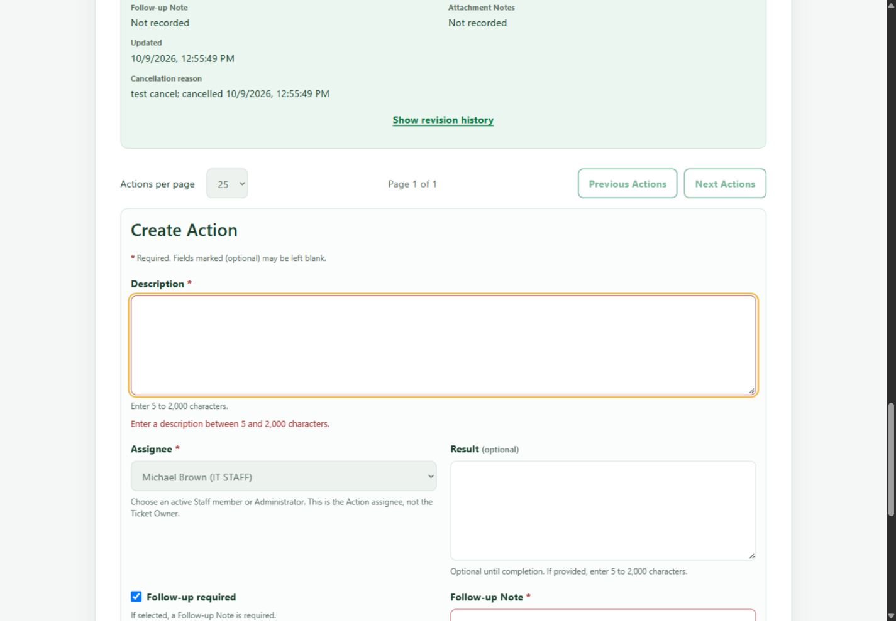
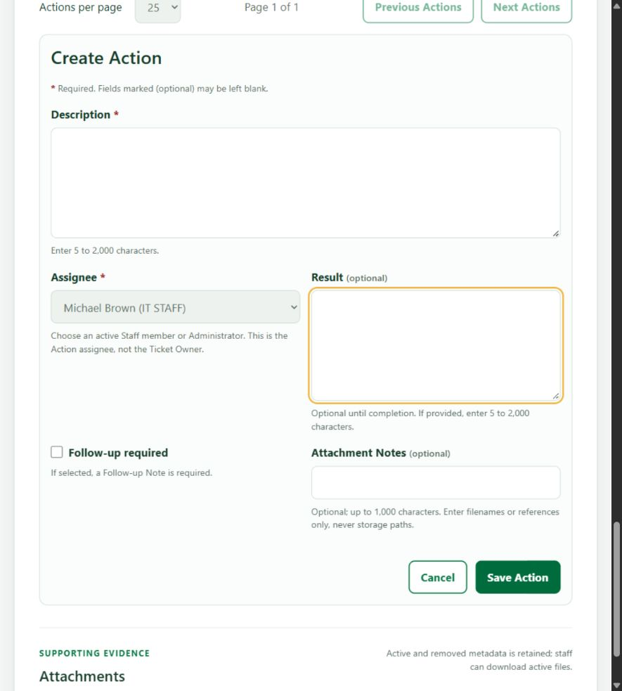
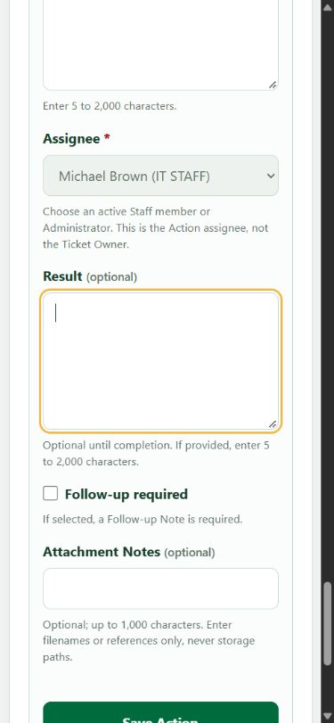

# Lab 4 Tests and Evidence

Issues #55–61 are merged into `lab4-staging`; Issue #62 audits the release candidate on `feature/28-Lab4ReleaseEvidence`, based on `5c51a0bb6bb9e5d26a25769f5a854f5e1f9ba266`. Section 4 preserves historical red/green evidence and the current Issue #62 checks separately. Normative requirements: [specification.md](specification.md); [API](api-spec.md); [UI](ui-spec.md). **Planned** means no check for that row has run; **Partial** means some but not all stated assertions/evidence were verified; **Passed** means the stated assertions were observed. A passing test suite does not automatically complete every planned scenario or human/course-delivery gate. Never claim candidate results came from final `main`.

## 1. Planned test matrix

For compactness, the exact path prefixes in this table are `S = server/tests/lab-04/`, `C = client/tests/lab-04/`, and `E = e2e/lab-04/`; concatenate prefix and filename, not a glob. The matrix includes both existing and planned files; each row's status and Issue evidence below distinguish them.

| Test ID | Type / exact planned path | Requirements and ACs | Required assertions | Status |
| --- | --- | --- | --- | --- |
| UNIT-01 | Unit; S`action-validation.unit.test.ts` | FR-02,05; BR-02,04,05,06; AC-02,03 | Trim boundaries, wrong types/unknown actor/date fields, default assignee, conditional note, Result completion and cancellation reason. | Partial: Issue #56 validation subset passed; full matrix remains open. |
| UNIT-02 | Unit; S`workflow-rules.unit.test.ts` | FR-04,07; BR-07,08,11,12,15; AC-05,07,08,10 | Every allowed/forbidden Action/Ticket transition, terminal edits, gate combinations, cancellation and legacy zero-Action rules. | Passed unit scope: 37 tests, including exhaustive Action/Ticket status-pair checks, gate predicates and legacy reopening. Integration and visual evidence have their own rows. |
| UNIT-03 | Unit; S`dashboard-calculations.unit.test.ts` | FR-09,10; BR-17,18; AC-11,13 | Distinct Tickets vs Actions, active states, zero counts, UTC seven-day edges/future dates, Asia/Bangkok display, deterministic ties. | Passed in Issue #59 worktree; 4 tests. |
| API-01 | API; S`actions-taken.api.test.ts` | FR-01,02,03,04,05,06; BR-01–09; AC-01–05 | Real create/list/edit/assign/complete/cancel, Owner≠actors, completed correction with inactive assignee, actor active-role recheck inside each write transaction, immutable prefix snapshots, no-op, scoped pagination, validation and rollback. | Partial: implemented lifecycle subset plus stale-actor and inactive-assignee corrections passed; remaining lifecycle assertions stay open. |
| API-02 | API; S`authorization.api.test.ts` | FR-01,10,13,14; BR-01,03,16,22; AC-01,12,18 | Missing/expired/revoked/password-gated sessions, CSRF/Origin, Requester mutation403, own read, cross-owner/resource404, Staff/Admin access and sanitized errors. | Partial: dashboard unauthenticated/wrong-role checks and existing session/role/ownership tests passed in full server run; complete authorization and browser matrix remains open. |
| API-03 | API; S`concurrency.api.test.ts` | FR-03,06,07,08; BR-09,10,12,14; AC-04,06,08,10 | Same-key concurrent create one row/revision; different payload409; replay after stale version; edit/edit, resolve/create, resolve/follow-up, assignment/Admin races; forced transaction failure; bounded conflict retry. | Partial: five concurrency tests pass on 29 October, including resolve/create, resolve/follow-up and forced cancellation rollback. Idempotency, stale replay and Action-insert rollback remain covered; additional simultaneous edit/edit interleavings remain planned. |
| API-04 | API; S`ticket-workflow.api.test.ts` | FR-07,08,12; BR-11–15; AC-07–10 | Full matrix, confirmation/reason, each gate predicate, event order, advisory indication, reopen clearing, terminal legacy behavior, atomic Ticket/Action cancellation rollback. | Partial: 4 workflow API tests passed, including gate rejection and success after a valid completed Action, cancellation effects, indication idempotency/reopen and history; exhaustive predicate/error/history isolation checks remain open. |
| API-05 | API; S`requester-dashboard.api.test.ts` | FR-10,11; BR-16,18,19; AC-12–14 | Session scope, all owned statuses, exact metrics, bounds/ties/zero, attention and recent, shared filtered totals, unsupported identity query400. | Passed in Issue #59 worktree; 4 tests. |
| API-06 | API; S`staff-dashboard.api.test.ts` | FR-09,11; BR-17–19; AC-11,13,14 | Unassigned/my-owned/urgent/distinct my-Action metrics, current-user Action rows, status/IT-priority counts, bounded lists, drill-down and Owner≠assignee. | Passed in Issue #59 worktree; 4 tests. |
| API-07 | Migration/API; S`migration-regression.api.test.ts`; `server/scripts/verify-test-recovery.mjs` | FR-07,12; BR-15,21; AC-10,16,17 | Apply real Lab 4 migration to a pre-Lab-4 schema, preserve Ticket/Attachment/changed-password state; seed twice and after edits; collision skip; counter monotonic; disposable backup/restore. | Passed for migration/seed/recovery: two API tests verify real upgrade and edited-data preservation; Issue #62's guarded command verifies an edited reserved-number graph and a counter already above the highest Ticket, then restores all 15 tables/sequences and protected bytes. Legacy workflow assertions remain in API-04. |
| API-08 | API; S`user-assignment-safety.api.test.ts` | FR-02,13; BR-02,05,20; AC-02,15 | Inactive/non-staff assignee, User active-Action conflict and session unchanged, self/last-Admin and owned-Ticket precedence, eligible role change and historical actors, concurrent eligibility change. | Partial: active-Action deactivation/demotion protection and assignment race passed; remaining safety cases stay open. |
| PERF-01 | Performance-smoke; S`dashboard-performance.api.test.ts` | FR-09,10; BR-16–19; AC-13 | Representative 500-Ticket/1000-Action fixture; aggregate query count stays bounded as fixture doubles (no N+1), arrays capped5, response does not contain complete collections. Record elapsed diagnostics, no invented production SLA. | Passed in Issue #59 worktree; 1 test. Query count remained 23 at both sizes; see §4. |
| UI-01 | Component; C`ActionsTaken.test.tsx` | FR-01–06; BR-01–10,18,22; AC-01–06,19 | Inline create/edit, required/optional markers, conditional requirements, plain-language field errors/focus, Requester and terminal-Ticket read-only views, lifecycle confirmation/reason, stale-draft retention, safe retry with stable idempotency key, active assignee and User-management safety feedback. | 27 component tests pass on 31 October: includes Create conflict draft/key retention, failed reload and successful refreshed-version retry, alongside Bangkok time, Ticket-switch reset and Edit conflict fieldErrors. Existing focus, loading/retry, revisions and terminal guards remain covered. Browser reassignment/conflict recovery is exercised in E2E-01; inactive-assignee browser capture and human visual/accessibility checks remain pending. |
| UI-02 | Component; C`TicketWorkflow.test.tsx` | FR-07,08; BR-11–15,22; AC-06–10,19 | Legal target controls, gate explanation, confirmation/cancel reason, protected direct calls, reload on stale version, indication vs status, ordered history. | Partial: 5 workflow UI tests passed, including history pagination reset when switching Tickets and Asia/Bangkok timestamp formatting; full visual/accessibility/E2E assertions remain open. |
| UI-03 | Component; C`RequesterDashboard.test.tsx` | FR-10,11,14; BR-16,18,19,22; AC-12–14,19 | Loading/zero/error/Retry/session expiry, correct owned cards/lists/links, time display, navigation/deep link and account-cache reset. | Partial: 3 dashboard component tests passed; Requester session-expiry/default-route behavior is covered by the App regression file. Authenticated E2E now compares live metrics, retries a safe failure, verifies an empty account and drills into owned Tickets; broader manual account-cache review remains open. |
| UI-04 | Component; C`StaffDashboard.test.tsx` and C`ActionsTaken.test.tsx` | FR-09,11,14; BR-17–19,22; AC-11,14,19 | Current-user assigned Actions and real metric links, capped summaries, all states/refresh, role navigation, keyboard semantics, and focus of a linked Action after its list loads. | Partial: dashboard component/App tests and linked Action-focus regression passed; authenticated E2E now compares live role metrics and drills through a real Action link. Manual keyboard/screen-reader review remains open. |
| STYLE-01 | Style/responsive; C`ZenGreen.styles.test.tsx` plus E2E browser assertions | FR-14; BR-22; AC-19 | Token and breakpoint/style contracts; real-browser responsive, visual, overflow and accessibility checks. | Partial: CSS contract tests pass. Issue #61 captured real dashboard and Action/detail screens at desktop/tablet/mobile sizes; axe and overflow assertions pass on dashboard/Action views, and 767/768/991/992 widths are checked. Manual screen-reader/touch-target review and full human visual checklist remain open. |
| E2E-01 | Browser; E`actions-taken-flow.spec.ts` | FR-01–06,13,14; BR-01–10,20,22; AC-01–06,15,18 | Authenticate real roles; create multiple Actions on one Ticket, assign/edit/complete/cancel, inactive rejection, read-only Requester, conflict/retry and attachment continuity; assert actual persisted records. | Partial: all three projects pass on 29 October with real reassignment and a concurrent API edit followed by browser stale-draft/reload/review/retry. Existing lifecycle, immutable revisions, ownership, attachments, axe and overflow still pass. Inactive-assignee browser rejection is not in this E2E; lower-level assignment safety and remaining human evidence are recorded separately. |
| E2E-02 | Browser; E`ticket-resolution.spec.ts` | FR-07,08,14; BR-11–15,22; AC-07–10,18 | Failed gate via direct API, complete/follow-up correction then resolve/close/reopen/cancel, confirmed transitions, retained events/revisions, advisory indication and legacy Ticket. | Partial, locally exercised in all three projects: failed gate remains unchanged; valid completed Action permits resolve; requester indication, persisted resolve/reopen events and read-only detail pass. Close/cancel and legacy zero-Action transitions remain covered by API/component regression rather than this browser flow. |
| E2E-03 | Browser; E`dashboards.spec.ts` | FR-09–11,14; BR-16–19,22; AC-11–14,18,19 | Requester/Staff/Admin dashboard roles, metrics-to-list totals, real Action links, zero/failure, 3 sizes/boundaries, keyboard/axe and no page overflow. | Passed locally in all three projects: live Requester and Staff metrics match API responses, Admin role navigation, real drill-down/focus, genuine empty-account state, safe failure/retry, axe, no overflow, and 767/768/991/992 width checks. |
| REG-01 | Full prior/new suites; manifest and Lab 2 flow mapping below; `e2e/lab-04/requester-regression.spec.ts` | FR-07,12–14; BR-13,21,22; AC-09,16,18,20 | Full inherited server/client suites and authenticated equivalents of every retained Lab 2 browser flow, plus Lab 3/4 E2E; verify mapped scenarios actually pass, builds, migrations/repeat seed; no hidden skips. | Partial: full server/client regressions, builds, migrations/repeated seed and all 60 Lab 3/Lab 4 Playwright tests pass locally with no skips. R02-01–16 browser continuity is mapped below; R02-06 filter-value semantics also rely on existing API/component tests, and MAN-01/release checks remain open. |
| DOC-01 | Manual/inline contract check; six files in docs/lab-04 | FR-14; BR-22; AC-20 | Presence, exact eleven specification headings, all IDs/paths mapped, exact APIs/decisions, labsheet rubric and peer approval order. Approval is separate from local structural success. | Structural/path/ID checks pass in Issue #62; git ancestry confirms the four contract files preceded implementation. PR #63's comment-only exception is recorded accurately; external course-delivery gates remain pending. |
| MAN-01 | Real captures/manual review; artifacts/lab-04/screenshots directories in ui-spec | FR-12,14; BR-21,22; AC-17,19,20 | Disposable recovery observation, role/metric API evidence, real readable responsive screenshots, focus/console/links, Project/history/review audit and nine-part submission. | Partial: 15 real screenshots and automated axe/overflow/focus checks are retained. Issue #62 verified disposable recovery, sampled responsive images, checked contract ancestry and actual own/partner PR reviews. Human accessibility/full visual evidence, Project/final-main and submission audits remain open. |

The eleven required files in labsheet §12 are API-01,04,05,06; UI-01,02,03,04; E2E-01,02,03. Additional focused tests cover explicit validation, authorization, concurrency, migration and performance requirements; they do not expand product scope.

## 2. FR/BR and AC traceability

The AC table in specification is authoritative; every AC-01–20 appears above with a path or genuine manual-evidence location. This direct index prevents a requirement disappearing between tables:

| AC | Test IDs (paths in §1) | Implementation acceptance status |
| --- | --- | --- |
| AC-01 | API-01,02; UI-01; E2E-01 | Partial: browser-persisted Action lifecycle and role-scoped read-only behavior passed; remaining API/auth edge cases remain open. |
| AC-02 | UNIT-01; API-01,08; E2E-01 | API verifies backend creator/date/default assignee, a distinct reassigned user and server completion performer independently of Ticket Owner; browser lifecycle supplements it. Inactive-assignee rejection belongs to AC-15, not a blanket browser prerequisite for this AC. |
| AC-03 | UNIT-01; API-01; UI-01; E2E-01 | Partial: valid browser create/edit passed; the broader invalid-input/conditional-validation matrix remains in unit/API/UI tests. |
| AC-04 | API-01,03; UI-01; E2E-01 | Passed automated acceptance: API lifecycle assertions verify reassignment, immutable prior snapshots, advancing real-change versions and unchanged no-op versions; UI/browser coverage supplements this. API-level coverage is valid acceptance evidence. |
| AC-05 | UNIT-02; API-01; UI-01; E2E-01 | Passed automated acceptance: exhaustive unit transition pairs, API completion/cancellation metadata and UI/browser lifecycle assertions. Every transition does not also require its own browser test. |
| AC-06 | API-03; UI-01,02; E2E-01 | Partial: stale/no-op versioned Ticket writes, workflow UI and synchronized Action version passed; full race/conflict E2E remains open. |
| AC-07 | UNIT-02; API-04; UI-02; E2E-02 | Passed automated acceptance: exhaustive unit matrix, direct API transition/confirmation tests and UI/browser lifecycle coverage. Matrix entries proved at unit/API level need not each be repeated in a browser. |
| AC-08 | UNIT-02; API-03,04; UI-02; E2E-02 | Partial: gate predicates, failed and successful browser gate, valid completion-to-resolution and cancellation effects passed; exhaustive concurrency/rollback remains open. |
| AC-09 | API-04; REG-01; E2E-02 | Passed automated acceptance: API indication is idempotent/advisory; reopen clears it without deleting ordered history. E2E verifies the indication, resolve and reopen flow. Wider history authorization remains tracked in API-02 rather than changing this AC's scope. |
| AC-10 | API-03,04,07; E2E-02 | Passed automated acceptance: unit legacy/terminal rules and API legacy reopening pass; API-03 forces workflow-event insertion failure and verifies unchanged Ticket, Action, revision and event state after cancellation rollback. |
| AC-11 | UNIT-03; API-06; UI-04; E2E-03 | Partial: live Staff metrics/status/priority API comparison, role landing and Action drill-down pass in browser; additional API cases remain open. |
| AC-12 | API-02,05; UI-03; E2E-03 | Partial: Requester-scoped API, empty/failure states, role landing, drill-down and authenticated list flows pass; account/session edge matrix remains open. |
| AC-13 | UNIT-03; API-05,06; PERF-01; E2E-03 | Partial: calculation/API, UI links, bounded-query smoke and live metric comparison pass; remaining filter/tie scenarios stay lower-level. |
| AC-14 | API-05,06; UI-03,04; E2E-03 | Partial: dashboards, role navigation, responsive projects, axe/overflow, drill-down and width boundaries pass; human visual review remains open. |
| AC-15 | API-08; REG-01; E2E-01 | API-08 and inherited User safety regressions prove active-Action assignment conflicts and unchanged User/session state; ownership/read-only isolation is also exercised in browser. Inactive-assignee browser capture is still pending as course evidence; API-level proof remains valid. |
| AC-16 | API-07; REG-01 | Passed: real pre-Lab-4 migration/credential/row preservation and repeat-seed tests pass; the Issue #62 scratch-schema check preserves an edited reserved-number graph and a counter above the maximum seeded Ticket. |
| AC-17 | API-07; MAN-01 | Passed: Issue #62 ran `npm.cmd run prisma:test:recovery`; all 15 table fingerprints and sequences plus protected attachment bytes matched after restore, and its generated schema/storage/backup were cleaned. Operational rollback guidance retains post-upgrade data. |
| AC-18 | API-02; REG-01; E2E-01,02,03 | Partial: server authorization, inherited E2E and Lab 4 role/ownership browser denials passed; remaining auth and release audit gates stay open. |
| AC-19 | UI-01,02,03,04; STYLE-01; MAN-01 | Partial: CSS/component checks plus real responsive screenshots, axe, keyboard, overflow and boundary assertions passed; manual screen-reader/touch-target review remains open. |
| AC-20 | DOC-01; REG-01; MAN-01 | Contract structure, paths, IDs and pre-implementation merge order verified. PR #72 is open; formal review, approved integration and remaining release evidence are pending. |

| FR | Test IDs | BR | Test IDs |
| --- | --- | --- | --- |
| FR-01 | API-01,02; UI-01; E2E-01 | BR-01 | API-01,02; UI-01 |
| FR-02 | UNIT-01; API-01,08; E2E-01 | BR-02 | UNIT-01; API-01,08 |
| FR-03 | API-01,03; UI-01; E2E-01 | BR-03 | API-01,02; UI-01 |
| FR-04 | UNIT-02; API-01; UI-01 | BR-04 | UNIT-01; API-01 |
| FR-05 | UNIT-01; API-01; UI-01 | BR-05 | UNIT-01; API-01,08 |
| FR-06 | API-01,03; UI-01; E2E-01 | BR-06 | UNIT-01; API-01; UI-01 |
| FR-07 | UNIT-02; API-03,04; UI-02; REG-01; E2E-02 | BR-07 | UNIT-02; API-01 |
| FR-08 | API-03,04; UI-02; E2E-02 | BR-08 | UNIT-02; API-01 |
| FR-09 | UNIT-03; API-06; PERF-01; UI-04; E2E-03 | BR-09 | API-01,03; UI-01 |
| FR-10 | UNIT-03; API-02,05; PERF-01; UI-03; E2E-03 | BR-10 | API-03; UI-01; E2E-01 |
| FR-11 | API-05,06; UI-03,04; E2E-03 | BR-11 | UNIT-02; API-04; UI-02 |
| FR-12 | API-04,07; REG-01; MAN-01 | BR-12 | UNIT-02; API-03,04; UI-02 |
| FR-13 | API-02,08; REG-01; E2E-01 | BR-13 | API-04; REG-01; E2E-02 |
| FR-14 | API-02; UI-01–04; STYLE-01; REG-01; DOC-01; MAN-01; E2E-01–03 | BR-14 | API-03,04; UI-02 |
| — | — | BR-15 | UNIT-02; API-04,07; E2E-02 |
| — | — | BR-16 | API-02,05; PERF-01; UI-03 |
| — | — | BR-17 | UNIT-03; API-06; UI-04 |
| — | — | BR-18 | UNIT-03; API-05,06; PERF-01 |
| — | — | BR-19 | API-05,06; UI-03,04; E2E-03 |
| — | — | BR-20 | API-08; REG-01; E2E-01 |
| — | — | BR-21 | API-07; REG-01; MAN-01 |
| — | — | BR-22 | API-02; UI-01–04; STYLE-01; REG-01; DOC-01; MAN-01 |

### Existing regression manifest (real files)

REG-01 runs all Vitest-discovered tests, not only a selected green subset. These paths existed at the inspected baseline; helper files are not counted as suites:

```text
server/tests/lab-01/categories.test.ts
server/tests/lab-01/health.test.ts
server/tests/lab-02/attachment-validation.unit.test.ts
server/tests/lab-02/attachment-rollback.api.test.ts
server/tests/lab-02/attachments.api.test.ts
server/tests/lab-02/create-ticket-rollback.api.test.ts
server/tests/lab-02/create-ticket.api.test.ts
server/tests/lab-02/e2e-environment.unit.test.ts
server/tests/lab-02/my-tickets.api.test.ts
server/tests/lab-02/reference-data.test.ts
server/tests/lab-02/ticket-detail.api.test.ts
server/tests/lab-02/ticket-validation.unit.test.ts
server/tests/lab-03/auth-rate-limit.api.test.ts
server/tests/lab-03/auth-session.api.test.ts
server/tests/lab-03/auth-validation.unit.test.ts
server/tests/lab-03/auth.api.test.ts
server/tests/lab-03/authorization.api.test.ts
server/tests/lab-03/comments-notes.api.test.ts
server/tests/lab-03/migration-seed.api.test.ts
server/tests/lab-03/requester-regression.api.test.ts
server/tests/lab-03/resolution-indication.unit.test.ts
server/tests/lab-03/session-security.unit.test.ts
server/tests/lab-03/staff-queue.api.test.ts
server/tests/lab-03/staff-ticket-detail.api.test.ts
server/tests/lab-03/status-transition.unit.test.ts
server/tests/lab-03/users-admin.api.test.ts
client/tests/lab-01/App.test.tsx
client/tests/lab-02/AttachmentSection.test.tsx
client/tests/lab-02/CreateTicket.test.tsx
client/tests/lab-02/MyTickets.test.tsx
client/tests/lab-02/RequesterSelection.test.tsx
client/tests/lab-02/RequesterTicketDetail.test.tsx
client/tests/lab-02/ZenGreen.styles.test.tsx
client/tests/lab-03/ChangePassword.test.tsx
client/tests/lab-03/Login.test.tsx
client/tests/lab-03/RequesterRegression.test.tsx
client/tests/lab-03/StaffTicketDetail.test.tsx
client/tests/lab-03/StaffTicketQueue.test.tsx
client/tests/lab-03/UserManagement.test.tsx
e2e/lab-03/authentication.spec.ts
e2e/lab-03/requester-regression.spec.ts
e2e/lab-03/staff-ticket-flow.spec.ts
e2e/lab-03/user-administration.spec.ts
e2e/lab-03/release-evidence-states.spec.ts
```

### Lab 2 browser-flow continuity (REG-01)

The files `e2e/lab-02/requester-ticket-flow.spec.ts` and `e2e/lab-02/release-evidence-states.spec.ts` use the removed development selector and spoofable header. Do not run them unchanged or count them as current authenticated passing tests. Retire only selector-specific behavior; preserve all still-relevant product assertions through the mapping below. At planning time, “Existing” meant inspected assertions existed and “Extend” identified a browser gap; the final column below records the Issue #61 execution outcome and any remaining limitation.

Exact inherited destinations: `e2e/lab-03/requester-regression.spec.ts` (owned lifecycle and removed selector), `e2e/lab-03/authentication.spec.ts` (login/password gate/logout/role routing), and `e2e/lab-03/release-evidence-states.spec.ts` (authenticated workspace responsiveness). The authenticated extension is implemented in **`e2e/lab-04/requester-regression.spec.ts`**, in addition to the required Lab 4 browser files. Existing component/API assertions supplement the browser checks and are identified separately below.

| Flow ID | Original Lab 2 assertions | Authenticated equivalent / inspected coverage | Executed evidence / remaining limitation |
| --- | --- | --- | --- |
| R02-01 | Selector route, active selection/Continue, selector loading/empty/failure and selector accessibility | Selector UI retired deliberately. Lab 3 requester-regression checks the old route has no selector/sessionStorage flow; authentication.spec tests real login, password gate, logout and role landing. | Passed in the full inherited E2E run; selector-only states remain excluded by the authenticated Lab 3 contract. |
| R02-02 | Selected Requester identity, Change Requester, other Requester's Ticket disappearing from list | `e2e/lab-04/requester-regression.spec.ts` creates Tickets as A, logs out, signs in as B, and verifies A's Ticket is absent and cross-owner detail is 404. | Passed in all three viewport projects; authenticated account replacement and server ownership isolation are asserted. |
| R02-03 | Create form Category/System/Requested Priority, summary/description, initial attachment selection | Inherited Lab 3 and Issue #61 browser flows create Tickets through the UI with these fields and an initial PDF. | Passed in inherited and new E2E; created Ticket fields and identity are checked on detail. |
| R02-04 | Creation success and backend Ticket Number format | Inherited Lab 3 lifecycle plus the Issue #61 creation helper assert success and `TKT-YYYY-######`; authenticated requester session owns the Ticket. | Passed in inherited and new E2E; no spoofable Requester header is used. |
| R02-05 | My Tickets shows actual created Ticket, desktop table/mobile cards | Issue #61 asserts the created Ticket link is visible in the populated list in desktop/tablet/mobile projects; component tests cover responsive table/card presentation. | Passed for actual listing visibility across configured projects. |
| R02-06 | Search submitted through Apply Filters, URL query value and matching Ticket link/open detail | Issue #61 searches real Tickets, checks URL updates for search/category/system/priority/status/sort/order/page size, opens a matching row by keyboard, and checks no-results; API/component suites cover filter semantics. | Passed for browser control/URL/search/detail behavior and lower-level filter semantics. E2E does not create a unique result fixture for every filter value. |
| R02-07 | Initial attachment visible and browser download filename | Inherited Lab 3 and Issue #61 Requester flows attach a real PDF and assert its browser download filename. | Passed in the complete E2E run. |
| R02-08 | Add PNG after creation, ready state, upload success and new metadata | Issue #61 uploads a PNG after creation, then verifies persisted metadata and download in an authenticated flow. | Passed; lower-layer attachment API and validation regressions also ran in the full suite. |
| R02-09 | Removal dialog/reason, retained removed metadata and removed Download control | Inherited Lab 3 and Issue #61 flows verify removal reason/retained metadata and blocked removed-file access. | Passed in authenticated E2E; repeat-removal conflict remains covered by the API regression. |
| R02-10 | Cross-owner detail/list-metadata/download/upload/remove API404 | Issue #61 uses a second authenticated Requester and valid browser session/CSRF context for denied attachment operations; responses are sanitized and A's rows remain unchanged. | Passed for cross-owner detail/list/download/upload/remove isolation; no `X-Requester-Id` trust. |
| R02-11 | Other Requester's filtered no-results and inaccessible detail/attachment errors | Issue #61 verifies B's filtered no-results and safe inaccessible detail; a separate empty-account test opens `/tickets` and checks genuine empty-list state versus filtered no-results. | Passed in the three-project Playwright run, including the added real empty-list assertion. |
| R02-12 | Axe and no horizontal scroll on selector/create/list/detail/after removal/account switch | Selector UI is retired. Inherited requester E2E checks axe/overflow; Issue #61 adds keyboard list navigation, dashboard/Action axe and overflow, and 767/768/991/992 width boundaries. | Automated checks passed across desktop/tablet/mobile. Manual screen-reader, touch-target and full visual review remain open. |
| R02-13 | Initial Create state and strict invalid-summary field error | Issue #61 submits an invalid summary, checks the field error/focus, and verifies that no Ticket POST was sent. | Passed in all three browser projects. |
| R02-14 | Invalid PDF signature, removal from pending selection | Issue #61 submits a fake PDF signature, checks rejection/no Ticket POST, removes the invalid selected file, and continues with a valid draft. | Passed in all three browser projects. |
| R02-15 | Creation API failure and preserved Summary/draft | Issue #61 injects a one-time safe 500 for Ticket creation and verifies Summary and Description remain. | Passed. This is a controlled Playwright response, not a real outage. |
| R02-16 | Delayed creation, busy submitting state and successful completion | Issue #61 delays the POST, checks the submit button is disabled, exactly one POST occurs, and creation succeeds. | Passed. The delay is controlled by Playwright, not a production-network claim. |

REG-01 now has named authenticated browser assertions for retained R02-01–16 flows; selector-only states are explicitly retired, while API/component tests supplement filter semantics. The complete inherited Lab 3 plus Lab 4 Playwright suite, server/client regressions, builds, migration and repeated seed were run locally for Issue #61. See the Issue #61 evidence below. The test results are tied to candidate code/test SHA `fb4d3f8827497d2aa72e549473726969289314f3`, with documentation-only follow-up commits afterward; this is not final-main evidence. PR #71 is open for teammate review.

## 3. Safe test environment and commands

All commands below belong in **VS Code PowerShell**, starting at repository root. They are prescribed commands; observed Issue #61 output is recorded in Section 4 and must not be confused with a commit or final-main result. Each command must finish successfully before continuing. Never paste terminal commands into DevTools Console.

Use required local `server/.env.test`, disposable PostgreSQL database ending `_test`, approved E2E schemas only (`toktickit_e2e`, `toktickit_release_e2e`, `toktickit_release_final`), and guarded temporary storage under `server/.test-attachments`. No fallback to `.env`, no random schema deletion, no unattended real database reset. Local passwords follow policy; keep them and real `.env.test` uncommitted. Existing seed uses three `LAB3_*_INITIAL_PASSWORD` variables. Record sanitized DB name/target, not connection string/password.

```powershell
git rev-parse HEAD
Set-Location server
npm.cmd run prisma:test:migrate
npm.cmd run prisma:test:seed
npm.cmd run prisma:test:seed
npm.cmd test -- --run tests/lab-04/actions-taken.api.test.ts
npm.cmd test -- --run
npm.cmd run build
Set-Location ../client
npm.cmd test -- --run tests/lab-04/ActionsTaken.test.tsx
npm.cmd test -- --run
npm.cmd run build
npx.cmd playwright test
Set-Location ..
```

Replace the two focused paths with the relevant matrix paths per Issue. Playwright is already a client development dependency; config stays under client, testDir `../e2e`. Portable prescribed form is `cd client` then `npx playwright test`. Stop manually started server/client instances before Playwright if they occupy its ports; do not enable reuse against the development database. Do not run guarded destructive fixture cleanup without identifying its disposable target. Migration/recovery tests require their own isolated fixture/restore target, not the live development database.

Preserve complete terminal output with command, tested SHA, all test files/counts, skips/failures and final build status. During TDD distinguish expected red from final green. Browser proof of permission needs real DevTools Network/Console fetch responses; database metric comparisons use the documented guarded client/script. A health200 proves availability only, not database/user/login correctness.

## 4. Issue evidence and execution order

All Issues are sequential. Issue #55 approved merge precedes #56; each later approved merge precedes the next. No branch/commit/push/Project/PR mutation without exact student authorization. Actual GitHub Approve before authorized merge; no automatic-closing PR text.

| Issue | Approved branch name / planned failing tests | Focused verification and evidence |
| --- | --- | --- |
| #55 Engineering contract | feature/21-Lab4Contract; DOC-01 missing/inconsistent contracts | Six contract documents merged to `lab4-staging` via PR #63 at `5cb5b31`; student accepted comment-based sign-off. No formal GitHub Approve is claimed. |
| #56 Actions foundation/APIs | feature/22-Lab4ActionsFoundation; UNIT-01/02, API-01/02/03/07/08 | Observed implementation evidence is recorded below; UI/dashboard/E2E remain for later Issues. |
| #57 Actions UI | feature/23-Lab4ActionsUI; UI-01 | Component tests, inherited client regression/build; real selected-record/read-only/validation captures. |
| #58 Ticket workflow | feature/24-Lab4TicketWorkflow; UNIT-02, API-03/04, UI-02 | Commit-bound evidence below: full server/client regressions and builds passed. E2E/manual screenshots and wider matrix completion remain pending. |
| #59 Dashboard APIs | feature/25-Lab4DashboardAPIs; UNIT-03, API-02/05/06/07, PERF-01 | [PR #68](https://github.com/osizk/TokTickIT/pull/68) merged into `lab4-staging` at `19117b1bed09407601e6e1064469dccff6b9a024`; TDD red then green; 13 focused dashboard API tests, full server regression (38 files/160 tests, including migration/seed), server build and bounded-query smoke. No formal GitHub **Approve** review submission was recorded. Detailed candidate-commit evidence below. |
| #60 Dashboards UI | feature/26-Lab4DashboardsUI, based on merged staging commit `19117b1bed09407601e6e1064469dccff6b9a024`; UI-03/04, STYLE-01 | Dashboard UI, Requester/Staff list-filter forwarding, role-default routing and inherited regressions; see PR #70 SHA-bound and local follow-up results in §4. Browser/screenshots were unavailable during Issue #60 and were subsequently exercised locally in Issue #61 below. |
| #61 Final regression | feature/27-Lab4FinalRegression; E2E-01/02/03 and regressions | Candidate SHA `fb4d3f8827497d2aa72e549473726969289314f3` (implementation commit `983e121`, staging base `8eec9ae4622dff57adba01f60022bfacf494ea0f`) passed server/client regressions and builds, guarded migration/repeated seed, and all 60 inherited Lab 3 + Lab 4 Playwright tests; detailed outputs and remaining review/release gates follow below. Later local review corrections are recorded separately. |
| #62 Release evidence | feature/28-Lab4ReleaseEvidence; DOC-01, REG-01, MAN-01 | In progress from staging `5c51a0b`. Current contract/README/review audit, complete regression rerun, two asynchronous assertion fixes, and real guarded database/file recovery are recorded below. AI selection/reflection, human evidence, Project access, Issue #62 PR/review and final-main/submission gates remain explicit. |

For each card: Backlog → Specified (scope/maps) → Started (approved branch/failing tests) → PR Review (authorized PR) → Fixing if requested → PR Review again → Done only after actual approval and authorized merge. The table is a plan, not an assertion cards were moved.

### Issue #55 — observed red phase

On baseline `a6cd507efcf4c666491cd79ef81ec0fbfba0f18c`, checked required file existence before drafting; exit code1 as expected. This was an inline documentation check, not an implemented product test suite.

```powershell
$contractPaths = @('specification.md','tests.md','ui-spec.md','api-spec.md','ai-use.md','reviewer.md')
$missingContractFiles = @($contractPaths | Where-Object { -not (Test-Path -LiteralPath (Join-Path 'docs/lab-04' $_)) })
Write-Output "DOC-01 red check at $(git rev-parse HEAD):"
$missingContractFiles | ForEach-Object { Write-Output "MISSING docs/lab-04/$_" }
if ($missingContractFiles.Count -gt 0) {
  Write-Output "FAIL: $($missingContractFiles.Count) required contract files are missing."
  exit 1
}
```

```text
DOC-01 red check at a6cd507efcf4c666491cd79ef81ec0fbfba0f18c:
MISSING docs/lab-04/specification.md
MISSING docs/lab-04/tests.md
MISSING docs/lab-04/ui-spec.md
MISSING docs/lab-04/api-spec.md
MISSING docs/lab-04/ai-use.md
MISSING docs/lab-04/reviewer.md
FAIL: 6 required contract files are missing.
```

### Issue #55 — green/review phase

Historical check: on 4 October 2026, the original filesystem-only check passed against uncommitted drafts above baseline `a6cd507efcf4c666491cd79ef81ec0fbfba0f18c`. That SHA did not contain the documents; it was not a committed-content green result. It also incorrectly allowed a local uncommitted PDF to satisfy a link. This historical result is superseded for PR-readiness by the committed-source check below.

Review reproduction: read all six documents using `git show HEAD:docs/lab-04/<file>` and check local link targets with `git cat-file -e HEAD:<target>`, not filesystem existence. On the actual reviewed PR SHA, this produced exit1:

```text
Committed source SHA: 74abfb06b1eee3004de32e72b52d410d506c240c
MISSING committed link target: docs/lab-04/Lab4_labsheet.pdf
FAIL: committed-source link check.
```

Correction: name the instructor labsheet in plain text instead of linking a deliberately uncommitted course resource. The following strengthened check defaults to **committed source**, prints the exact SHA and mode, verifies link/regression targets exist in that Git tree, and checks explicit R02-01–16 continuity mappings. Run from repository root with client dependencies installed. `node - worktree` is an explicitly labeled pre-commit preview only; it must not be represented as verification of the committed SHA. No file is emitted or database touched.

```powershell
$docCheck = @'
const fs = require('fs');
const path = require('path');
const ts = require('./client/node_modules/typescript');
const {execFileSync} = require('child_process');
const sourceSha = execFileSync('git',['rev-parse','HEAD'],{encoding:'utf8'}).trim();
const sourceMode = process.argv[2] ?? 'committed';
if (!['committed','worktree'].includes(sourceMode)) throw new Error('Unknown source mode');
console.log('Source SHA: '+sourceSha+'; mode: '+sourceMode);
function trackedFile(file) {
 try { execFileSync('git',['cat-file','-e',sourceSha+':'+file],{stdio:'pipe'}); return true; }
 catch { return false; }
}
const root = 'docs/lab-04';
const names = ['specification.md','tests.md','ui-spec.md','api-spec.md','ai-use.md','reviewer.md'];
function check(ok, label) { if (!ok) throw new Error(label); console.log('PASS: ' + label); }
const docs = Object.fromEntries(names.map(n => [n,sourceMode === 'committed'
 ? execFileSync('git',['show',sourceSha+':'+root+'/'+n],{encoding:'utf8'})
 : fs.readFileSync(path.join(root,n),'utf8')]));
check(names.every(n => docs[n].length > 500), 'six required nonempty contract/evidence files');
const sections = ['Sprint Goal','Stakeholder Request','Scope','Functional Requirements','Business Rules','UI Specification Summary','Data Changes','API Contract','Acceptance Criteria','Definition of Done','Assumptions and Decisions'];
const headings = [...docs['specification.md'].matchAll(/^## (\d+)\. (.+)$/gm)].map(m => m[1]+'. '+m[2]);
check(JSON.stringify(headings) === JSON.stringify(sections.map((s,i) => (i+1)+'. '+s)), 'exact numbered specification section order (11)');
for (const [prefix,count] of [['FR',14],['BR',22],['AC',20]]) {
 const ids = Array.from({length:count},(_,i) => prefix+'-'+String(i+1).padStart(2,'0'));
 check(ids.every(id => docs['specification.md'].includes('| '+id+' |') && docs['tests.md'].includes(id)), prefix+' declarations and explicit traceability ('+count+')');
}
const testIds = ['UNIT-01','UNIT-02','UNIT-03','API-01','API-02','API-03','API-04','API-05','API-06','API-07','API-08','PERF-01','UI-01','UI-02','UI-03','UI-04','STYLE-01','E2E-01','E2E-02','E2E-03','REG-01','DOC-01','MAN-01'];
check(testIds.every(id => docs['tests.md'].includes('| '+id+' |')), '23 planned Test IDs with individual matrix rows');
const required = ['actions-taken.api.test.ts','ticket-workflow.api.test.ts','requester-dashboard.api.test.ts','staff-dashboard.api.test.ts','StaffDashboard.test.tsx','RequesterDashboard.test.tsx','ActionsTaken.test.tsx','TicketWorkflow.test.tsx','actions-taken-flow.spec.ts','ticket-resolution.spec.ts','dashboards.spec.ts'];
check(required.every(n => docs['tests.md'].includes('`'+n+'`')), 'all 11 labsheet-required automated filenames mapped');
const oldPaths = [...docs['tests.md'].matchAll(/^(?:server\/tests|client\/tests|e2e\/lab-03)\/.+\.(?:ts|tsx)$/gm)].map(m => m[0]);
check(oldPaths.length === 44 && oldPaths.every(trackedFile), '44 inherited regression paths exist in the source commit');
const flowIds = Array.from({length:16},(_,i) => 'R02-'+String(i+1).padStart(2,'0'));
check(flowIds.every(id => docs['tests.md'].includes('| '+id+' |')), '16 explicit Lab 2 authenticated continuity mappings (execution remains planned)');
const links = Object.values(docs).flatMap(d => [...d.matchAll(/\]\(([^)]+)\)/g)].map(m => m[1])).filter(p => !p.startsWith('http'));
check(links.every(p => trackedFile(path.posix.normalize(root+'/'+p))), 'local Markdown links resolve to committed files, not untracked local resources');
check(!/<detail>|<staff-ticket>/.test(docs['api-spec.md']) && !Object.values(docs).some(d => /^- \[x\]/im.test(d)), 'no unresolved response placeholders or unperformed checked boxes');
check(docs['api-spec.md'].includes('removedByRequesterId: number|null') && docs['api-spec.md'].includes('sort value is `requestedPriority`'), 'inherited attachment DTO and Requester sort/filter distinction');
const apiTypes = [...docs['api-spec.md'].matchAll(/```ts\r?\n([\s\S]*?)```/g)].map(m => m[1]).join('\n')+'\nexport {};\n';
const virtualPath = path.resolve('client/lab4-contract-check.ts');
const options = {noEmit:true,strict:true,skipLibCheck:true,target:ts.ScriptTarget.ES2022,types:[]};
const host = ts.createCompilerHost(options);
const original = host.getSourceFile.bind(host);
host.getSourceFile = (name, language, onError, shouldCreateNew) => path.resolve(name) === virtualPath ? ts.createSourceFile(name,apiTypes,language,true) : original(name,language,onError,shouldCreateNew);
const program = ts.createProgram([virtualPath],options,host);
const diagnostics = ts.getPreEmitDiagnostics(program);
if (diagnostics.length) console.log(ts.formatDiagnosticsWithColorAndContext(diagnostics, {getCanonicalFileName:n=>n,getCurrentDirectory:()=>process.cwd(),getNewLine:()=> '\n'}));
check(diagnostics.length === 0,'all API TypeScript response/request declarations type-check without emitting files');
console.log('DOC-01 structural green: PASS ('+sourceMode+'); peer approval and product checks remain pending.');
'@
$docCheck | node - committed
exit $LASTEXITCODE
```

Historical corrected worktree preview command: run the same here-string with `$docCheck | node - worktree`. Its output below is not represented as a committed-content result. The student subsequently authorized commit/push; the actual committed-source passing result is recorded afterward. An evidence-only follow-up cites that tested commit rather than pretending to reference its own future SHA.

```text
Source SHA: 74abfb06b1eee3004de32e72b52d410d506c240c; mode: worktree
PASS: six required nonempty contract/evidence files
PASS: exact numbered specification section order (11)
PASS: FR declarations and explicit traceability (14)
PASS: BR declarations and explicit traceability (22)
PASS: AC declarations and explicit traceability (20)
PASS: 23 planned Test IDs with individual matrix rows
PASS: all 11 labsheet-required automated filenames mapped
PASS: 44 inherited regression paths exist in the source commit
PASS: 16 explicit Lab 2 authenticated continuity mappings (execution remains planned)
PASS: local Markdown links resolve to committed files, not untracked local resources
PASS: no unresolved response placeholders or unperformed checked boxes
PASS: inherited attachment DTO and Requester sort/filter distinction
PASS: all API TypeScript response/request declarations type-check without emitting files
DOC-01 structural green: PASS (worktree); peer approval and product checks remain pending.
```

### Review-fix committed-source green — observed 4 October 2026

Committed the four correction documents as `b9ebdc224e6ab823c56f6ef944d25eecfd9ced54`, then ran the exact PowerShell here-string above with `$docCheck | node - committed`. Exit code **0**. Documents and local-link/regression targets were read from that Git tree; the local uncommitted PDF cannot satisfy this check. This evidence-only update does not change the product contract/API implementation. Complete output:

```text
Source SHA: b9ebdc224e6ab823c56f6ef944d25eecfd9ced54; mode: committed
PASS: six required nonempty contract/evidence files
PASS: exact numbered specification section order (11)
PASS: FR declarations and explicit traceability (14)
PASS: BR declarations and explicit traceability (22)
PASS: AC declarations and explicit traceability (20)
PASS: 23 planned Test IDs with individual matrix rows
PASS: all 11 labsheet-required automated filenames mapped
PASS: 44 inherited regression paths exist in the source commit
PASS: 16 explicit Lab 2 authenticated continuity mappings (execution remains planned)
PASS: local Markdown links resolve to committed files, not untracked local resources
PASS: no unresolved response placeholders or unperformed checked boxes
PASS: inherited attachment DTO and Requester sort/filter distinction
PASS: all API TypeScript response/request declarations type-check without emitting files
DOC-01 structural green: PASS (committed); peer approval and product checks remain pending.
```

Rerun committed mode after the evidence-only commit and record the final pushed head/check result in PR #63. This avoids an endless self-referencing commit cycle while retaining both a reproducible tested correction SHA and verification of the final review head. No product regression/Approve/merge is inferred from documentation success.

Substantive cross-check: reviewed full labsheet and rubric, existing schema/services/routes/auth/seed and accepted templates; corrected inherited attachment metadata (`removedByRequesterId`), Requester filter vs sort names (`priority` vs `requestedPriority`), repeat-removal409, inactive/credential errors, idempotent logout204, exact screenshot directories, and non-destructive seed requirements. The contract was subsequently merged through PR #63; downstream implementation and release checks remain separate. No Lab 4 product tests, full database regression, migration, seed, screenshot, teammate approval or merge occurred as part of Issue #55 itself. Earlier plan baseline tests remain historical, not Issue #56 results. The student accepted the partner's comment-based sign-off for PR #63; no formal GitHub Approve is claimed. All later release checks remain separate.

Scope clarification after student commit `74abfb0`: this PR now also includes small `.gitignore` housekeeping (the local Lab 3 draft, Lab 4 labsheet/private plan and transient Lab 4 Playwright report). These are deliberately retained to prevent accidental local-artifact commits; no Lab 3 product file is changed. The earlier six-document commit excluded the then-uncommitted ignore changes; the current PR description must acknowledge the later commit. The local PDF/plan themselves remain excluded.

### Issue #56 - Actions foundation and APIs (observed worktree evidence)

Submitted as [PR #64](https://github.com/osizk/TokTickIT/pull/64) from `feature/22-Lab4ActionsFoundation` into `lab4-staging`, related to [Issue #56](https://github.com/osizk/TokTickIT/issues/56). The PR does not use automatic-closing language. Review is pending; no Project status change or merge is claimed.

Implementation is on `feature/22-Lab4ActionsFoundation`, based on `lab4-staging` at `5cb5b31eaa0603673cef142d6082660c6a100459`. The first results below were run against the worktree before it was committed; they are evidence for the tested source tree based on that staging SHA, not evidence from final `main`. Later results are dated separately.

TDD red phase was observed on the unmodified baseline before implementation: the new Actions API test received `404` where creation expected `201`, and the new unit tests failed because `action-validation` and `workflow-rules` modules did not exist. The complete raw red-phase terminal output was not retained, so this is an outcome summary rather than a transcript.

Focused verification command, run after implementation:

```powershell
cd server
npm.cmd test -- --run tests/lab-04/action-validation.unit.test.ts tests/lab-04/workflow-rules.unit.test.ts tests/lab-04/actions-taken.api.test.ts tests/lab-04/authorization.api.test.ts tests/lab-04/concurrency.api.test.ts tests/lab-04/user-assignment-safety.api.test.ts tests/lab-04/migration-regression.api.test.ts
```

```text
Test Files  7 passed (7)
     Tests  27 passed (27)
Duration  14.02s
```

The seven executed files cover strict Action validation and workflow rules; authenticated Action create/read/edit/assignment/completion; transaction-time active actor checks; narrative correction after an assignee becomes inactive; authorization and safe cross-owner reads; idempotency, stale replay, rollback and assignment races; a real pre-Lab-4-to-Lab-4 migration; and repeated-seed stability. This is the implemented Issue #56 subset, not completion of every assertion listed in the broader UNIT/API matrix. In particular, Ticket status workflow, dashboards, UI, Playwright, and release screenshots remain pending for their later Issues.

Complete server regression command:

```powershell
cd server
npm.cmd test -- --run
```

```text
Test Files  33 passed (33)
     Tests  115 passed (115)
Duration  32.97s
```

The full server regression initially exposed two stale fixture assumptions: the Lab 2 reference test assumed no extra non-fixture Requesters existed, and the Lab 3 migration test assumed every generated `User.id` must equal its legacy Requester ID despite the collision fallback. Those assertions were corrected to verify the active reference-data contract and `legacyRequesterId` mapping. Focused rerun of those two inherited files passed (2 files, 9 tests), followed by the full 33-file passing run above. No test database reset was performed.

### Later full-regression rerun on 2026-10-05

The subsequent full command exited 1: `Test Files 9 failed | 24 passed (33); Tests 7 failed | 84 passed | 24 skipped (115)`. The Lab 4 focused suite still passed (7 files/26 tests), and a read-only check confirmed the configured `toktickit_test` database had an active Amina account whose stored password did not match the local `LAB3_REQUESTER_INITIAL_PASSWORD`; inherited authenticated Lab 1–2 tests consequently received 401/429. No credential or database reset was performed. The failed setup also exposed that the inherited attachment-rollback test could call cleanup without initialized fixture targets; cleanup now skips restoration unless exact targets were initialized. This failure is historical and was superseded by the isolated full rerun recorded below.

### Pre-commit review-fix verification (superseded)

These earlier results were run on the uncommitted review-fix worktree based on `07f8349224cd43ed3bf9f5d4b8d202e9c35d43f9`. They are retained as history, not as the current commit-bound result; see the successful rerun on `a90f94f9e5916463b715b42c099c8fda447cc807` below. That earlier run used a generated schema in the validated `_test` database and dropped only that schema afterward.

The two Action regression assertions were added before the service fix. The first pre-fix invocation did not reach Vitest because the sandbox blocked Node's parent-directory resolution (`Cannot read directory "../../..": Access is denied`); therefore no expected-red assertion result is claimed. The post-fix focused and full runs below did start and pass.

The isolated migration command applied all 7 migrations, including `20261004100000_lab4_actions_foundation`. Seed succeeded with 4 categories, 7 Related Systems, 5 Requesters, 15 Tickets, 3 Actions, and 3 Action revisions. The migration regression applied the actual Lab 4 migration only after creating legacy Ticket/Attachment and changed-password data under the six pre-Lab-4 migrations, then verified those records and credentials remained intact. The migration/seed test also reran seed twice and verified it did not overwrite edited fixtures.

Focused Issue #56 command and result:

```powershell
cd server
npm.cmd test -- --run tests/lab-04/action-validation.unit.test.ts tests/lab-04/workflow-rules.unit.test.ts tests/lab-04/actions-taken.api.test.ts tests/lab-04/authorization.api.test.ts tests/lab-04/concurrency.api.test.ts tests/lab-04/user-assignment-safety.api.test.ts tests/lab-04/migration-regression.api.test.ts
```

```text
Test Files  7 passed (7)
     Tests  27 passed (27)
Duration  14.02s
```

Complete server regression command and result:

```powershell
cd server
npm.cmd test -- --run
```

```text
Test Files  33 passed (33)
     Tests  116 passed (116)
Duration  35.78s
```

Server build on that worktree also passed with `npm.cmd run build` (`tsc`, exit code 0). The earlier credential-mismatch failures were avoided for that isolated run by fresh seed data using the local configured test passwords; the pre-existing test database schema and records were not reset or modified.

Server build command and result:

```powershell
cd server
npm.cmd run build
```

```text
> toktickit-server@1.0.0 build
> tsc

Exit code: 0
```

### Commit-bound review-fix verification on 2026-10-06

All results below were rerun after commit `a90f94f9e5916463b715b42c099c8fda447cc807` (branch `feature/22-Lab4ActionsFoundation`). The database URL was read from local `server/.env.test` and validated as the disposable database `toktickit_test`. The run created the previously absent scratch schema `toktickit_full_regression_test_26048_1791303742821`, applied migrations and ran seed/tests/build there, then dropped only that generated schema. The existing `public` schema and its manual data were not reset or changed.

Migration and repeated-seed output:

```text
7 migrations found in prisma/migrations
Applying migration `20260811000000_init`
Applying migration `20260826100000_lab2_data_reference`
Applying migration `20260915090000_lab3_auth_foundation`
Applying migration `20260916100000_lab3_requester_regression`
Applying migration `20260917100000_lab3_staff_queue`
Applying migration `20260917110000_lab3_ticket_operations`
Applying migration `20261004100000_lab4_actions_foundation`
All migrations have been successfully applied.

Seed run 1: Ensured 4 categories, 7 related systems, 5 requesters, 15 Tickets, 3 Actions, and 3 Action revisions; created 12 Lab 3 and 3 Lab 4 Ticket graphs and 3 Actions.
Seed run 2: Ensured 4 categories, 7 related systems, 5 requesters, 15 Tickets, 3 Actions, and 3 Action revisions; created 0 Ticket graphs and 0 Actions; all 3 existing Lab 4 fixture numbers were unchanged.
```

Focused Issue #56 command and result on the commit above:

```powershell
cd server
npm.cmd test -- --run tests/lab-04/action-validation.unit.test.ts tests/lab-04/workflow-rules.unit.test.ts tests/lab-04/actions-taken.api.test.ts tests/lab-04/authorization.api.test.ts tests/lab-04/concurrency.api.test.ts tests/lab-04/user-assignment-safety.api.test.ts tests/lab-04/migration-regression.api.test.ts
```

```text
Test Files  7 passed (7)
     Tests  27 passed (27)
Start at  23:22:30
Duration  13.58s
```

Complete server regression command and result on the same commit:

```powershell
cd server
npm.cmd test -- --run
```

```text
Test Files  33 passed (33)
     Tests  116 passed (116)
Start at  23:22:44
Duration  35.83s
```

Server build on the same commit:

```powershell
cd server
npm.cmd run build
```

```text
> toktickit-server@1.0.0 build
> tsc

Exit code: 0
```

Node emitted the existing non-blocking `DEP0169` `url.parse()` deprecation warning during Prisma/test startup; all commands exited successfully with no failed or skipped tests. One initial unprivileged attempt stopped during seed at Node's OS-user lookup (`uv_os_get_passwd`, `ERR_SYSTEM_ERROR`); it dropped its temporary schema. The complete rerun above succeeded with elevated local execution and also cleaned up only its generated schema.

An earlier repeated-seed check on the existing `toktickit_test` schema found no pending migrations and reported 7 Requesters alongside 4 Categories, 7 Related Systems, 15 Tickets, 3 Actions, and 3 Action revisions. That was a separate pre-existing test schema; the commit-bound isolated run above used a fresh schema and reported its own exact counts. The migration regression additionally confirmed the real Lab 4 migration preserves legacy Ticket/Attachment and changed-password data and that repeated seeding does not overwrite edited fixtures.

No UI/client or browser test is claimed for Issue #56. Remaining release checklist items in Section 5 stay unchecked until actually completed.

### Issue #57 — Actions Taken UI (uncommitted worktree evidence)

Work is on `feature/23-Lab4ActionsUI`, based on `lab4-staging` commit `6cabca6acda5853a825180bf318a782b6a1edfb5`. These checks ran against the current uncommitted Issue #57 worktree, not against that base commit as an isolated commit; rerun and record the resulting commit SHA after the Issue is committed. The planned red phase was observed before implementation: component/style coverage failed because the Actions Taken UI and its styles did not exist, and the User Management active-Action conflict did not yet provide actionable guidance.

Full client regression command, run after implementation and inherited-test updates:

```powershell
cd client
npm.cmd test -- --run
```

```text
Test Files  15 passed (15)
     Tests  69 passed (69)
Start at  21:44:17
Duration  14.91s (transform 1.02s, setup 2.32s, collect 6.64s, tests 46.91s, environment 15.55s, prepare 2.56s)
```

This includes `client/tests/lab-04/ActionsTaken.test.tsx` (9 tests), `client/tests/lab-04/ZenGreen.styles.test.tsx` (2), `client/tests/lab-03/StaffTicketDetail.test.tsx` (4, including terminal-Ticket read-only behavior), `client/tests/lab-03/UserManagement.test.tsx` (6, including unfinished-Action safety feedback), and `client/tests/lab-02/RequesterTicketDetail.test.tsx` (2, updated for the Requester read-only Actions section). All 15 client test files passed; no failures or skips were reported.

Client production build command and result:

```powershell
cd client
npm.cmd run build
```

```text
> toktickit-client@1.0.0 build
> tsc && vite build

vite v6.4.3 building for production...
transforming...
✓ 36 modules transformed.
rendering chunks...
computing gzip size...
dist/index.html                   0.39 kB │ gzip:  0.27 kB
dist/assets/index-DTBx-d_D.css  252.75 kB │ gzip: 35.18 kB
dist/assets/index-CB1vuN2o.js   282.71 kB │ gzip: 75.36 kB
✓ built in 651ms
```

Manual browser verification, real responsive screenshots, Playwright/E2E, and authenticated API/database behavior have not been tested in this Issue turn. The component tests use mocked APIs and do not replace those later checks. No commit, push, PR, review, merge, or Project status change is claimed.

### Issue #57 UI clarity follow-up — observed 9 October 2026

Added visible required asterisks, explicit `(optional)` labels, and clearer conditional requirements and validation guidance to the Action forms. The tests were written first and failed before the UI change:

```text
cd client
npm.cmd test -- --run tests/lab-04/ActionsTaken.test.tsx tests/lab-04/ZenGreen.styles.test.tsx
Test Files  2 failed (2)
     Tests  4 failed | 10 passed (14)
```

After replacing the still-generic summary copy with a direct next step, the updated assertion was run before changing the UI message and failed as expected:

```text
Test Files  1 failed (1)
     Tests  1 failed | 10 passed (11)
```

Focused verification after the changes:

```text
Test Files  2 passed (2)
     Tests  14 passed (14)
Start at 13:13:57
Duration 6.33s
```

The first full-client rerun exposed a missing mock for the new Action-history request in the inherited Staff Ticket Queue navigation test; its real request received 401 and triggered the app's normal session-expiry redirect. After adding the empty Action-history response to that test setup, the isolated queue regression passed (1 file/5 tests), and the complete client suite passed:

```text
Test Files  15 passed (15)
     Tests  72 passed (72)
Start at 13:14:10
Duration 14.29s
```

The production build also passed on this same uncommitted worktree:

```text
> npm.cmd run build
> tsc && vite build
vite v6.4.3 building for production...
✓ 36 modules transformed.
✓ built in 703ms
dist/index.html                   0.39 kB │ gzip:  0.26 kB
dist/assets/index-ppuTSGFd.css  253.01 kB │ gzip: 35.25 kB
dist/assets/index-VSHBuafL.js   285.01 kB │ gzip: 75.97 kB
```

These are local uncommitted-worktree results, not tied to a commit SHA or final `main`. Browser/manual accessibility review, screenshots, and Playwright remain pending; component/style tests do not prove real browser rendering or keyboard/screen-reader behavior.

### Issue #57 real browser verification — 9 October 2026

The student signed in as IT Staff Michael Brown in the real local application using the guarded `server/.env.test` database. No development database was used. Browser checks inspected existing Ticket `TKT-2026-910001`; no Action was saved, started, completed or cancelled during this browser inspection. The invalid form submissions remained client-side.

- [x] Enter opens Create Action and focuses its heading; invalid Save focuses Description and displays actionable field errors.
- [x] Red required markers, optional Result/Attachment Notes, and conditional required Follow-up Note are visible; short Follow-up Note is rejected.
- [x] Tab moves from Description to Assignee with visible focus; Cancel Create and Cancel edit return focus to their originating buttons.
- [x] Completed Action inline edit requires Result and retains narrative fields; existing five persisted revisions show actors, timestamps and previous values.
- [x] Real layouts inspected at 1440×1000, 900×1000 and 390×844. Boundary checks at widths 767, 768, 991 and 992 also passed: document scroll width was never greater than viewport width.
- [x] Sanitized genuine browser screenshots retained with captions below; no generated images used.

The browser check found lost keyboard focus after cancelling Create. A regression was added and failed first (1 file: 1 failed/11 passed); returning focus to the existing Create button fixed it. Focused Action/style tests then passed 2 files/15 tests. The complete client regression passed 15 files/73 tests, with no skipped tests:

```text
cd client
npm.cmd test -- --run
Test Files  15 passed (15)
     Tests  73 passed (73)
Start at 14:03:06
Duration 14.39s
```

The first build detected an unsupported Testing Library matcher option in the new test; removing that option restored the build:

```text
cd client
npm.cmd run build
> tsc && vite build
vite v6.4.3 building for production...
✓ 36 modules transformed.
dist/index.html                   0.39 kB │ gzip:  0.26 kB
dist/assets/index-ppuTSGFd.css  253.01 kB │ gzip: 35.25 kB
dist/assets/index-BTbWbmYc.js   285.11 kB │ gzip: 76.01 kB
✓ built in 717ms
```

Relevant real API/authorization/User-assignment safety regressions also passed:

```text
cd server
npm.cmd test -- --run tests/lab-04/actions-taken.api.test.ts tests/lab-04/authorization.api.test.ts tests/lab-04/user-assignment-safety.api.test.ts
✓ tests/lab-04/actions-taken.api.test.ts (3 tests)
✓ tests/lab-04/user-assignment-safety.api.test.ts (2 tests)
✓ tests/lab-04/authorization.api.test.ts (3 tests)
Test Files  3 passed (3)
     Tests  8 passed (8)
Start at 14:03:24
Duration 4.97s
```



Figure 57.1 — Real desktop required/optional fields, conditional Follow-up Note and first-invalid-field focus. Supports UI-01/STYLE-01 and AC-03/19.



Figure 57.2 — Real tablet two-column editor with visible focus and reachable Cancel/Save controls. Supports STYLE-01 and AC-19.



Figure 57.3 — Real mobile stacked Action fields with readable help, required/optional cues and visible focus. Supports STYLE-01 and AC-19.

These results describe the uncommitted Issue #57 worktree, not final `main`. The prior browser-pending statements above are historical. Full lifecycle/Requester-role browser automation, screen-reader testing, broad visual evidence and complete inherited E2E remain planned for Issues #60–61; the release checklist below is deliberately not prechecked. Full server regression was not rerun in this UI follow-up; the three focused server files above were rerun.

### Issue #57 committed-candidate rerun

Tested clean implementation commit: `1d0e048a7ba00ba1874fce7cbefac9ac9f8030f2` on `feature/23-Lab4ActionsUI`. This evidence-only update does not change the tested product code or tests.

```text
cd client
git rev-parse HEAD
1d0e048a7ba00ba1874fce7cbefac9ac9f8030f2
npm.cmd test -- --run
Test Files  15 passed (15)
     Tests  73 passed (73)
Start at 14:05:54
Duration 14.30s
npm.cmd run build
> tsc && vite build
vite v6.4.3 building for production...
✓ 36 modules transformed.
dist/index.html                   0.39 kB │ gzip:  0.26 kB
dist/assets/index-ppuTSGFd.css  253.01 kB │ gzip: 35.25 kB
dist/assets/index-BTbWbmYc.js   285.11 kB │ gzip: 76.01 kB
✓ built in 701ms

cd ../server
git rev-parse HEAD
1d0e048a7ba00ba1874fce7cbefac9ac9f8030f2
npm.cmd test -- --run tests/lab-04/actions-taken.api.test.ts tests/lab-04/authorization.api.test.ts tests/lab-04/user-assignment-safety.api.test.ts
✓ tests/lab-04/actions-taken.api.test.ts (3 tests) 730ms
✓ tests/lab-04/user-assignment-safety.api.test.ts (2 tests) 564ms
✓ tests/lab-04/authorization.api.test.ts (3 tests) 507ms
Test Files  3 passed (3)
     Tests  8 passed (8)
Start at 14:06:07
Duration 3.38s
```

All commands exited 0; no skipped tests. This is Issue #57 candidate evidence, not a complete Lab 4 release or final-main claim.

### PR #65 review corrections — 9 October 2026

The student's supplied partner review identified three actual UI defects. Fixed only the existing frontend behavior, without API/database changes:

- `RESOLVED`, `CLOSED` and `CANCELLED` Tickets all render Actions read-only, matching BR-15. The Staff detail regression is parameterized across all three states.
- History Retry calls the existing loader directly, keeps the panel open, clears its error and shows loading. A fail → Retry → successful revision → hide/show test proves the request is retried once and successful cached history still toggles normally.
- Every Action renders a Result row; a null Result displays `Not recorded`, verified with an OPEN Action fixture.

Tests ran before implementation and failed for exactly these defects:

```text
cd client
npm.cmd test -- --run tests/lab-04/ActionsTaken.test.tsx tests/lab-03/StaffTicketDetail.test.tsx
Test Files  2 failed (2)
     Tests  3 failed | 17 passed (20)
```

After the fixes, the same command passed:

```text
Test Files  2 passed (2)
     Tests  20 passed (20)
Start at 20:34:42
Duration 7.15s
```

Full client regression and production build on the revised uncommitted worktree based on `64627d6`:

```text
cd client
npm.cmd test -- --run
Test Files  15 passed (15)
     Tests  77 passed (77)
Start at 20:35:00
Duration 15.16s
npm.cmd run build
> tsc && vite build
vite v6.4.3 building for production...
✓ 36 modules transformed.
dist/index.html                   0.39 kB │ gzip:  0.26 kB
dist/assets/index-ppuTSGFd.css  253.01 kB │ gzip: 35.25 kB
dist/assets/index-Deuiu-n0.js   285.18 kB │ gzip: 76.03 kB
✓ built in 1.32s
```

Both commands exited 0; no skipped tests. Existing screenshots are historical pre-review-fix captures and were not replaced. No new browser/E2E or server rerun, commit, push, PR update or approval is claimed in this correction round.

### PR #65 second review corrections and SHA-bound rerun — 9 October 2026

Before any new edits, verified a clean working tree at `067be0de20b024547ee3415f3b225898f4512808` and reran the client suite/build. The earlier uncommitted-worktree statement is retained as historical evidence, not the latest reviewed result:

```text
cd client
git rev-parse HEAD
067be0de20b024547ee3415f3b225898f4512808
npm.cmd test -- --run
Test Files  15 passed (15)
     Tests  77 passed (77)
Start at 22:16:28
Duration 18.05s
npm.cmd run build
> tsc && vite build
vite v6.4.3 building for production...
✓ 36 modules transformed.
dist/index.html                   0.39 kB │ gzip:  0.26 kB
dist/assets/index-ppuTSGFd.css  253.01 kB │ gzip: 35.25 kB
dist/assets/index-Deuiu-n0.js   285.18 kB │ gzip: 76.03 kB
✓ built in 747ms
```

The new review found Actions controls mounted before successful Ticket loading and an open editor/confirmation remaining usable after a read-only transition. Added regressions for loading, 403/404/500, create/edit closure and completion/cancellation dialog closure; returning to an active Ticket does not silently reopen those UI states. Draft values are not erased; no database or API behavior changed.

Tests failed before implementation, then passed after guarding the mount and closing editors/confirmations when read-only becomes true:

```text
cd client
npm.cmd test -- --run tests/lab-04/ActionsTaken.test.tsx tests/lab-03/StaffTicketDetail.test.tsx
Before: 2 files failed; 8 failed / 20 passed (28)
After:  2 files passed; 28 passed (28)
```

Final full rerun on the revised **uncommitted** worktree based on `067be0d` (not a claim about the clean SHA above):

```text
cd client
npm.cmd test -- --run
✓ tests/lab-03/StaffTicketDetail.test.tsx (10 tests)
✓ tests/lab-04/ActionsTaken.test.tsx (18 tests)
Test Files  15 passed (15)
     Tests  85 passed (85)
Start at 22:18:43
Duration 14.91s
npm.cmd run build
> tsc && vite build
vite v6.4.3 building for production...
✓ 36 modules transformed.
dist/index.html                   0.39 kB │ gzip:  0.26 kB
dist/assets/index-ppuTSGFd.css  253.01 kB │ gzip: 35.25 kB
dist/assets/index-MFyozoXo.js   285.21 kB │ gzip: 76.04 kB
✓ built in 732ms
```

Commands exited 0, with no skipped tests. Async test handling was corrected so the final full run has no React act warnings. PR description distinguishes the clean committed result (77) from local corrections (85). No commit/push, new browser/E2E capture or server rerun is claimed for this round. The local corrections require commit-bound verification when submitted.

### Committed review-fix verification — 9 October 2026

After committing the second-round corrections, reran from clean commit `9d26bfdcfd3cc19218fa0e37727d4e37e554b431`. This supersedes the local-worktree result above. Subsequent evidence-only edits do not change product code or tests.

```text
cd client
git rev-parse HEAD
9d26bfdcfd3cc19218fa0e37727d4e37e554b431
npm.cmd test -- --run
Test Files  15 passed (15)
     Tests  85 passed (85)
Start at 22:29:25
Duration 16.40s
npm.cmd run build
> tsc && vite build
vite v6.4.3 building for production...
✓ 36 modules transformed.
dist/index.html                   0.39 kB │ gzip:  0.26 kB
dist/assets/index-ppuTSGFd.css  253.01 kB │ gzip: 35.25 kB
dist/assets/index-MFyozoXo.js   285.21 kB │ gzip: 76.04 kB
✓ built in 747ms
```

Both commands exited 0; no skipped tests or React act warnings. No new server, browser or E2E rerun is claimed. PR #65 remains pending re-review, not approved or merged.

### PR #65 follow-up — Create Action loading guard and revision pagination

The fixes were committed and pushed in `5480ccbf8902193e081b7c54c2612b1638360ac6`. The earlier red run below reproduced both reported defects and the missing loading/error guard; the passing results that follow were rerun at the pushed PR head. At test time, the only pre-existing modified file was `docs/lab-04/ai-use.md`; no client source or test file differed from the tested commit.

```text
cd client
npm.cmd test -- --run tests/lab-04/ActionsTaken.test.tsx
Before fix: 1 file failed; 3 failed / 18 passed (21)
```

Create Action is now disabled until the list response supplies the current Ticket version. Its loading test holds the request open; its error test confirms it stays disabled until Retry succeeds. Revision history uses the existing API pagination at 25 records per page, with Previous/Next controls and page count; a 26-revision test verifies navigation in both directions and exact page requests.

Full client rerun and production build on commit `5480ccbf8902193e081b7c54c2612b1638360ac6`:

```text
cd client
git rev-parse HEAD
5480ccbf8902193e081b7c54c2612b1638360ac6
npm.cmd test -- --run
Test Files  15 passed (15)
     Tests  88 passed (88)
Start at 17:32:29
Duration 18.57s
npm.cmd run build
> tsc && vite build
vite v6.4.3 building for production...
✓ 36 modules transformed.
dist/index.html                   0.39 kB │ gzip:  0.27 kB
dist/assets/index-DF3oHQfJ.css  253.08 kB │ gzip: 35.26 kB
dist/assets/index-LHu-N5T-.js   285.99 kB │ gzip: 76.18 kB
✓ built in 709ms
```

Both commands exited 0. No browser/E2E checks were rerun for this follow-up.

### Issue #58 — Ticket workflow and resolution gate

The tested and pushed implementation commit is `a83f77b194fe5880e90142984b075750a5e3c495` on `feature/24-Lab4TicketWorkflow`, based on current `lab4-staging` commit `aa4f51ac178433b89a14dcd33f2be425e45bdad0`. The evidence-only follow-up `b8e2fb3` bound the recorded results to that tested commit. The migration and automated database tests used the guarded disposable `toktickit_test` database; no reset or development-database mutation was performed. PR #66 was closed unmerged after discovering it was created under the wrong GitHub account; replacement PR [#67](https://github.com/osizk/TokTickIT/pull/67) is open into `lab4-staging`. No review, approval, merge, or Project status change is claimed.

Issue coverage adds the persisted `TicketWorkflowEvent` history, backend transition matrix and action-based resolution gate, transaction-time active actor/owner checks, optimistic `workflowVersion`, safe ordered history retrieval, Ticket cancellation with unfinished-Action revisions, and Requester resolution indication as an advisory value. Client controls use server-permitted targets, display gate reasons/history, collect cancellation reasons, and offer reload after stale writes. An inherited status-update caller now omits an empty cancellation reason on non-cancellation transitions. Regression fixtures were updated for the required version and new response fields. The repeat-seed test now preserves pre-existing create-only seed graphs and uses its own unique Ticket for Action-preservation checks rather than assuming reserved fixture numbers are pristine.

Focused Issue #58 and inherited verification:

```text
cd server
npm.cmd test -- --run tests/lab-04/workflow-rules.unit.test.ts tests/lab-04/ticket-workflow.api.test.ts tests/lab-03/staff-queue.api.test.ts
Test Files  3 passed (3)
     Tests  47 passed (47)
```

```text
cd client
npm.cmd test -- --run tests/lab-04/TicketWorkflow.test.tsx tests/lab-03/StaffTicketDetail.test.tsx tests/lab-03/StaffTicketQueue.test.tsx tests/lab-02/RequesterTicketDetail.test.tsx tests/lab-02/AttachmentSection.test.tsx
Test Files  5 passed (5)
     Tests  23 passed (23)
```

Complete regression reruns on commit `a83f77b194fe5880e90142984b075750a5e3c495`:

```text
cd client
npm.cmd test -- --run
Test Files  16 passed (16)
     Tests  91 passed (91)
Start at 19:56:53
Duration 32.96s
```

```text
cd server
npm.cmd test -- --run
Test Files  34 passed (34)
     Tests  147 passed (147)
Start at 19:56:53
Duration 45.80s
```

Both full suites exited 0 with no skips. Production builds passed on commit `a83f77b194fe5880e90142984b075750a5e3c495`:

```text
cd client
npm.cmd run build
> tsc && vite build
vite v6.4.3 building for production...
37 modules transformed.
dist/assets/index-DF3oHQfJ.css  253.08 kB │ gzip: 35.26 kB
dist/assets/index-DAT9DUbd.js   293.72 kB │ gzip: 78.01 kB
✓ built in 1.31s

cd server
npm.cmd run build
> tsc
exit code 0
```

Prisma schema validation/generation and guarded `prisma:test:migrate` also passed earlier in this worktree; migration `20261011100000_lab4_ticket_workflow` was applied to the `_test` database. No real-browser screenshots, Playwright workflow E2E, or screen-reader audit are claimed here. Those remain release/Issue #61 evidence rather than checked Issue #58 results.

### PR #67 review fixes — verification before follow-up commit

These results were run from a worktree based on PR branch tip `b8e2fb3`, before the follow-up commit. Two regression tests first failed before the implementation changes: one showed the new Ticket still requested history page 2, and one showed the formatter omitted the Bangkok timezone. After the fixes:

```text
cd client
npm.cmd test -- --run tests/lab-04/TicketWorkflow.test.tsx
Test Files  1 passed (1)
     Tests  5 passed (5)
```

```text
cd client
npm.cmd test -- --run
Test Files  16 passed (16)
     Tests  93 passed (93)
```

```text
cd client
npm.cmd run build
> tsc && vite build
37 modules transformed.
✓ built in 706ms
```

The full server suite was not rerun because these follow-up changes affect only the client.

### Issue #59 — Dashboard APIs and calculations

Implementation branch: `feature/25-Lab4DashboardAPIs`, created from the merged `lab4-staging` commit `74d63fac8d5414471d1725c2eb3d12a472f67387` (PR #67). The initial red checks ran against the pre-implementation worktree. Final focused, full-server and build verification was rerun against feature commit `83005d7b7c1705d1239e2aba14f853932bd63487`; this is candidate-branch evidence, not final `main` evidence.

The planned dashboard tests were run before implementation and failed as expected: 4 files failed, with 11 tests failing and 1 passing. Failures showed that dashboard routes and the new list predicates were not implemented yet. After implementation and the added Staff drill-down assertions, against `83005d7b7c1705d1239e2aba14f853932bd63487`:

```text
cd server
npm.cmd test -- --run --reporter=verbose tests/lab-04/dashboard-calculations.unit.test.ts tests/lab-04/requester-dashboard.api.test.ts tests/lab-04/staff-dashboard.api.test.ts tests/lab-04/dashboard-performance.api.test.ts
Test Files  4 passed (4)
     Tests  13 passed (13)
Start at 23:40:38
Duration 3.91s
Dashboard smoke diagnostics: 500 Tickets/1,000 Actions=23 queries, 24 ms; 1,000 Tickets/2,000 Actions=23 queries, 19 ms.
```

Complete server regression, including the real pre-Lab-4 migration and repeated-seed preservation tests, against `83005d7b7c1705d1239e2aba14f853932bd63487`:

```text
cd server
npm.cmd test -- --run
Test Files  38 passed (38)
     Tests  160 passed (160)
Start at 23:40:49
Duration 43.86s
```

Server production build against `83005d7b7c1705d1239e2aba14f853932bd63487`:

```text
cd server
npm.cmd run build
> tsc
exit code 0
```

No skips were reported by the full server run. The dashboard API and query/filter work is verified here. PR #68 was merged into `lab4-staging` at `19117b1bed09407601e6e1064469dccff6b9a024`; the GitHub review-submission list is empty, so no formal **Approve** is claimed. Dashboard UI is now covered by Issue #60 tests below; responsive screenshots, authenticated browser E2E and visual/accessibility evidence remain for Issues #61–62.

### Issue #60 — Requester and Staff dashboards

Implementation commit: `e7f4af720bd4750f93f7dd9cf89b456e9ddbab32` on `feature/26-Lab4DashboardsUI`, created from the PR #68 merge commit `19117b1bed09407601e6e1064469dccff6b9a024`. The complete client regression and production build below were rerun against this committed SHA; this is not a final `main` run.

The planned dashboard UI tests were added first and failed to resolve the not-yet-created `Dashboards.tsx` component module. After implementation, dashboard views, login defaults, role navigation, linked list filters, and inherited route tests passed:

```text
cd client
npm.cmd test -- --run tests/lab-02/MyTickets.test.tsx tests/lab-03/StaffTicketQueue.test.tsx tests/lab-04/RequesterDashboard.test.tsx tests/lab-04/StaffDashboard.test.tsx --reporter=dot
Test Files  4 passed (4)
     Tests  20 passed (20)
Duration 8.87s
```

Complete client regression on the committed implementation SHA:

```text
cd client
npm.cmd test
Test Files  18 passed (18)
     Tests  109 passed (109)
Start at 14:13:30
Duration 14.72s
```

Dashboard Action-link focus regression:

```text
cd client
npm.cmd test -- --run tests/lab-04/ActionsTaken.test.tsx --reporter=dot
Test Files  1 passed (1)
     Tests  22 passed (22)
Duration 7.81s
```

Client production build:

```text
cd client
npm.cmd run build
> tsc && vite build
✓ 38 modules transformed.
✓ built in 711ms
exit code 0
```

At the end of Issue #60, the real-browser check was unavailable: requests to `http://localhost:3000/api/health` and `http://localhost:5173` each timed out after three seconds, so that Issue did not claim screenshots or Playwright results. Issue #61 later completed the local authenticated browser, metrics/API, responsive, axe, keyboard-drilldown, and screenshot checks recorded below. Manual screen-reader/touch-target review and remaining release audit are still open; component tests do not replace them.

### PR #70 review follow-up — verification status

The deep-link preservation and cross-page Action-focus changes were first included in pushed PR head `084eec56c0057f5be298e53957e33e4ddba481d1`. The server test-fixture correction was committed and pushed in `a3fd3f38ece92a19b3a778e4ade22d23620b675a`. The full server/client regressions and both builds below were rerun against that committed code/test SHA. This evidence text is being added afterward; no product or test code changed after `a3fd3f38ece92a19b3a778e4ade22d23620b675a`. `GET /api/tickets/:ticketNumber/actions-taken` accepts optional `focusActionId`, returning the normal paginated page containing that Ticket-scoped Action in createdAt/id order. The UI requests that page from the Dashboard hash and focuses the Action. The 26-Action API fixture proves that a target on page two is returned.

Red-phase note: the cross-page UI test first failed because it displayed Page 1 even when its linked Action belonged on Page 2. The password-gate/deep-link regression was already green before the explicit retention change: the App happened to recapture the URL during its rerender. The conditional clear now preserves the contract directly rather than depending on that incidental render timing.

Focused client regression:

```text
cd client
npm.cmd test -- --run tests/lab-03/RequesterRegression.test.tsx tests/lab-04/ActionsTaken.test.tsx
Test Files  2 passed (2)
     Tests  37 passed (37)
```

Focused server API regression:

```text
cd server
npm.cmd test -- --run tests/lab-04/actions-taken.api.test.ts
Test Files  1 passed (1)
     Tests  4 passed (4)
```

Complete client regression and builds:

```text
cd client
npm.cmd test -- --run
Test Files  18 passed (18)
     Tests  111 passed (111)
Start at 20:57:11
Duration 14.04s

npm.cmd run build
> tsc && vite build
vite v6.4.3
✓ 38 modules transformed.
✓ built in 734ms
Exit code 0

cd server
npm.cmd run build
> tsc
Exit code 0
```

Historical full-server red run on pushed head `084eec56c0057f5be298e53957e33e4ddba481d1`, before the test-fixture correction:

```text
cd server
npm.cmd test
Test Files  9 failed | 29 passed (38)
     Tests  7 failed | 130 passed | 24 skipped (161)
Exit code 1
```

The inherited Lab 2 compatibility tests tried the login API with the configured initial password for seeded Requesters. Because the idempotent seed correctly preserves user-changed passwords, a manually changed test account no longer matched that password and subsequent attempts hit the login rate limiter. The compatibility helper now creates scoped test sessions without relying on seeded credentials, deletes only sessions it created, and restores the prior `mustChangePassword` state. The initial-password login assertion now uses a newly backfilled non-fixture Requester. The first-login-state regression was observed failing before the state-restoration correction (`expected true to be false`) and passing afterward.

Post-fix full server regression on pushed code/test commit `a3fd3f38ece92a19b3a778e4ade22d23620b675a`:

```text
cd server
npm.cmd test
Test Files  38 passed (38)
     Tests  162 passed (162)
Start at 20:56:02
Duration 41.27s

npm.cmd run build
> tsc
Exit code 0
```

The new six-test compatibility-session regression is included in this full run. It passed with the rest of the suite; no tests were skipped.

GitHub snapshot taken after pushing code/test commit `a3fd3f38ece92a19b3a778e4ade22d23620b675a` on 12 October 2026 and before the documentation-only evidence update: PR #70 was open at that head and GitHub reported it mergeable, but the head had no commit statuses and no PR workflow runs. The partner had submitted two `CHANGES_REQUESTED` reviews; both inline threads from the first review remained unresolved (the App.tsx thread was outdated). No re-review or **Approve** is claimed. The PR description still cites implementation commit `e7f4af720bd4750f93f7dd9cf89b456e9ddbab32` and 109 client tests, while the regression above records 111. No merge is claimed. Browser, Playwright, responsive screenshot, and manual keyboard evidence remain unperformed for this follow-up.

### Issue #61 — final regression and visual evidence (verified candidate commit)

This work is on `feature/27-Lab4FinalRegression`, based on `lab4-staging` SHA `8eec9ae4622dff57adba01f60022bfacf494ea0f`. The complete checks below were rerun from candidate commit `fb4d3f8827497d2aa72e549473726969289314f3`; the code-bearing Issue #61 commit is `983e121`, and the follow-up only records evidence and removes a trailing blank line. These are candidate-branch results, not final `main`.

The new Action version-sync regression was first observed failing: after the parent Ticket refreshed from workflow version 3 to 4, the child Action form still sent version 3. `ActionsTaken` now synchronizes its version from the refreshed Ticket prop; the focused client regression and full client suite passed afterward. The authenticated empty My Tickets test was also run by itself in all three viewport projects (3 passed).

Complete server regression and production build:

```text
cd server
npm.cmd test -- --run
Test Files  38 passed (38)
     Tests  162 passed (162)
No tests skipped.

npm.cmd run build
> tsc
Exit code 0
```

Complete client regression and production build:

```text
cd client
npm.cmd test -- --run
Test Files  18 passed (18)
     Tests  112 passed (112)

npm.cmd run build
> tsc && vite build
Exit code 0
```

Guarded test migration and repeated idempotent seed used `server/.env.test` with database `toktickit_test`; no credentials are recorded:

```text
cd server
npm.cmd run prisma:test:migrate
8 migrations found in prisma/migrations
No pending migrations to apply.

npm.cmd run prisma:test:seed
npm.cmd run prisma:test:seed
Both runs reported the same counts:
Ensured 4 categories, 7 related systems, 7 requesters, 16 Tickets, 6 Actions, and 13 Action revisions (0 Lab 3 and 0 Lab 4 Ticket graphs created this run, 0 Actions created, 3 existing Lab 4 fixture numbers left unchanged); all existing Requesters received idempotent credential backfill.
```

Complete authenticated Playwright regression:

```text
cd client
npx.cmd playwright test
Running 60 tests using 1 worker
60 passed (4.5m)
PLAYWRIGHT_EXIT_CODE=0
```

The 60 tests cover the inherited Lab 3 suites plus `e2e/lab-04/actions-taken-flow.spec.ts`, `ticket-resolution.spec.ts`, `dashboards.spec.ts`, and `requester-regression.spec.ts` across desktop, tablet, and mobile projects. No tests were skipped. A prior run first exposed three inherited Staff-flow timeouts caused by an outdated post-login Create Ticket locator; it was changed to the current navigation link and all projects passed. Another run completed all assertions but reported the API bootstrap's intentional shutdown as exit code 1; the bootstrap now treats parent-requested shutdown as normal, and the final run above exited 0. Node emitted a `url.parse()` deprecation warning; it did not fail the tests.

Issue #61 added 15 real Playwright screenshots and preserved the three existing JPEG captures. New files are grouped below; each base name has `desktop`, `tablet`, and `mobile` PNGs:

- `artifacts/lab-04/screenshots/actions-taken/dashboard-action-detail-{desktop,tablet,mobile}.png`
- `artifacts/lab-04/screenshots/actions-taken/multi-action-workflow-{desktop,tablet,mobile}.png`
- `artifacts/lab-04/screenshots/requester-dashboard/requester-empty-{desktop,tablet,mobile}.png`
- `artifacts/lab-04/screenshots/requester-dashboard/requester-populated-{desktop,tablet,mobile}.png`
- `artifacts/lab-04/screenshots/staff-dashboard/staff-populated-{desktop,tablet,mobile}.png`

Automated axe and no-overflow checks passed on dashboard and Action pages; keyboard drill-down/focus and widths 767, 768, 991, and 992 were checked. Representative desktop, tablet, and mobile captures were visually sampled; no AI-generated image was used. PR #71 (`Issue #61: [Lab 4] Final regression, accessibility, and visual testing`) is open from `feature/27-Lab4FinalRegression` into `lab4-staging`, authored by `osizk`, and awaits teammate review; no approval or merge is claimed. Manual screen-reader/touch-target review, the Project board, migration-recovery rehearsal, final release audit, and final-main verification remain open.

### PR #71 review corrections — focused local verification

Applied locally on top of PR head `17a904014def9975776eea418353930dfe8326bc`: corrected PR #70's approval/merge record, aligned the Issue #61 summary with tested SHA `fb4d3f8827497d2aa72e549473726969289314f3`, and added the existing `requesterD` fixture key to `Lab3Role`. GitHub confirms that the partner approved PR #70 head `a33fb720b689ad7113e3d633d4fb17fc66bdec2e` before merge commit `8eec9ae4622dff57adba01f60022bfacf494ea0f`.

The focused check uses the installed client TypeScript compiler API with strict/no-emit options and reports diagnostics for `e2e/lab-03/lab3-fixtures.ts`. It resolves Playwright from the existing client dependency; it is not a type-check of every E2E file. Reproduce in VS Code PowerShell from `client/`:

```powershell
$fixtureCheck = @'
const ts = require('typescript');
const path = require('node:path');
const target = path.resolve('../e2e/lab-03/lab3-fixtures.ts');
const program = ts.createProgram([target], { strict: true, noEmit: true, skipLibCheck: true, target: ts.ScriptTarget.ES2022, module: ts.ModuleKind.NodeNext, moduleResolution: ts.ModuleResolutionKind.NodeNext, esModuleInterop: true, baseUrl: process.cwd(), paths: { '@playwright/test': [path.resolve('node_modules/@playwright/test')] }, types: ['node'], typeRoots: [path.resolve('node_modules/@types'), path.resolve('../server/node_modules/@types')] });
const diagnostics = ts.getPreEmitDiagnostics(program).filter(d => d.file && path.resolve(d.file.fileName) === target);
console.log(ts.formatDiagnosticsWithColorAndContext(diagnostics, { getCanonicalFileName: f => f, getCurrentDirectory: () => process.cwd(), getNewLine: () => '\n' }));
console.log('Fixture type-check: ' + diagnostics.length + ' diagnostics');
process.exitCode = diagnostics.length ? 1 : 0;
'@
$fixtureCheck | node
```

Observed before the type correction:

```text
TS2561: 'requesterD' does not exist in type 'Record<Lab3Role, ...>'.
Fixture type-check: 1 diagnostics
Exit code 1
```

Observed after the correction, with additional assertions checking the Issue #61 summary and PR #70 evidence:

```text
Fixture type-check: 0 diagnostics
Review-evidence consistency: passed
Exit code 0
```

The full server/client/Playwright suites were not rerun for this type-only and documentation correction. Their 162/112/60 results above remain tied to `fb4d3f8`, not to this correction. No runtime behavior, database data, screenshot, or CI configuration changed. This follow-up includes the three corrections and awaits teammate re-review; no new approval or merge is claimed.


### Issue #62 — release evidence and verification (25 October 2026)

Branch: `feature/28-Lab4ReleaseEvidence`, created from live staging/PR #71 merge `5c51a0bb6bb9e5d26a25769f5a854f5e1f9ba266`. GitHub confirms that PR #71 was approved at `1c497d2` before merge. Issues #55–61 are closed; #62 is open. The four contract files exist at `5cb5b31`, and `git merge-base --is-ancestor 5cb5b31 6cabca6` exits 0, proving contract integration preceded the foundation implementation merge. Live main still points to `a6cd507efcf4c666491cd79ef81ec0fbfba0f18c`; no Lab 4 final-main result is claimed.

These checks describe the Issue #62 worktree on that recorded baseline. Server/client product source is unchanged. Server 162/build passed before the verification-only changes. The client 112/build result below includes two test synchronization fixes. The final Playwright result includes direct API spawning in the harness; recovery uses the new guarded script. A clean, committed release-candidate SHA cannot be assigned before the student authorizes committing. Record that SHA and rerun affected checks before freezing/opening its release PR; do not relabel these runs as a future commit.

#### DOC-01 / MAN-01 red audit and corrections

Observed before correction: README lacked current Lab 4/demo/recovery instructions and still described the removed selector as current; contract headers still said Draft/approval pending; reviewer evidence omitted PR #64 and PR #71's actual approval/merge; the AI log had 12 records and no reflection. The recovery command did not exist (`Missing script: prisma:test:recovery`, exit 1).

Corrections: updated the existing six documents and README; kept historical failures separate; used actual GitHub outcomes rather than invented approvals; selected ten real prompts and drafted the reflection after the student's explicit request. No extra release-evidence hierarchy, local submission document, GitHub mutation, commit or push was created by this Issue-start task.

The first complete client run observed 2 failures/110 passes: RequesterTicketDetail queried Ticket Number before the async data rendered, and UserManagement queried its table before its async list rendered. Both passed in isolation. Replaced only those two synchronous assertions with awaited findBy queries; full rerun is green below. The initial browser run completed 60 assertions and exited 0 but logged an API wrapper exit-1 diagnostic during Windows teardown. The harness now starts one Node/tsx API process directly instead of npm/dev/watch; the full rerun below has no teardown error. Nonfatal url.parse and color-environment warnings remain visible.

The extended recovery script initially used the wrong Prisma relation name `actions`; that run failed and cleaned its own scratch state. Corrected it to the existing `actionsTaken` relation and reran successfully. This was a verification-script correction, not a data/model change.

#### Guarded migrations, repeated seed and recovery — observed exit 0

Commands from `server/`: `npm.cmd run prisma:test:migrate`, then `npm.cmd run prisma:test:seed` twice. Configuration is exclusively local `server/.env.test`, database `toktickit_test`; all three initial-password keys were checked for presence without printing their values.

<details>
<summary>Complete migration and repeated-seed output</summary>

```text
> toktickit-server@1.0.0 prisma:test:migrate
> node scripts/run-test-prisma.mjs migrate

Using server/.env.test for Prisma migrate against database toktickit_test.
Environment variables loaded from .env
Prisma schema loaded from prisma\schema.prisma
Datasource "db": PostgreSQL database "toktickit_test", schema "public" at "localhost:5432"

8 migrations found in prisma/migrations


No pending migrations to apply.
npm notice
npm notice New minor version of npm available! 11.11.0 -> 11.21.1
npm notice Changelog: https://github.com/npm/cli/releases/tag/v11.21.1
npm notice To update run: npm install -g npm@11.21.1
npm notice

> toktickit-server@1.0.0 prisma:test:seed
> node scripts/run-test-prisma.mjs seed

Using server/.env.test for Prisma seed against database toktickit_test.
Environment variables loaded from .env
Running seed command `tsx prisma/seed.ts` ...
(node:27520) [DEP0169] DeprecationWarning: `url.parse()` behavior is not standardized and prone to errors that have security implications. Use the WHATWG URL API instead. CVEs are not issued for `url.parse()` vulnerabilities.
(Use `node --trace-deprecation ...` to show where the warning was created)
Ensured 4 categories, 7 related systems, 7 requesters, 16 Tickets, 6 Actions, and 13 Action revisions (0 Lab 3 and 0 Lab 4 Ticket graphs created this run, 0 Actions created, 3 existing Lab 4 fixture numbers left unchanged); all existing Requesters received idempotent credential backfill.

The seed command has been executed.
┌─────────────────────────────────────────────────────────┐
│  Update available 5.22.0 -> 8.0.0-rc.27                 │
│                                                         │
│  This is a major update - please follow the guide at    │
│  https://pris.ly/d/major-version-upgrade                │
│                                                         │
│  Run the following to update                            │
│    npm i --save-dev prisma@latest                       │
│    npm i @prisma/client@latest                          │
└─────────────────────────────────────────────────────────┘

> toktickit-server@1.0.0 prisma:test:seed
> node scripts/run-test-prisma.mjs seed

Using server/.env.test for Prisma seed against database toktickit_test.
Environment variables loaded from .env
Running seed command `tsx prisma/seed.ts` ...
(node:16140) [DEP0169] DeprecationWarning: `url.parse()` behavior is not standardized and prone to errors that have security implications. Use the WHATWG URL API instead. CVEs are not issued for `url.parse()` vulnerabilities.
(Use `node --trace-deprecation ...` to show where the warning was created)
Ensured 4 categories, 7 related systems, 7 requesters, 16 Tickets, 6 Actions, and 13 Action revisions (0 Lab 3 and 0 Lab 4 Ticket graphs created this run, 0 Actions created, 3 existing Lab 4 fixture numbers left unchanged); all existing Requesters received idempotent credential backfill.

The seed command has been executed.
```

</details>

Recovery command from `server/`: put the matching PostgreSQL bin directory on the current terminal PATH, then run `npm.cmd run prisma:test:recovery`. Only a fresh generated schema and a fresh protected test-storage directory are created and removed. The check uses real pg_dump/pg_restore, all-table row fingerprints and sequence values, and a separately backed-up attachment file. It additionally changes a reserved-number fixture graph and advances the test-owned counter above the highest existing Ticket, then repeats seed to verify neither is overwritten/lowered.

```text
> toktickit-server@1.0.0 prisma:test:recovery
> node scripts/verify-test-recovery.mjs

Recovery target: disposable schema toktickit_lab4_recovery_test_16440_1792917482916 in toktickit_test; existing schemas are untouched.
PASS: repeated seed preserves an edited reserved-number graph and never lowers a counter above the highest Ticket.
PASS: restored all 15 tables, row fingerprints, IDs, credential flags/hashes, audit rows, counters, and sequences.
PASS: restored protected attachment bytes match the backed-up metadata/file.
PASS: disposable recovery schema, backup, and test storage cleaned.
```

All post-upgrade IDs, credential fields, audit rows, counter values and sequences in that scratch schema are included in the restored fingerprints. The matching protected file bytes are compared directly. This complements the actual pre-Lab-4 upgrade and changed/non-fixture credential tests in the server suite; it does not claim to back up a development database. Operational application rollback retains additive tables/new work; restoring real data requires a coordinated database-and-files backup under maintenance, not dropping live Lab 4 tables.

#### Complete server regression/build — observed exit 0

Commands from `server/`: `npm.cmd test -- --run`, then `npm.cmd run build`. All 38 discovered files/162 tests pass; no tests skipped.

<details>
<summary>Complete passing server test/build output</summary>

```text
> toktickit-server@1.0.0 test
> vitest run --run

RUN v2.1.9 C:/Users/Ashira Sansoda/Desktop/TokTickIT/server

(node:26824) [DEP0169] DeprecationWarning: `url.parse()` behavior is not standardized and prone to errors that have security implications. Use the WHATWG URL API instead. CVEs are not issued for `url.parse()` vulnerabilities.
(Use `node --trace-deprecation ...` to show where the warning was created)
 ✓ tests/lab-04/actions-taken.api.test.ts (4 tests) 2488ms
   ✓ Lab 4 Actions Taken API > creates, replays, edits, assigns and completes an Action with immutable revisions 1304ms
(node:28560) [DEP0169] DeprecationWarning: `url.parse()` behavior is not standardized and prone to errors that have security implications. Use the WHATWG URL API instead. CVEs are not issued for `url.parse()` vulnerabilities.
(Use `node --trace-deprecation ...` to show where the warning was created)
 ✓ tests/lab-04/migration-regression.api.test.ts (2 tests) 11811ms
   ✓ Lab 4 migration and repeat seed regression > applies the real Lab 4 migration to a pre-Lab-4 schema and preserves existing Tickets, Attachments, and changed credentials 2045ms
   ✓ Lab 4 migration and repeat seed regression > runs the guarded seed twice without duplicating graphs or overwriting user-edited references and credentials 9582ms
(node:31404) [DEP0169] DeprecationWarning: `url.parse()` behavior is not standardized and prone to errors that have security implications. Use the WHATWG URL API instead. CVEs are not issued for `url.parse()` vulnerabilities.
(Use `node --trace-deprecation ...` to show where the warning was created)
 ✓ tests/lab-03/staff-queue.api.test.ts (6 tests) 689ms
(node:31240) [DEP0169] DeprecationWarning: `url.parse()` behavior is not standardized and prone to errors that have security implications. Use the WHATWG URL API instead. CVEs are not issued for `url.parse()` vulnerabilities.
(Use `node --trace-deprecation ...` to show where the warning was created)
 ✓ tests/lab-04/ticket-workflow.api.test.ts (4 tests) 716ms
(node:28336) [DEP0169] DeprecationWarning: `url.parse()` behavior is not standardized and prone to errors that have security implications. Use the WHATWG URL API instead. CVEs are not issued for `url.parse()` vulnerabilities.
(Use `node --trace-deprecation ...` to show where the warning was created)
 ✓ tests/lab-02/attachments.api.test.ts (8 tests) 379ms
(node:23820) [DEP0169] DeprecationWarning: `url.parse()` behavior is not standardized and prone to errors that have security implications. Use the WHATWG URL API instead. CVEs are not issued for `url.parse()` vulnerabilities.
(Use `node --trace-deprecation ...` to show where the warning was created)
 ✓ tests/lab-03/users-admin.api.test.ts (6 tests) 784ms
(node:20040) [DEP0169] DeprecationWarning: `url.parse()` behavior is not standardized and prone to errors that have security implications. Use the WHATWG URL API instead. CVEs are not issued for `url.parse()` vulnerabilities.
(Use `node --trace-deprecation ...` to show where the warning was created)
 ✓ tests/lab-03/staff-ticket-detail.api.test.ts (4 tests) 490ms
(node:19324) [DEP0169] DeprecationWarning: `url.parse()` behavior is not standardized and prone to errors that have security implications. Use the WHATWG URL API instead. CVEs are not issued for `url.parse()` vulnerabilities.
(Use `node --trace-deprecation ...` to show where the warning was created)
 ✓ tests/lab-02/create-ticket.api.test.ts (7 tests) 295ms
(node:32680) [DEP0169] DeprecationWarning: `url.parse()` behavior is not standardized and prone to errors that have security implications. Use the WHATWG URL API instead. CVEs are not issued for `url.parse()` vulnerabilities.
(Use `node --trace-deprecation ...` to show where the warning was created)
 ✓ tests/lab-04/user-assignment-safety.api.test.ts (2 tests) 441ms
(node:30480) [DEP0169] DeprecationWarning: `url.parse()` behavior is not standardized and prone to errors that have security implications. Use the WHATWG URL API instead. CVEs are not issued for `url.parse()` vulnerabilities.
(Use `node --trace-deprecation ...` to show where the warning was created)
 ✓ tests/lab-03/migration-seed.api.test.ts (5 tests) 7456ms
   ✓ Lab 3 migration and seed preservation > preserves a changed non-fixture credential across repeated seed runs 4683ms
(node:15552) [DEP0169] DeprecationWarning: `url.parse()` behavior is not standardized and prone to errors that have security implications. Use the WHATWG URL API instead. CVEs are not issued for `url.parse()` vulnerabilities.
(Use `node --trace-deprecation ...` to show where the warning was created)
 ✓ tests/lab-02/my-tickets.api.test.ts (4 tests) 265ms
(node:16720) [DEP0169] DeprecationWarning: `url.parse()` behavior is not standardized and prone to errors that have security implications. Use the WHATWG URL API instead. CVEs are not issued for `url.parse()` vulnerabilities.
(Use `node --trace-deprecation ...` to show where the warning was created)
 ✓ tests/lab-03/requester-regression.api.test.ts (3 tests) 453ms
(node:20964) [DEP0169] DeprecationWarning: `url.parse()` behavior is not standardized and prone to errors that have security implications. Use the WHATWG URL API instead. CVEs are not issued for `url.parse()` vulnerabilities.
(Use `node --trace-deprecation ...` to show where the warning was created)
 ✓ tests/lab-04/authorization.api.test.ts (3 tests) 515ms
(node:22512) [DEP0169] DeprecationWarning: `url.parse()` behavior is not standardized and prone to errors that have security implications. Use the WHATWG URL API instead. CVEs are not issued for `url.parse()` vulnerabilities.
(Use `node --trace-deprecation ...` to show where the warning was created)
 ✓ tests/lab-04/concurrency.api.test.ts (2 tests) 381ms
(node:25152) [DEP0169] DeprecationWarning: `url.parse()` behavior is not standardized and prone to errors that have security implications. Use the WHATWG URL API instead. CVEs are not issued for `url.parse()` vulnerabilities.
(Use `node --trace-deprecation ...` to show where the warning was created)
 ✓ tests/lab-04/requester-dashboard.api.test.ts (4 tests) 566ms
(node:7888) [DEP0169] DeprecationWarning: `url.parse()` behavior is not standardized and prone to errors that have security implications. Use the WHATWG URL API instead. CVEs are not issued for `url.parse()` vulnerabilities.
(Use `node --trace-deprecation ...` to show where the warning was created)
 ✓ tests/lab-04/staff-dashboard.api.test.ts (4 tests) 638ms
(node:28936) [DEP0169] DeprecationWarning: `url.parse()` behavior is not standardized and prone to errors that have security implications. Use the WHATWG URL API instead. CVEs are not issued for `url.parse()` vulnerabilities.
(Use `node --trace-deprecation ...` to show where the warning was created)
 ✓ tests/lab-03/auth-session.api.test.ts (5 tests) 358ms
(node:23548) [DEP0169] DeprecationWarning: `url.parse()` behavior is not standardized and prone to errors that have security implications. Use the WHATWG URL API instead. CVEs are not issued for `url.parse()` vulnerabilities.
(Use `node --trace-deprecation ...` to show where the warning was created)
 ✓ tests/lab-02/reference-data.test.ts (6 tests) 150ms
(node:16688) [DEP0169] DeprecationWarning: `url.parse()` behavior is not standardized and prone to errors that have security implications. Use the WHATWG URL API instead. CVEs are not issued for `url.parse()` vulnerabilities.
(Use `node --trace-deprecation ...` to show where the warning was created)
 ✓ tests/lab-03/comments-notes.api.test.ts (2 tests) 279ms
(node:24060) [DEP0169] DeprecationWarning: `url.parse()` behavior is not standardized and prone to errors that have security implications. Use the WHATWG URL API instead. CVEs are not issued for `url.parse()` vulnerabilities.
(Use `node --trace-deprecation ...` to show where the warning was created)
 ✓ tests/lab-02/ticket-detail.api.test.ts (3 tests) 178ms
 ✓ tests/lab-04/workflow-rules.unit.test.ts (37 tests) 6ms
(node:31300) [DEP0169] DeprecationWarning: `url.parse()` behavior is not standardized and prone to errors that have security implications. Use the WHATWG URL API instead. CVEs are not issued for `url.parse()` vulnerabilities.
(Use `node --trace-deprecation ...` to show where the warning was created)
 ✓ tests/lab-02/attachment-rollback.api.test.ts (1 test) 134ms
(node:22168) [DEP0169] DeprecationWarning: `url.parse()` behavior is not standardized and prone to errors that have security implications. Use the WHATWG URL API instead. CVEs are not issued for `url.parse()` vulnerabilities.
(Use `node --trace-deprecation ...` to show where the warning was created)
 ✓ tests/lab-03/auth.api.test.ts (5 tests) 239ms
(node:21128) [DEP0169] DeprecationWarning: `url.parse()` behavior is not standardized and prone to errors that have security implications. Use the WHATWG URL API instead. CVEs are not issued for `url.parse()` vulnerabilities.
(Use `node --trace-deprecation ...` to show where the warning was created)
 ✓ tests/lab-02/create-ticket-rollback.api.test.ts (1 test) 128ms
(node:4500) [DEP0169] DeprecationWarning: `url.parse()` behavior is not standardized and prone to errors that have security implications. Use the WHATWG URL API instead. CVEs are not issued for `url.parse()` vulnerabilities.
(Use `node --trace-deprecation ...` to show where the warning was created)
stdout | tests/lab-04/dashboard-performance.api.test.ts > Lab 4 dashboard performance smoke > keeps query count and payload bounded when the fixture doubles from 500/1,000 to 1,000/2,000
Dashboard smoke diagnostics: 500 Tickets/1,000 Actions=23 queries, 27 ms; 1,000 Tickets/2,000 Actions=23 queries, 18 ms.

 ✓ tests/lab-04/dashboard-performance.api.test.ts (1 test) 769ms
   ✓ Lab 4 dashboard performance smoke > keeps query count and payload bounded when the fixture doubles from 500/1,000 to 1,000/2,000 374ms
 ✓ tests/lab-04/action-validation.unit.test.ts (5 tests) 4ms
 ✓ tests/lab-04/dashboard-calculations.unit.test.ts (4 tests) 5ms
 ✓ tests/lab-02/ticket-validation.unit.test.ts (3 tests) 2ms
 ✓ tests/lab-02/attachment-validation.unit.test.ts (2 tests) 4ms
(node:31120) [DEP0169] DeprecationWarning: `url.parse()` behavior is not standardized and prone to errors that have security implications. Use the WHATWG URL API instead. CVEs are not issued for `url.parse()` vulnerabilities.
(Use `node --trace-deprecation ...` to show where the warning was created)
 ✓ tests/lab-03/auth-rate-limit.api.test.ts (1 test) 398ms
   ✓ Lab 3 login rate limiting > blocks after five failed attempts and allows recovery after the bucket is cleared 302ms
(node:5740) [DEP0169] DeprecationWarning: `url.parse()` behavior is not standardized and prone to errors that have security implications. Use the WHATWG URL API instead. CVEs are not issued for `url.parse()` vulnerabilities.
(Use `node --trace-deprecation ...` to show where the warning was created)
 ✓ tests/lab-03/auth-validation.unit.test.ts (4 tests) 62ms
(node:26208) [DEP0169] DeprecationWarning: `url.parse()` behavior is not standardized and prone to errors that have security implications. Use the WHATWG URL API instead. CVEs are not issued for `url.parse()` vulnerabilities.
(Use `node --trace-deprecation ...` to show where the warning was created)
 ✓ tests/lab-03/session-security.unit.test.ts (3 tests) 4ms
 ✓ tests/lab-03/status-transition.unit.test.ts (2 tests) 3ms
 ✓ tests/lab-02/e2e-environment.unit.test.ts (3 tests) 4ms
(node:2876) [DEP0169] DeprecationWarning: `url.parse()` behavior is not standardized and prone to errors that have security implications. Use the WHATWG URL API instead. CVEs are not issued for `url.parse()` vulnerabilities.
(Use `node --trace-deprecation ...` to show where the warning was created)
 ✓ tests/lab-01/categories.test.ts (1 test) 102ms
(node:33396) [DEP0169] DeprecationWarning: `url.parse()` behavior is not standardized and prone to errors that have security implications. Use the WHATWG URL API instead. CVEs are not issued for `url.parse()` vulnerabilities.
(Use `node --trace-deprecation ...` to show where the warning was created)
 ✓ tests/lab-03/authorization.api.test.ts (2 tests) 23ms
(node:24976) [DEP0169] DeprecationWarning: `url.parse()` behavior is not standardized and prone to errors that have security implications. Use the WHATWG URL API instead. CVEs are not issued for `url.parse()` vulnerabilities.
(Use `node --trace-deprecation ...` to show where the warning was created)
 ✓ tests/lab-01/health.test.ts (2 tests) 19ms
(node:30500) [DEP0169] DeprecationWarning: `url.parse()` behavior is not standardized and prone to errors that have security implications. Use the WHATWG URL API instead. CVEs are not issued for `url.parse()` vulnerabilities.
(Use `node --trace-deprecation ...` to show where the warning was created)
 ✓ tests/lab-03/resolution-indication.unit.test.ts (1 test) 3ms

 Test Files  38 passed (38)
      Tests  162 passed (162)
   Start at  15:20:33
   Duration  58.62s (transform 2.14s, setup 0ms, collect 18.92s, tests 31.24s, environment 5ms, prepare 2.97s)


> toktickit-server@1.0.0 build
> tsc
```

</details>

#### Complete client regression/build — observed exit 0 after synchronization fixes

Commands from `client/`: `npm.cmd test -- --run`, then `npm.cmd run build`. All 18 files/112 tests pass; no tests skipped. No application logic or expected value was weakened.

<details>
<summary>Complete passing client test/build output</summary>

```text
> toktickit-client@1.0.0 test
> vitest run --run

RUN v2.1.9 C:/Users/Ashira Sansoda/Desktop/TokTickIT/client

✓ tests/lab-01/App.test.tsx (4 tests) 2575ms
   ✓ App > renders the TokTickIT heading 796ms
   ✓ App > shows categories returned by the API 1255ms
   ✓ App > shows a loading state while categories are being requested 341ms
 ✓ tests/lab-04/RequesterDashboard.test.tsx (3 tests) 3550ms
   ✓ Lab 4 Requester dashboard > announces loading, renders owned metrics, and links each metric/list to its real destination 2755ms
   ✓ Lab 4 Requester dashboard > shows a real empty state for zero Tickets and supports refresh 439ms
   ✓ Lab 4 Requester dashboard > hides untrusted error details and retries a failed dashboard request 353ms
 ✓ tests/lab-02/RequesterTicketDetail.test.tsx (2 tests) 4013ms
   ✓ Ticket Detail > shows owned read-only fields and excludes staff workflow fields 2897ms
   ✓ Ticket Detail > keeps Ticket and Attachment loading states independent and offers safe retry 1113ms
 ✓ tests/lab-02/ZenGreen.styles.test.tsx (5 tests) 3ms
 ✓ tests/lab-04/ZenGreen.styles.test.tsx (4 tests) 3ms
 ✓ tests/lab-03/Login.test.tsx (1 test) 76ms
 ✓ tests/lab-02/RequesterSelection.test.tsx (2 tests) 4322ms
   ✓ Lab 3 authenticated Requester context > guards a protected route with Sign in and does not render the removed selector 1377ms
   ✓ Lab 3 authenticated Requester context > uses the authenticated shell identity and clears legacy storage 2933ms
 ✓ tests/lab-02/AttachmentSection.test.tsx (3 tests) 6297ms
   ✓ Ticket Detail Attachments > validates a signature, uploads one file, and exposes active download 4077ms
   ✓ Ticket Detail Attachments > requires a removal reason and renders a removed attachment without Download or Preview 1971ms
 ✓ tests/lab-04/TicketWorkflow.test.tsx (5 tests) 6964ms
   ✓ Lab 4 Ticket workflow UI > keeps the Requester indication advisory and renders immutable status history 559ms
   ✓ Lab 4 Ticket workflow UI > resets history pagination when the displayed Ticket changes 1743ms
   ✓ Lab 4 Ticket workflow UI > shows resolution prerequisites and only permits legal Status targets 3885ms
   ✓ Lab 4 Ticket workflow UI > offers an explicit Ticket reload after a stale workflow write 692ms
 ✓ tests/lab-03/StaffTicketDetail.test.tsx (10 tests) 7550ms
   ✓ Lab 3 Staff Ticket Detail operations > renders the staff operation controls and keeps comments and notes distinct 2442ms
   ✓ Lab 3 Staff Ticket Detail operations > keeps Actions Taken read-only on a RESOLVED Ticket 357ms
   ✓ Lab 3 Staff Ticket Detail operations > keeps Actions Taken read-only on a CLOSED Ticket 443ms
   ✓ Lab 3 Staff Ticket Detail operations > requires confirmation for reassignment and terminal status changes 1790ms
   ✓ Lab 3 Staff Ticket Detail operations > posts a public comment and a staff-only internal note 1455ms
 ✓ tests/lab-03/ChangePassword.test.tsx (4 tests) 7846ms
   ✓ Lab 3 mandatory Change Password screen > keeps a first-login User on the password-change route with required controls 1660ms
   ✓ Lab 3 mandatory Change Password screen > shows precise local password validation before making a request 2634ms
   ✓ Lab 3 mandatory Change Password screen > updates every password requirement and confirmation status while the User types 2121ms
   ✓ Lab 3 mandatory Change Password screen > surfaces safe server messages and field errors 1415ms
 ✓ tests/lab-04/StaffDashboard.test.tsx (6 tests) 8330ms
   ✓ Lab 4 Staff dashboard > announces the Staff dashboard loading state and disables refresh until data arrives 1686ms
   ✓ Lab 4 Staff dashboard > lands an authenticated 'IT_STAFF' user on the Staff dashboard 3408ms
   ✓ Lab 4 Staff dashboard > lands an authenticated 'ADMINISTRATOR' user on the Staff dashboard 1632ms
   ✓ Lab 4 Staff dashboard > shows linked operational metrics, summaries and real dashboard sections 813ms
   ✓ Lab 4 Staff dashboard > links current-user Actions to the matching detail heading and recent lists to the seven-day predicate 333ms
   ✓ Lab 4 Staff dashboard > shows empty sections, safe retryable failures, and a distinct forbidden state 446ms
 ✓ tests/lab-03/UserManagement.test.tsx (6 tests) 11151ms
   ✓ Lab 3 Administrator User Management > loads a searchable, role-filterable safe user list 3111ms
   ✓ Lab 3 Administrator User Management > renders mobile user cards with usable Edit actions 301ms
   ✓ Lab 3 Administrator User Management > creates and edits one-role users with safe conflict feedback 4081ms
   ✓ Lab 3 Administrator User Management > reapplies the active search and role filters after creating or editing a User 2715ms
   ✓ Lab 3 Administrator User Management > shows safe owner/safety failures and offers a password reset action 439ms
   ✓ Lab 3 Administrator User Management > explains that unfinished assigned Actions must be reassigned or finished before User changes 500ms
 ✓ tests/lab-02/MyTickets.test.tsx (5 tests) 11045ms
   ✓ My Tickets > loads owned Tickets with controls and a desktop table plus mobile cards 4834ms
   ✓ My Tickets > writes search/filter controls to the URL and requests the selected page 2088ms
   ✓ My Tickets > applies Requester dashboard date and active filters from a deep link 1043ms
   ✓ My Tickets > distinguishes no owned Tickets from filtered no-results and can clear filters 1607ms
   ✓ My Tickets > shows loading and safe retry states 1467ms
 ✓ tests/lab-03/RequesterRegression.test.tsx (14 tests) 11022ms
   ✓ Lab 3 authenticated Requester UI > shows Login instead of the Lab 2 requester selector 1601ms
   ✓ Lab 3 authenticated Requester UI > redirects the removed selector route to Login 546ms
   ✓ Lab 3 authenticated Requester UI > signs in and reaches the Requester shell without sessionStorage or requester-header context 2495ms
   ✓ Lab 3 authenticated Requester UI > keeps the authenticated workspace visible and offers retry when logout fails 1470ms
   ✓ Lab 3 authenticated Requester UI > redirects to Login when a protected dashboard request returns SESSION_REQUIRED after sign-in 940ms
   ✓ Lab 3 authenticated Requester UI > returns a successfully authenticated Requester to a permitted deep link 1073ms
   ✓ Lab 3 authenticated Requester UI > returns a restored session through mandatory password change to its permitted deep link 1835ms
   ✓ Lab 3 authenticated Requester UI > ignores a stale initial session restore after a successful Login 943ms
 ✓ tests/lab-03/StaffTicketQueue.test.tsx (6 tests) 14177ms
   ✓ Lab 3 Staff Ticket Queue > renders queue controls, priorities, ownership, table, and mobile cards 5294ms
   ✓ Lab 3 Staff Ticket Queue > keeps queue filters in the URL and passes all selected parameters to the API 3908ms
   ✓ Lab 3 Staff Ticket Queue > applies Staff dashboard ownership, Action and date filters from a deep link 1197ms
   ✓ Lab 3 Staff Ticket Queue > opens a queue Ticket in the staff detail route 1193ms
   ✓ Lab 3 Staff Ticket Queue > distinguishes an empty queue from filtered no-results and can clear filters 1345ms
   ✓ Lab 3 Staff Ticket Queue > shows a safe retryable failure and a distinct forbidden state 1233ms
 ✓ tests/lab-04/ActionsTaken.test.tsx (24 tests) 15602ms
   ✓ Lab 4 Actions Taken UI > focuses the linked Action heading after its list loads 1357ms
   ✓ Lab 4 Actions Taken UI > loads and focuses a dashboard-linked Action beyond the first page 494ms
   ✓ Lab 4 Actions Taken UI > shows public Action history to Requesters without edit controls or Internal Notes 462ms
   ✓ Lab 4 Actions Taken UI > keeps Create Action disabled after a list failure until retry succeeds 580ms
   ✓ Lab 4 Actions Taken UI > paginates revision history beyond the first 25 records 1970ms
   ✓ Lab 4 Actions Taken UI > retries failed revision loading without closing the panel and preserves show/hide 753ms
   ✓ Lab 4 Actions Taken UI > closes Edit Action when read-only is enabled and does not reopen it later 360ms
   ✓ Lab 4 Actions Taken UI > marks required fields clearly and identifies optional fields 1077ms
   ✓ Lab 4 Actions Taken UI > requires a valid Result when editing a completed Action 427ms
   ✓ Lab 4 Actions Taken UI > creates with validated fields, an eligible assignee and a stable request key 2704ms
   ✓ Lab 4 Actions Taken UI > retains an edited draft after a stale-version response and offers an explicit reload 1005ms
   ✓ Lab 4 Actions Taken UI > retains the same creation key and payload when retrying an uncertain request 993ms
   ✓ Lab 4 Actions Taken UI > requires a reason and confirmation before cancelling an Action 681ms
   ✓ Lab 4 Actions Taken UI > uses the refreshed Ticket version before creating an Action 911ms
 ✓ tests/lab-02/CreateTicket.test.tsx (8 tests) 18098ms
   ✓ Create Ticket > renders the approved Create Ticket form inside the selected requester shell 4330ms
   ✓ Create Ticket > keeps submission disabled while Ticket reference data is loading 1507ms
   ✓ Create Ticket > shows a safe reference-data failure and retries successfully 1203ms
   ✓ Create Ticket > shows strict validation errors and focuses the first invalid field before submission 1196ms
   ✓ Create Ticket > trims fields and shows the backend-created Ticket result after a successful submit 3274ms
   ✓ Create Ticket > preserves entered values and shows a safe message when creation fails 2698ms
   ✓ Create Ticket > guards against duplicate submissions while the create request is pending 2880ms
   ✓ Create Ticket > rejects unsupported attachment metadata before calling the API 1007ms

 Test Files  18 passed (18)
      Tests  112 passed (112)
   Start at  15:24:05
   Duration  26.00s (transform 10.61s, setup 4.94s, collect 71.86s, tests 132.62s, environment 29.44s, prepare 3.42s)


> toktickit-client@1.0.0 build
> tsc && vite build

vite v6.4.3 building for production...
transforming...
✓ 38 modules transformed.
rendering chunks...
computing gzip size...
dist/index.html                   0.39 kB │ gzip:  0.27 kB
dist/assets/index-BMkhRdt7.css  256.68 kB │ gzip: 35.73 kB
dist/assets/index-C-3zJbjA.js   312.37 kB │ gzip: 81.88 kB
✓ built in 826ms
```

</details>

#### Complete authenticated E2E — observed exit 0 after harness correction

Command from `client/`: `npx.cmd playwright test`. Desktop/tablet/mobile each execute the 20 current Lab 3/4 tests. All 60 pass; no tests skipped, no retries, and no API teardown error in this rerun. This is test execution evidence; retained old screenshot bytes are not represented as newly captured on this date.

<details>
<summary>Complete passing Playwright test output</summary>

```text
Running 60 tests using 1 worker

(node:21304) [DEP0169] DeprecationWarning: `url.parse()` behavior is not standardized and prone to errors that have security implications. Use the WHATWG URL API instead. CVEs are not issued for `url.parse()` vulnerabilities.
(Use `node --trace-deprecation ...` to show where the warning was created)
(node:33044) Warning: The 'NO_COLOR' env is ignored due to the 'FORCE_COLOR' env being set.
(Use `node --trace-warnings ...` to show where the warning was created)
(node:33044) [DEP0169] DeprecationWarning: `url.parse()` behavior is not standardized and prone to errors that have security implications. Use the WHATWG URL API instead. CVEs are not issued for `url.parse()` vulnerabilities.
  ok  1 [desktop] › ..\e2e\lab-03\authentication.spec.ts:17:7 › Lab 3 authentication and role navigation › requires the first-login password change and lands the Requester on their dashboard (2.1s)
  ok  2 [desktop] › ..\e2e\lab-03\authentication.spec.ts:36:7 › Lab 3 authentication and role navigation › logs out and blocks a protected route after the session is revoked (1.6s)
  ok  3 [desktop] › ..\e2e\lab-03\authentication.spec.ts:47:7 › Lab 3 authentication and role navigation › routes each role to its permitted workspace (1.5s)
  ok  4 [desktop] › ..\e2e\lab-03\release-evidence-states.spec.ts:16:7 › Lab 3 release evidence states › captures a readable authenticated workspace at each responsive breakpoint (2.1s)
  ok  5 [desktop] › ..\e2e\lab-03\requester-regression.spec.ts:23:7 › Lab 3 authenticated Requester regression › creates an owned Ticket, preserves the attachment lifecycle, and keeps notes private (8.3s)
  ok  6 [desktop] › ..\e2e\lab-03\requester-regression.spec.ts:95:7 › Lab 3 authenticated Requester regression › does not expose the legacy selector route or sessionStorage context (2.0s)
  ok  7 [desktop] › ..\e2e\lab-03\staff-ticket-flow.spec.ts:25:7 › Lab 3 IT Staff queue and Ticket detail › shows the responsive staff queue and preserves searchable URL controls (3.0s)
  ok  8 [desktop] › ..\e2e\lab-03\staff-ticket-flow.spec.ts:49:7 › Lab 3 IT Staff queue and Ticket detail › executes Staff Ticket Detail operations and reads an active Attachment (6.7s)
  ok  9 [desktop] › ..\e2e\lab-03\staff-ticket-flow.spec.ts:111:7 › Lab 3 IT Staff queue and Ticket detail › does not expose staff workspace controls to a Requester (1.8s)
  ok 10 [desktop] › ..\e2e\lab-03\user-administration.spec.ts:16:7 › Lab 3 Administrator User Management › lists users, opens an editor, and shows a safe no-results state (3.8s)
  ok 11 [desktop] › ..\e2e\lab-03\user-administration.spec.ts:43:7 › Lab 3 Administrator User Management › keeps Administrator actions isolated from Requester navigation (1.7s)
  ok 12 [desktop] › ..\e2e\lab-04\actions-taken-flow.spec.ts:14:7 › Lab 4 Actions Taken browser flow › E2E-01 persists Action create, edit, completion, cancellation, ownership and read-only Requester behavior (8.6s)
  ok 13 [desktop] › ..\e2e\lab-04\dashboards.spec.ts:14:7 › Lab 4 role dashboard browser regression › E2E-03 compares live dashboard metrics, drills into owned work, and preserves role boundaries (6.3s)
  ok 14 [desktop] › ..\e2e\lab-04\dashboards.spec.ts:90:7 › Lab 4 role dashboard browser regression › shows a genuine zero-data Requester dashboard for an isolated empty account (1.7s)
  ok 15 [desktop] › ..\e2e\lab-04\dashboards.spec.ts:109:7 › Lab 4 role dashboard browser regression › shows a safe dashboard failure and retries to a real response (1.9s)
  ok 16 [desktop] › ..\e2e\lab-04\requester-regression.spec.ts:14:7 › Authenticated Lab 2 Requester continuity (REG-01) › R02-11 distinguishes a genuinely empty My Tickets list from filtered no-results (1.5s)
  ok 17 [desktop] › ..\e2e\lab-04\requester-regression.spec.ts:27:7 › Authenticated Lab 2 Requester continuity (REG-01) › R02-02/05/06/11/12 keeps ownership, URL filters, pagination, keyboard navigation and responsive list behavior (9.0s)
  ok 18 [desktop] › ..\e2e\lab-04\requester-regression.spec.ts:94:7 › Authenticated Lab 2 Requester continuity (REG-01) › R02-03/04/07/08/09/10 preserves initial and added Attachments with safe cross-owner denial (4.6s)
  ok 19 [desktop] › ..\e2e\lab-04\requester-regression.spec.ts:164:7 › Authenticated Lab 2 Requester continuity (REG-01) › R02-13/14/15/16 validates locally, retains drafts on safe failure and blocks duplicate submit (3.7s)
  ok 20 [desktop] › ..\e2e\lab-04\ticket-resolution.spec.ts:12:7 › Lab 4 Ticket workflow browser flow › E2E-02 exercises the resolution gate, advisory, persisted history, resolve and reopen (7.7s)
(node:12444) Warning: The 'NO_COLOR' env is ignored due to the 'FORCE_COLOR' env being set.
(Use `node --trace-warnings ...` to show where the warning was created)
(node:12444) [DEP0169] DeprecationWarning: `url.parse()` behavior is not standardized and prone to errors that have security implications. Use the WHATWG URL API instead. CVEs are not issued for `url.parse()` vulnerabilities.
  ok 21 [tablet] › ..\e2e\lab-03\authentication.spec.ts:17:7 › Lab 3 authentication and role navigation › requires the first-login password change and lands the Requester on their dashboard (1.9s)
  ok 22 [tablet] › ..\e2e\lab-03\authentication.spec.ts:36:7 › Lab 3 authentication and role navigation › logs out and blocks a protected route after the session is revoked (1.3s)
  ok 23 [tablet] › ..\e2e\lab-03\authentication.spec.ts:47:7 › Lab 3 authentication and role navigation › routes each role to its permitted workspace (1.5s)
  ok 24 [tablet] › ..\e2e\lab-03\release-evidence-states.spec.ts:16:7 › Lab 3 release evidence states › captures a readable authenticated workspace at each responsive breakpoint (2.1s)
  ok 25 [tablet] › ..\e2e\lab-03\requester-regression.spec.ts:23:7 › Lab 3 authenticated Requester regression › creates an owned Ticket, preserves the attachment lifecycle, and keeps notes private (8.6s)
  ok 26 [tablet] › ..\e2e\lab-03\requester-regression.spec.ts:95:7 › Lab 3 authenticated Requester regression › does not expose the legacy selector route or sessionStorage context (1.8s)
  ok 27 [tablet] › ..\e2e\lab-03\staff-ticket-flow.spec.ts:25:7 › Lab 3 IT Staff queue and Ticket detail › shows the responsive staff queue and preserves searchable URL controls (3.0s)
  ok 28 [tablet] › ..\e2e\lab-03\staff-ticket-flow.spec.ts:49:7 › Lab 3 IT Staff queue and Ticket detail › executes Staff Ticket Detail operations and reads an active Attachment (6.7s)
  ok 29 [tablet] › ..\e2e\lab-03\staff-ticket-flow.spec.ts:111:7 › Lab 3 IT Staff queue and Ticket detail › does not expose staff workspace controls to a Requester (1.9s)
  ok 30 [tablet] › ..\e2e\lab-03\user-administration.spec.ts:16:7 › Lab 3 Administrator User Management › lists users, opens an editor, and shows a safe no-results state (3.9s)
  ok 31 [tablet] › ..\e2e\lab-03\user-administration.spec.ts:43:7 › Lab 3 Administrator User Management › keeps Administrator actions isolated from Requester navigation (1.6s)
  ok 32 [tablet] › ..\e2e\lab-04\actions-taken-flow.spec.ts:14:7 › Lab 4 Actions Taken browser flow › E2E-01 persists Action create, edit, completion, cancellation, ownership and read-only Requester behavior (9.2s)
  ok 33 [tablet] › ..\e2e\lab-04\dashboards.spec.ts:14:7 › Lab 4 role dashboard browser regression › E2E-03 compares live dashboard metrics, drills into owned work, and preserves role boundaries (6.7s)
  ok 34 [tablet] › ..\e2e\lab-04\dashboards.spec.ts:90:7 › Lab 4 role dashboard browser regression › shows a genuine zero-data Requester dashboard for an isolated empty account (1.4s)
  ok 35 [tablet] › ..\e2e\lab-04\dashboards.spec.ts:109:7 › Lab 4 role dashboard browser regression › shows a safe dashboard failure and retries to a real response (1.6s)
  ok 36 [tablet] › ..\e2e\lab-04\requester-regression.spec.ts:14:7 › Authenticated Lab 2 Requester continuity (REG-01) › R02-11 distinguishes a genuinely empty My Tickets list from filtered no-results (1.7s)
  ok 37 [tablet] › ..\e2e\lab-04\requester-regression.spec.ts:27:7 › Authenticated Lab 2 Requester continuity (REG-01) › R02-02/05/06/11/12 keeps ownership, URL filters, pagination, keyboard navigation and responsive list behavior (8.4s)
  ok 38 [tablet] › ..\e2e\lab-04\requester-regression.spec.ts:94:7 › Authenticated Lab 2 Requester continuity (REG-01) › R02-03/04/07/08/09/10 preserves initial and added Attachments with safe cross-owner denial (5.1s)
  ok 39 [tablet] › ..\e2e\lab-04\requester-regression.spec.ts:164:7 › Authenticated Lab 2 Requester continuity (REG-01) › R02-13/14/15/16 validates locally, retains drafts on safe failure and blocks duplicate submit (3.2s)
  ok 40 [tablet] › ..\e2e\lab-04\ticket-resolution.spec.ts:12:7 › Lab 4 Ticket workflow browser flow › E2E-02 exercises the resolution gate, advisory, persisted history, resolve and reopen (6.9s)
(node:31896) Warning: The 'NO_COLOR' env is ignored due to the 'FORCE_COLOR' env being set.
(Use `node --trace-warnings ...` to show where the warning was created)
(node:31896) [DEP0169] DeprecationWarning: `url.parse()` behavior is not standardized and prone to errors that have security implications. Use the WHATWG URL API instead. CVEs are not issued for `url.parse()` vulnerabilities.
  ok 41 [mobile] › ..\e2e\lab-03\authentication.spec.ts:17:7 › Lab 3 authentication and role navigation › requires the first-login password change and lands the Requester on their dashboard (1.7s)
  ok 42 [mobile] › ..\e2e\lab-03\authentication.spec.ts:36:7 › Lab 3 authentication and role navigation › logs out and blocks a protected route after the session is revoked (1.3s)
  ok 43 [mobile] › ..\e2e\lab-03\authentication.spec.ts:47:7 › Lab 3 authentication and role navigation › routes each role to its permitted workspace (1.3s)
  ok 44 [mobile] › ..\e2e\lab-03\release-evidence-states.spec.ts:16:7 › Lab 3 release evidence states › captures a readable authenticated workspace at each responsive breakpoint (2.0s)
  ok 45 [mobile] › ..\e2e\lab-03\requester-regression.spec.ts:23:7 › Lab 3 authenticated Requester regression › creates an owned Ticket, preserves the attachment lifecycle, and keeps notes private (7.7s)
  ok 46 [mobile] › ..\e2e\lab-03\requester-regression.spec.ts:95:7 › Lab 3 authenticated Requester regression › does not expose the legacy selector route or sessionStorage context (1.7s)
  ok 47 [mobile] › ..\e2e\lab-03\staff-ticket-flow.spec.ts:25:7 › Lab 3 IT Staff queue and Ticket detail › shows the responsive staff queue and preserves searchable URL controls (2.7s)
  ok 48 [mobile] › ..\e2e\lab-03\staff-ticket-flow.spec.ts:49:7 › Lab 3 IT Staff queue and Ticket detail › executes Staff Ticket Detail operations and reads an active Attachment (6.3s)
  ok 49 [mobile] › ..\e2e\lab-03\staff-ticket-flow.spec.ts:111:7 › Lab 3 IT Staff queue and Ticket detail › does not expose staff workspace controls to a Requester (1.5s)
  ok 50 [mobile] › ..\e2e\lab-03\user-administration.spec.ts:16:7 › Lab 3 Administrator User Management › lists users, opens an editor, and shows a safe no-results state (4.6s)
  ok 51 [mobile] › ..\e2e\lab-03\user-administration.spec.ts:43:7 › Lab 3 Administrator User Management › keeps Administrator actions isolated from Requester navigation (1.4s)
  ok 52 [mobile] › ..\e2e\lab-04\actions-taken-flow.spec.ts:14:7 › Lab 4 Actions Taken browser flow › E2E-01 persists Action create, edit, completion, cancellation, ownership and read-only Requester behavior (18.3s)
  ok 53 [mobile] › ..\e2e\lab-04\dashboards.spec.ts:14:7 › Lab 4 role dashboard browser regression › E2E-03 compares live dashboard metrics, drills into owned work, and preserves role boundaries (5.9s)
  ok 54 [mobile] › ..\e2e\lab-04\dashboards.spec.ts:90:7 › Lab 4 role dashboard browser regression › shows a genuine zero-data Requester dashboard for an isolated empty account (1.6s)
  ok 55 [mobile] › ..\e2e\lab-04\dashboards.spec.ts:109:7 › Lab 4 role dashboard browser regression › shows a safe dashboard failure and retries to a real response (1.6s)
  ok 56 [mobile] › ..\e2e\lab-04\requester-regression.spec.ts:14:7 › Authenticated Lab 2 Requester continuity (REG-01) › R02-11 distinguishes a genuinely empty My Tickets list from filtered no-results (1.7s)
  ok 57 [mobile] › ..\e2e\lab-04\requester-regression.spec.ts:27:7 › Authenticated Lab 2 Requester continuity (REG-01) › R02-02/05/06/11/12 keeps ownership, URL filters, pagination, keyboard navigation and responsive list behavior (13.9s)
  ok 58 [mobile] › ..\e2e\lab-04\requester-regression.spec.ts:94:7 › Authenticated Lab 2 Requester continuity (REG-01) › R02-03/04/07/08/09/10 preserves initial and added Attachments with safe cross-owner denial (4.5s)
  ok 59 [mobile] › ..\e2e\lab-04\requester-regression.spec.ts:164:7 › Authenticated Lab 2 Requester continuity (REG-01) › R02-13/14/15/16 validates locally, retains drafts on safe failure and blocks duplicate submit (3.3s)
  ok 60 [mobile] › ..\e2e\lab-04\ticket-resolution.spec.ts:12:7 › Lab 4 Ticket workflow browser flow › E2E-02 exercises the resolution gate, advisory, persisted history, resolve and reopen (9.5s)

  60 passed (4.5m)
```

</details>

#### Current document, visual and GitHub audit

The inline Node assertion audit checked all six documents, the exact eleven specification headings, FR-01–14/BR-01–22/AC-01–20 in traceability, all S/C/E matrix paths and local Markdown links, exactly ten selected prompts and the requested reflection draft, unique own-PR rows, and all fifteen expected responsive PNGs. It exited 0. `node --check server/scripts/verify-test-recovery.mjs` and `git diff --check` pass.

Representative existing images inspected: Staff populated desktop (metric and current-user Actions sections); Requester populated tablet (owned metric grid and zero attention/recent sections); multi-Action workflow mobile (stacked form/record layout). Captions and AC mappings are in ui-spec.md. The long mobile screenshot needs readable split/cropped figures for submission; no screenshot was replaced or generated. These samples do not prove every state, touch target or screen-reader behavior.

Historical 25 October GitHub read-only audit: PRs #63–71 had distinct entries in reviewer.md, including comment-only exceptions and the closed-unmerged wrong-account PRs #66 and #69. At that time the partner repository returned no Lab 4 PR; that finding is superseded by the 31 October audit below, which verifies partner PRs #57–62 and osizk's formal approvals. Issue #62 returned no Project items. Project access failed because the token lacked `read:project`; no board state was inferred or modified. No CI was added or falsely reported as green.

| Remaining gate | What completes it |
| --- | --- |
| Extra planned assertion coverage | Partial rows in §§1–2 remain explicit. The 29 October follow-up adds resolve/create and resolve/follow-up races, cancellation rollback, browser reassignment/conflict recovery, Action timezone/Ticket switching and dashboard glyph-overlap checks. Remaining edge-case assertions and inactive-assignee browser evidence must still be evaluated individually. A requirement can be proved by an appropriate unit/API/component test; no blanket all-AC E2E gate is imposed. |
| Human accessibility and state evidence | Observe screen-reader announcements, touch targets and the full visual/state checklist; retain readable real validation/conflict/denial/inactive-assignee captures where current images do not prove the requirement. |
| Student reflection review | Edit/accept the requested My Reflection draft in ai-use.md in the student's own words. Ten prompts are selected as requested. |
| Partner Lab 4 review | Completed and linked on 31 October: six real partner PRs #57–62, actual feedback, responses, formal approvals by osizk and merged outcomes. The student's own Issue #62 still requires its separate PR/review/authorized merge. |
| Project/Kanban evidence | Student can grant the CLI read scope using `gh auth refresh -h github.com -s read:project`, or supply the actual board link/evidence. Recheck cards; a closed Issue is not proof of Project Done. |
| Frozen candidate and Issue #62 PR | Product/test candidate `4038abee06ec9ca8a8f3bc642c36d342e63478a1` is committed; publication head `002c2858153dbd11edfe5a2c331c3c4951571159` is PR #72 into `lab4-staging`. The partner left a top-level merge question, not a review submission. A formal teammate review and authorized merge are still pending. |
| Final main / final board / PDF | After authorized staging-to-main merge, verify its real SHA and rerun complete required commands from main, capture the final all-Done board, and audit exactly one readable/captioned Answer Part 1–9 PDF. Future events remain unchecked. |

## 5. Release and visual checklist — actual work only

- [x] Student and teammate approve engineering decisions; four public contracts merged before implementation.
- [x] The executed Lab 4 unit/API/UI/auth/workflow/concurrency/performance suites pass with actual counts and paths: server 166, client 115, and Playwright 66 (no skips); the latest working-tree runs are recorded in §§11–12. Rows marked Partial identify uncovered scenario/evidence gaps, not failures in these runs.
- [x] Complete inherited server/client regression and both builds pass independently of local API state. The 31 October isolation defect is fixed: the full client suite passes with the API endpoint reachable, and the Requester context test asserts no unmocked network request.
- [x] Authenticated Lab 3 + Lab 4 Playwright suite passes with no skipped required test; complete output retained.
- [x] Real additive migration, repeated create-only seed, changed/non-fixture credential preservation, counter and recovery verification pass.
- [x] Dashboard metrics and drill-downs match guarded database/API fixtures; current-user Actions and ownership isolation proved.
- [x] Automated Action lifecycle, assignment safety, conditional validation, stale retry and immutable-history checks pass; the existing genuine desktop/tablet/mobile workflow captures show completed and cancelled Actions. The full 1 November Playwright rerun passed all three projects. The current images do not show an inactive-assignee rejection.
- [x] Automated Ticket status/gate, advisory indication, cancellation/reopening and direct API gate/permission checks pass in unit/API/browser tests; the existing workflow image shows the gate prerequisites.
- [x] Sanitized API-response captures of inactive-assignee rejection and denied Ticket gate/permission responses are recorded in §11; exact error shapes remain asserted in API tests.
- [x] Staff dashboard, Requester dashboard and Actions/workflow captured desktop/tablet/mobile; boundaries and no overflow inspected.
- [x] Automated axe, keyboard/focus, labels, validation and responsive-overflow checks pass in the recorded suites.
- [x] Automated 44px touch-target check passes for visible Requester controls on Dashboard, My Tickets with an owned Ticket, and Create Ticket at desktop/tablet/mobile widths (§12).
- [x] Human screen-reader announcements and touch-target usability remain for a person to review; the automated 44px measurement above is complete.
- [x] Automated loading, empty/no-results, busy/error/Retry, role-denial, session-expiry and draft-retention scenarios covered by the passing server/client/Playwright suites.
- [x] Real-browser Playwright audit of primary navigation for Requester, Staff and Administrator passed on desktop/tablet/mobile with no uncaught page errors; only expected pre-login `/api/auth/me` 401 Console entries occurred (§11).
- [x] Human manual sweep of remaining in-page links, Console output and visual error states remains pending; the automated primary-navigation/Console check above is complete.
- [x] Representative authentication/Requester/attachments/comments/Internal Notes/Staff/Admin regression evidence retained: the passing 31 October Lab 3/4 E2E run covers these flows; existing authentication, Staff queue/detail and User Management captures remain under `artifacts/lab-03/screenshots/`. These historical captures are not claimed as new Lab 4 screenshots.
- [x] Earlier own/partner PR review and response records are linked without duplicate PR rows; actual formal approvals are distinguished from comments in `reviewer.md`.
- [x] PR #72 review state checked: the PR is open with no submitted reviews or formal **Approve**; the student's merge authorization remains pending. The partner's conversation comment is not an **Approve**.
- [x] README, `.gitignore`, and repository/branch evidence were checked during Issue #62; local secrets, submission files and generated test output remain excluded.
- [x] Project-board evidence requirement identified; final all-Done status is still unverified because Project access requires `read:project` or a supplied board capture.
- [x] Release-candidate product SHA verified: `4038abee06ec9ca8a8f3bc642c36d342e63478a1`. The §11–12 results were run on the working tree based on `e68512c3fe50b127a96c6cb4acbb0fd041288266`; they are not results from the product SHA or final `main`.
- [x] Final-main verification requirement identified; the SHA and complete output cannot be captured until after the authorized release merge.
- [x] Submission-file gate accepted as complete at the student's explicit instruction: one concise PDF with exact Answer Part 1–9 order, working links, readable genuine images/captions, personal reflection and 6–10 selected prompts. This is a student-authorized assumption for this checklist, not an independently performed PDF audit.

These checked rows record the current verification status, including explicitly pending human and later release events; a checked row does not claim those future events occurred. The submission-file gate above is the student's explicit exception and does not establish completion of unrelated product, review or Project gates. Preserve real evidence in the required documents; no extra release-evidence folder is mandated. The student requires repository documentation to be finalized in this PR: record its own review while the PR is open, and retain later merge/final-main/board facts in GitHub and local release evidence without another Markdown-only correction PR. Until those events occur, this document must not describe them as observed.

## 6. Issue #62 audit corrections — 29 October 2026

Scope: existing candidate branch `feature/28-Lab4ReleaseEvidence`, base HEAD `5c51a0bb6bb9e5d26a25769f5a854f5e1f9ba266`, with the student's existing uncommitted work preserved. These are working-tree checks, not results from that unchanged base commit or actual final main. No commit, push, PR or GitHub mutation was authorized by “fix it”. Historical outputs above are retained.

### Reproduced failures and corrections

- UI-01 / AC-01,19 / BR-18: two new regressions failed before the fix (24 passed / 2 failed). A simulated UTC viewer displayed Action timestamps seven hours early; switching from Ticket A page 2 to Ticket B left a blank Actions view. Explicit Asia/Bangkok formatting and a Ticket-keyed inner view fix both without changing API contracts. The focused suite then passed 26/26.
- STYLE-01 / E2E-03 / AC-19: the original browser element-box check passed despite overflowing glyphs. A text Range measured actual overlap (label right 397.484375 versus count left 357.203125). The regression failed before the CSS change and passed afterward across widths 390, 767, 768, 900, 991, 992 and 1440. Summary labels wrap fully; counts do not shrink. No existing screenshot was replaced.
- UI-01 / E2E-01 / AC-06: a real concurrent API edit exposed an additional defect: STALE_VERSION includes fieldErrors, which previously suppressed the conflict explanation and Reload button. The updated component test failed with the real error shape before the fix. Stale errors now retain the failed draft and offer Reload; explicitly reloading still replaces fields with current server values for review.
- API-03 / AC-06,08,10: added actual concurrent resolve/create and resolve/follow-up tests, asserting exactly one successful write and a valid final resolution gate. Added a test-owned trigger that fails workflow-event insertion after cancellation writes; Ticket/Action/revisions/history remain unchanged. All five concurrency tests pass; the trigger/function and test-created records are removed afterward.
- E2E-01 now performs a real reassignment plus an API edit while the browser editor is open, checks the stale draft, reloads/reviews and retries. Revision assertions target Revision 1 explicitly because the additional real edit creates another snapshot with the original description.
- E2E-03 creates its own recent Requester Ticket and prepares a waiting-state fixture, asserting that the exact owned Ticket appears in both recent and attention lists. This makes a future human capture meaningful rather than presenting empty sections as populated evidence.

### Observed full server and client results

Commands below ran against the guarded test environment; credentials and connection strings are not recorded.

```text
server> npm.cmd test -- --run
Test Files  38 passed (38)
     Tests  165 passed (165)
Start at  00:05:17
Duration  46.95s
server> npm.cmd run build
> tsc
Exit 0

client> npm.cmd test -- --run --maxWorkers=2 --minWorkers=1
Test Files  18 passed (18)
     Tests  114 passed (114)
Start at  00:06:22
Duration  36.50s
client> npm.cmd run build
> tsc && vite build
38 modules transformed; production bundle built successfully
Exit 0

client> npx.cmd playwright test
Running 60 tests using 1 worker
desktop: 20 passed
tablet: 20 passed
mobile: 20 passed
60 passed (4.8m)
Exit 0
```

These are result excerpts, not complete final-main submission transcripts. No tests were skipped in the passing full runs. An earlier default-worker client run under simultaneous browser/server load timed out in two inherited UI tests (112 passed / 2 failed); bounding workers reran every test successfully without increasing timeouts or disabling assertions. Restricted-sandbox startup failures occurred before tests ran; the successful runs used the normal host permissions. The E2E validation also found and corrected a strict locator ambiguity after an extra revision was intentionally introduced; it was not a product regression.

The final browser run exercised the expanded Action reassignment/conflict flow, nonempty owned recent/attention sections and actual summary glyph/count bounds in all three projects, with no skipped tests. `git diff --check` passed; relative document links resolve, the specification retains eleven numbered sections, and the ten selected prompts remain intact. `git diff --name-only -- artifacts` is empty.

Human screenshots, database-query capture, complete accessibility observation, personal reflection acceptance, partner review and Project/final-main evidence remain separate. Existing screenshots and the ten selected AI prompts are preserved. No image was generated and no checkbox was checked for an unobserved or future event.

## 7. Issue #62 recheck — 31 October 2026 (historical red audit; fixes in §8)

Scope confirmed by the student: inspect current code, tests, six Lab 4 documents and artifacts against the instructor's Lab 4 handout, including existing uncommitted work; exclude the submission PDF. Update reviewer.md using actual partner PRs in `HolyThiccDaddy/toktickit`. This audit changes only reviewer.md and this test/evidence record; existing product edits, prompts and screenshot bytes are preserved. No commit, push, branch, PR, review, merge, Issue or Project mutation was performed.

Branch remains `feature/28-Lab4ReleaseEvidence`, HEAD `5c51a0bb6bb9e5d26a25769f5a854f5e1f9ba266`, with pre-existing uncommitted product changes. Results below test that working tree, not the unchanged HEAD contents, a frozen committed candidate, or final main. They supersede older summaries only for the commands actually rerun. Future final-main output is still required by rubric Part 3.

### Observed commands and results

| Working directory | Command/check | Observed result |
| --- | --- | --- |
| server | `npm.cmd test -- --run` | Exit 0; 38 files, 165 tests passed, no skips; duration 70.61s. Includes real pre-Lab-4 migration, two-run seed preservation, workflow, authorization, concurrency, inherited regression and performance smoke. |
| server | `npm.cmd run build` | Exit 0; TypeScript build passed. |
| client | `npm.cmd test -- --run --maxWorkers=2 --minWorkers=1` | Exit 0; 18 files, 114 tests passed, no skips; duration 44.19s. This standalone success does not invalidate the separate failing isolation diagnostic below. |
| client | `npm.cmd run build` | Exit 0; TypeScript/Vite production build passed, 38 modules transformed. |
| server | `npm.cmd run prisma:test:recovery` with installed PostgreSQL 18 bin added to this process's PATH | Exit 0; repeat seed preserves an edited reserved-number graph and higher counter; all 15 tables/fingerprints/sequences and protected attachment bytes match after restore; generated recovery schema, backup and storage cleaned. The initial invocation failed before creating data because `pg_dump` was not on PATH; README already documents the remedy. |
| client | `$env:LAB4_CAPTURE_EVIDENCE='0'; npx.cmd playwright test` | Exit 0; 60 tests passed in 4.8m across desktop/tablet/mobile, no skipped test. Uses the allowlisted isolated test schema and preserves existing captures. |
| client | `npm.cmd test -- --run tests/lab-02/RequesterSelection.test.tsx --maxWorkers=1 --minWorkers=1` | Exit 0; 2 tests passed with the default endpoint in this environment. |
| client | `$env:VITE_API_URL='http://127.0.0.1:3000'; npm.cmd test -- --run tests/lab-02/RequesterSelection.test.tsx --maxWorkers=1 --minWorkers=1` while the isolated E2E API is running | Exit 1; 1 passed, 1 failed. The authenticated-shell test loses My Tickets and returns to Sign in. A real unmocked dashboard 401 invalidates mocked authentication. This diagnostic changes only its child-process environment. |
| repository | Inline structural assertions | Exit 0: six documents, eleven exact specification sections, all 14 FR/22 BR/20 AC IDs represented in traceability, ten selected prompts plus My Reflection, eleven mandatory test paths, no broken local Markdown links, fifteen unique own/partner PR rows, and fifteen valid PNG headers/dimensions. Presence checks do not prove every planned scenario. |
| repository | `git diff --check`; `git diff --name-only -- artifacts` | Whitespace check passed; no artifact diff. Existing screenshots were inspected, not replaced or generated. |

These are observed command/result excerpts, not a complete final-main terminal transcript. Initial Vitest startup attempts failed under restricted filesystem permissions before tests ran; the host-permission reruns above completed. No assertion, timeout or fixture was changed to make the audit pass.

### Confirmed remaining product/test findings

| Finding | Evidence and impact | Smallest completion step |
| --- | --- | --- |
| Test isolation, REG-01 / FR-14 | `client/tests/lab-02/RequesterSelection.test.tsx` mocks Login/currentUser but omits fetchRequesterDashboard. The live-API diagnostic fails at its My Tickets assertion although the standalone full suite passes. | Mock the Dashboard API with a contract-valid response, then rerun the focused test with a running API and the complete client suite. Do not hide the request with an unreachable endpoint or longer timeout. |
| Create Action conflict feedback, UI-01 / AC-03,06 | `client/src/ActionsTaken.tsx` submitCreate prioritizes fieldErrors over STALE_VERSION. Executing the current handler with a real-shaped 409 and expectedTicketVersion field error yields `Fix the errors listed below, then choose Save Action again.` That version key has no rendered form field; the list reloads but the user is given no visible field correction. | Classify stale conflicts before ordinary field validation, retain the draft and provide an explicit Ticket-version recovery message/action; add a create-conflict regression. Existing Edit conflict coverage does not cover Create. |
| Ticket-card status overflow, STYLE-01 / AC-19 | `client/src/styles.css` wraps summary badges but leaves `.dashboard-ticket-link` badges with inherited nowrap. Real Chromium measurement using current CSS and a representative tablet card shows WAITING_FOR_REQUESTER text extending 32.83px outside the card at 768px and 24.83px at 800px. This is a card-text check, not a claim that the whole page scrolls. | Scope wrapping to Ticket-card badges and assert actual text bounds inside their cards at responsive boundaries. Keep the already-correct summary wrapping. |
| Timezone consistency, BR-18 | Actual date helpers extracted/transpiled from ActionsTaken, TicketWorkflow and Dashboards render 07:00 for `2026-10-01T00:00:00.000Z` under a UTC viewer. TicketDetail, StaffTicketDetail, StaffTicketQueue and MyTickets render 00:00; CreateTicket's date helper also omits an explicit timezone. | Apply Asia/Bangkok consistently to the affected retained screens and add an appropriate non-Bangkok-viewer regression. No date/schema migration is needed. |
| Requester empty wording, UI-03 / AC-12,13 | `client/src/Dashboards.tsx` infers `You have no Tickets yet.` from four zero metrics and empty bounded lists. An account with only CANCELLED Tickets older than seven days produces those values despite owning Tickets. The API correctly excludes those rows from the four metrics/recent window. | Use accurate wording such as `No active or recent Tickets to show` and retain a My Tickets link; test this response shape. A new total-count API is unnecessary. |

These findings do not authorize product edits during this audit. Passing current suites does not establish absence of defects or complete the Partial matrix rows. The additional planned edge assertions still need individual reconciliation against the actual unit/API/component/browser tests; every AC does not require its own E2E test.

### Review, visual and course-delivery evidence

- Partner evidence is now verified: reviewer.md has one row each for partner PRs #57–62, actual feedback, response links, formal osizk Approve reviews and merged outcomes. Partner #57–61 target lab4-staging; partner #62 targets main. This documents the partner's actual workflow rather than silently presenting it as this repository's workflow.
- Own PR metadata/reviews were rechecked: #63–65, #67–68, #70–71 are merged; #66 and #69 are closed unmerged. Formal teammate Approve exists on #65, #67, #70 and #71. #63, #64 and #68 remain accurately identified as historical comment-only sign-offs; no formal approval is invented. Own Issue #62 remains open and has no PR recorded in this branch's evidence.
- Existing Staff tablet capture still shows the old overlapping status summary and long Ticket-card status text; it is not proof of the corrected summary layout. Existing populated Requester tablet capture shows both attention/recent sections empty. Recapture meaningful current states after fixes; preserve readable human screenshots for inactive-assignee rejection, direct denial, metric/database comparison and required lifecycle/failure states. No new screenshots were taken for this audit.
- `gh project list --owner osizk --format json` fails with missing `read:project`. The actual final all-Done board remains unverified; a closed Issue is not board evidence. Read access or a real board link/capture is needed; no authorization scope or Project status was changed.
- Student acceptance of the My Reflection draft, remaining human keyboard/screen-reader/touch-target checks, frozen committed candidate, own Issue #62 PR/Approve/authorized merge, and actual final-main evidence remain open. The submission PDF was expressly excluded from this recheck, so no PDF audit is claimed.
- At audit time, local-only submission files were not covered by an ignore rule; the Lab 4-specific ignore patterns added in §8 now protect them. No extra release-evidence hierarchy, generated evidence images, blanket CI requirement or unrelated feature was introduced.

Historical conclusion before fixes: partner review documentation was corrected and the full suites/builds/recovery passed, but the five confirmed defects prevented declaring the candidate ready. Section 8 records the student's subsequent authorized fixes and verification; course-delivery gates remain distinct from readiness to request PR review.

## 8. Issue #62 PR-readiness fixes — 31 October 2026

Student instruction: fix all five findings from §7 and prepare the branch for PR review. Existing work is preserved; no commit, push, branch creation or GitHub mutation is authorized by this instruction. The source remains the uncommitted working tree based on `5c51a0bb6bb9e5d26a25769f5a854f5e1f9ba266`, not a frozen committed candidate or final main. The code/test/config fingerprint covers 131 files and is SHA-256 `09de705f90133997fc9c391ba5400e3347e2d94c0ae917a9930bb34442853da9`; it is a content checksum, not a Git commit SHA. Bind the eventual authorized commit to this tested content before publication; rerun affected checks if product content changes.

### Red evidence before implementation

- Eight focused component files: **8 failed / 55 passed (63 tests)**. Five date-display assertions simulate a UTC viewer; the other failures cover the unmocked Requester dashboard request, Create Action stale-version feedback and inaccurate dashboard empty wording.
- Tablet dashboard E2E: **1 failed** at the added actual-text/card-bounds assertion. A status label's right edge was `729.96875` while the card ended at `699.28125`. This is the expected red result before the scoped CSS fix, not a hidden final-suite failure.
- The first focused rerun after implementation passed 62 tests and failed one Requester-context locator because both the navigation and the new empty-summary link correctly say My Tickets. The assertion now scopes to the navigation, rather than selecting an arbitrary first match. The complete client rerun below verifies the correction.

### Fixes and regression mapping

| Finding / IDs | Implemented correction and verification path |
| --- | --- |
| Requester test isolation — REG-01 / FR-14 | `client/tests/lab-02/RequesterSelection.test.tsx` mocks a contract-valid fetchRequesterDashboard response. Its authenticated-shell test installs a failing network response and asserts fetch is never called. The full suite also runs with VITE_API_URL pointing to the reachable isolated E2E API. |
| Create Action stale conflict — UI-01 / AC-03,06 | Classify STALE_VERSION before fieldErrors; preserve draft and creation key. Save is blocked until the user chooses Reload Ticket version and the current Actions/version load successfully. A failed reload retains the draft and disabled Save. `client/tests/lab-04/ActionsTaken.test.tsx` exercises conflict, failed reload, successful reload and retry using the updated version and original key. All 27 Action component tests pass. |
| Ticket-card overflow — STYLE-01 / E2E-03 / AC-19 | Scope normal whitespace to status/priority badges inside dashboard Ticket links; retain existing anywhere wrapping and summary badge rules. `e2e/lab-04/dashboards.spec.ts` measures actual badge text ranges inside card boundaries at 390, 767, 768, 900, 991, 992 and 1440px. No hidden overflow or tooltip substitutes for readable text. |
| Bangkok dates — REG-01 / BR-18 | Add explicit Asia/Bangkok to CreateTicket, TicketDetail, StaffTicketDetail, MyTickets and StaffTicketQueue date helpers. Existing render/success tests in `client/tests/lab-02/{CreateTicket,RequesterTicketDetail,MyTickets}.test.tsx` and `client/tests/lab-03/{StaffTicketDetail,StaffTicketQueue}.test.tsx` simulate UTC defaults and assert actual displayed Bangkok dates. Existing invalid-date fallback and date formatting styles are retained. |
| Accurate dashboard empty state — UI-03 / E2E-03 / AC-12,13 | The all-zero/empty response says No active or recent Tickets to show and links to My Tickets, so it remains true for older CANCELLED Tickets. `client/tests/lab-04/RequesterDashboard.test.tsx` verifies wording, destination and refresh; the real empty-account browser assertion is updated too. My Tickets retains its separate genuine no-owned-Tickets wording. No API/count/schema change is needed. |

The UI contract now distinguishes Create Ticket-version reload from Edit Action reload, and specifies the accurate empty-summary text. Lab 4-specific ignore patterns keep local submission documents out of later commits. Current ai-use.md contents and ten selected prompts are preserved; no reflection acceptance or human evidence was invented.

### Observed post-fix regression

```text
server> npm.cmd test -- --run
Test Files  38 passed (38)
     Tests  165 passed (165)
Start at 22:53:01
Duration 58.03s
Exit 0

server> npm.cmd run build
> tsc
Exit 0

client> $env:VITE_API_URL='http://127.0.0.1:3000'
client> npm.cmd test -- --run --maxWorkers=2 --minWorkers=1
Test Files  18 passed (18)
     Tests  115 passed (115)
Start at 22:52:17
Duration 44.89s
Exit 0

client> npm.cmd run build
> tsc && vite build
38 modules transformed; production bundle built successfully
Exit 0
```

All tests in these passing runs executed; none were skipped. The server suite includes the real pre-Lab-4 upgrade and repeat-seed preservation checks. The guarded recovery rehearsal from §7 remains valid because the recovery script/schema/backend were not changed by these five fixes. These excerpts do not replace the required complete output from actual final main.

```text
client> $env:LAB4_CAPTURE_EVIDENCE='0'
client> npx.cmd playwright test
Running 60 tests using 1 worker
desktop: 20 passed
tablet: 20 passed
mobile: 20 passed
60 passed (5.1m)
Exit 0
```

The full browser run includes the new card-text bounds and accurate empty-state assertions; all three projects pass without skips. `git diff --check` passes, local document links resolve, no artifact diff exists, and local environment/submission files are ignored. No screenshots were replaced or generated as submission evidence.

**Pre-publication readiness snapshot:** before the authorized commit and PR, all five confirmed code/test defects from §7 were fixed and their affected checks passed. This snapshot preceded PR #72; it is not the current review state. Issue #62 is not Done: scenario coverage and human visual/accessibility/state evidence remain open, Project read access is unavailable, and approval, authorized merge, final-main and board evidence require later real events. The live PR status is recorded in §9; opening it did not authorize merge.

## 9. Authorized publication and candidate binding — 31 October 2026

The student explicitly authorized commit, push and PR creation as osizk, without merge. [PR #72](https://github.com/osizk/TokTickIT/pull/72), `Issue #62: [Lab 4] Release evidence and integration`, is open from `feature/28-Lab4ReleaseEvidence` into `lab4-staging`. GitHub confirms author osizk and base `5c51a0bb6bb9e5d26a25769f5a854f5e1f9ba266`. The partner left [a top-level comment asking whether the student wants to merge](https://github.com/osizk/TokTickIT/pull/72#issuecomment-6546220810); this is not a review submission or **Approve**. No student reply, formal review, authorized integration or Project/final-main evidence is recorded. Earlier no-PR statements in historical audit sections describe their observation time.

The verified product/test/config content from §8 was committed unchanged as `4038abee06ec9ca8a8f3bc642c36d342e63478a1`. All 32 reviewed files were explicitly staged, including the recovery script; local submission files, environment files, protected bytes and transient artifacts were excluded. The recorded 131-file content checksum matched before publication; the product working-tree diff against that commit was empty. Server 165/client 115/E2E 60 and both build results were observed before this commit on identical content, not rerun after committing and not misrepresented as final-main runs.

At publication, the follow-up changed only reviewer.md and tests.md to record the real PR and candidate binding. The later 1 November follow-up below changed one E2E test timeout after a reproducible tablet timeout; it did not alter product code or screenshot files. Distinguish the product candidate SHA above from later test/documentation commits and from final main.

## 10. Post-publication verification — 1 November 2026

The checks below ran on branch `feature/28-Lab4ReleaseEvidence`, based on PR #72 head `002c2858153dbd11edfe5a2c331c3c4951571159`. The local working tree also contains this documentation update and one test-only change in `e2e/lab-04/requester-regression.spec.ts`: the long authenticated ownership/filter/pagination test now has a 90-second timeout. Product source is unchanged. These results describe this working tree, not the PR's immutable GitHub head or final `main`.

The first full Playwright run on this tree reported 59 passed and one tablet test timed out at its original 60-second limit. The focused tablet rerun passed, and after setting the test-specific timeout to 90 seconds, the complete suite passed:

```text
server> npm.cmd test -- --run
Test Files  38 passed (38)
     Tests  165 passed (165)
Duration 60.08s
Exit 0

server> npm.cmd run build
> tsc
Exit 0

client> $env:VITE_API_URL='http://127.0.0.1:3000'
client> npm.cmd test -- --run --maxWorkers=2 --minWorkers=1
Test Files  18 passed (18)
     Tests  115 passed (115)
Duration 64.95s
Exit 0

client> npm.cmd run build
> tsc && vite build
38 modules transformed; production bundle built successfully
Exit 0

client> npx.cmd playwright test ../e2e/lab-04/requester-regression.spec.ts --project=tablet --grep "R02-02/05/06/11/12" --reporter=list
1 passed (21.8s including setup)
Exit 0

client> $env:LAB4_CAPTURE_EVIDENCE='0'
client> npx.cmd playwright test --reporter=list
Running 60 tests using 1 worker
desktop: 20 passed
tablet: 20 passed
mobile: 20 passed
60 passed (3.8m)
Exit 0
```

No tests were skipped. The E2E rerun exercised Action lifecycle, ownership, Ticket gate/advisory and role flows; API/component tests cover the inactive-actor/assignee and error-state rules. Screenshot capture was intentionally disabled to preserve existing artifacts, so no new evidence image is claimed. `git diff --check` passed and no file under `artifacts/` changed. Manual screen-reader/touch-target review, new sanitized denial captures, PR #72 review/approval and student merge authorization, Project Done state, and post-merge final-main SHA/tests remain unchecked because they were not verified or have not occurred.

The read-only GitHub check confirmed PR #72 remains open and mergeable at head `002c2858153dbd11edfe5a2c331c3c4951571159`; it has no formal review submissions, inline review threads, or commit status checks. The partner's conversation comment asking whether the student wants to merge is not an **Approve**. The GitHub connection available here cannot read the Project board, and the CLI token still needs `read:project`; no Kanban status is inferred.

## 11. Additional API and browser evidence — 1 November 2026

These checks ran on `feature/28-Lab4ReleaseEvidence` with committed HEAD `e68512c3fe50b127a96c6cb4acbb0fd041288266` plus the local, uncommitted test changes listed below. Product source did not change. Results belong to this working tree, not the immutable PR head or final `main`.

- `server/tests/lab-04/user-assignment-safety.api.test.ts` now creates a real inactive Staff assignee in the guarded `_test` database, asserts a safe `409 ASSIGNMENT_CONFLICT`, unchanged Ticket version and zero Action rows, and restores the Staff fixture in `finally`.
- `server/tests/lab-04/ticket-workflow.api.test.ts` and `authorization.api.test.ts` now assert exact safe gate and forbidden response shapes. Existing cross-owner denial asserts the same safe `404` contract.
- `e2e/lab-04/release-browser-audit.spec.ts` opens each role's primary navigation links in real Chromium on desktop, tablet and mobile, confirms the destination headings, and checks for uncaught page exceptions or unexpected Console errors. The only observed Console errors were expected `401` responses from `/api/auth/me` before login. This is automated browser coverage, not a human screen-reader or full manual link audit.

The following sanitized responses were observed from the focused API tests using temporary output instrumentation, then the instrumentation was removed while the exact response assertions remained:

```json
{"status":409,"error":{"code":"ASSIGNMENT_CONFLICT","message":"Choose an active IT Staff or Administrator.","fieldErrors":{"assigneeUserId":"This User is not eligible for Action assignment."}}}
{"status":409,"error":{"code":"RESOLUTION_GATE_NOT_MET","message":"Complete the Ticket prerequisites before resolving or closing it.","fieldErrors":{"resolutionGate":"OWNER_REQUIRED,COMPLETED_ACTION_REQUIRED"}}}
{"status":403,"error":{"code":"FORBIDDEN","message":"You do not have permission to perform this action."}}
{"status":404,"error":{"code":"TICKET_NOT_FOUND","message":"Ticket was not found."}}
```

```text
server> npm.cmd test -- --run tests/lab-04/user-assignment-safety.api.test.ts tests/lab-04/ticket-workflow.api.test.ts tests/lab-04/authorization.api.test.ts
Test Files  3 passed (3)
     Tests  10 passed (10)
Duration 4.24s
Exit 0

server> npm.cmd test -- --run
Test Files  38 passed (38)
     Tests  166 passed (166)
Duration 52.07s
Exit 0

client> npx.cmd playwright test ../e2e/lab-04/release-browser-audit.spec.ts --reporter=list
3 passed (28.5s)
Exit 0

client> $env:LAB4_CAPTURE_EVIDENCE='0'
client> npx.cmd playwright test --reporter=list
Running 63 tests using 1 worker
desktop: 21 passed
tablet: 21 passed
mobile: 21 passed
63 passed (5.0m)
Exit 0
```

No Playwright tests were skipped. `LAB4_CAPTURE_EVIDENCE=0` prevented screenshot replacement. The human screen-reader/touch review, remaining manual link/Console sweep, formal teammate **Approve**, student-authorized merge, all-Done Project board and final-main SHA/tests still require their respective real events; they are not checked above.

## 12. Touch-target follow-up — 1 November 2026

After §11, an automated browser measurement found the primary navigation links were 43px high and Logout was 29px high on mobile. A new 44px assertion failed as expected. The full-suite run then revealed 35px Ticket Number links when owned Tickets were present. `client/src/styles.css` now gives primary navigation, Logout and Ticket Number links at least 44px of clickable height. The regression creates its own owned Ticket so it cannot pass merely because the list is empty; it cleans up its test-owned data. This is a small product styling correction, not a generated screenshot or a human touch/screen-reader review.

At the time of these checks, the working tree was based on committed PR head `e68512c3fe50b127a96c6cb4acbb0fd041288266` with test, stylesheet and documentation changes not yet committed. The results belong to that tested content, not the earlier commit or final `main`.

```text
client> npm.cmd test -- --run --maxWorkers=2 --minWorkers=1
Test Files  18 passed (18)
     Tests  115 passed (115)
Duration 41.51s
Exit 0

client> npm.cmd run build
> tsc && vite build
38 modules transformed; production bundle built successfully
Exit 0

client> $env:LAB4_CAPTURE_EVIDENCE='0'
client> npx.cmd playwright test ../e2e/lab-04/release-browser-audit.spec.ts --grep "44px touch target" --reporter=list
3 passed (24.2s)
Exit 0

client> npx.cmd playwright test --reporter=list
Running 66 tests using 1 worker
desktop: 22 passed
tablet: 22 passed
mobile: 22 passed
66 passed (5.2m)
Exit 0
```

The failed intermediate run (64 passed, 2 failed) identified the 35px Ticket Number links. It was followed by the targeted 3/3 and complete 66/66 green runs above. No existing screenshot under `artifacts/` was replaced. Human screen-reader announcements, actual touch usability, remaining manual browser sweep, PR review/authorized merges, Project Done and final-main checks remain pending.

A read-only `gh pr view 72 --repo osizk/TokTickIT` check made before the follow-up commit confirmed the PR was open and mergeable at `e68512c3fe50b127a96c6cb4acbb0fd041288266` with zero submitted reviews. Those fixes were subsequently committed and pushed as `0befd489dbaef19982faf00e277e540a2faa848a`; a conversation comment does not satisfy the formal **Approve** gate.
